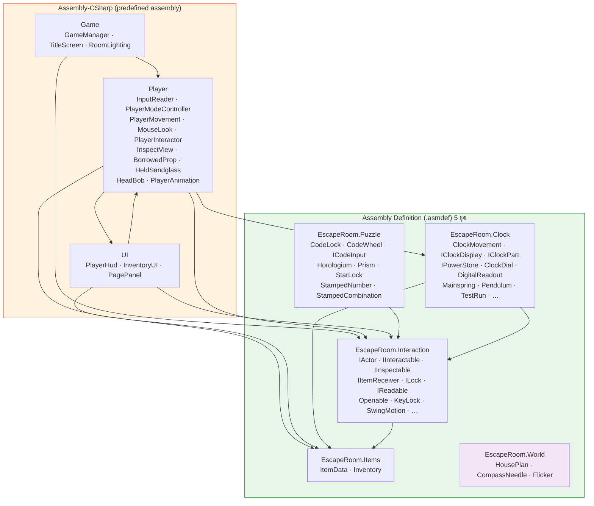
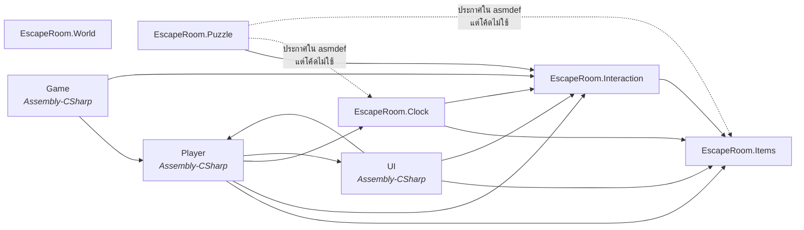
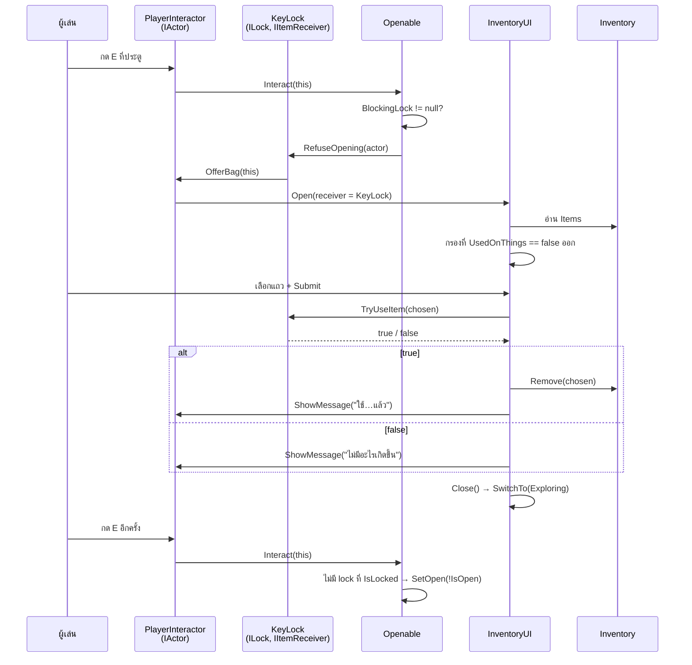
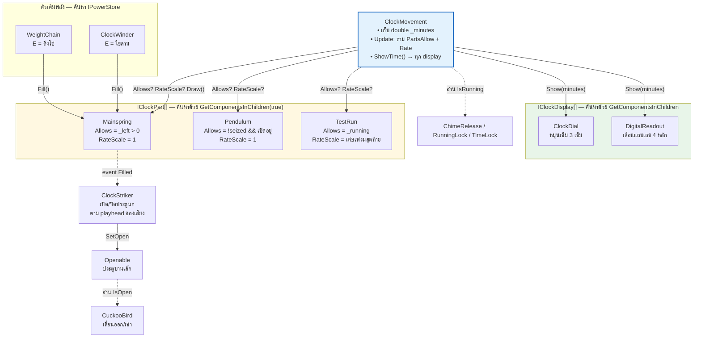
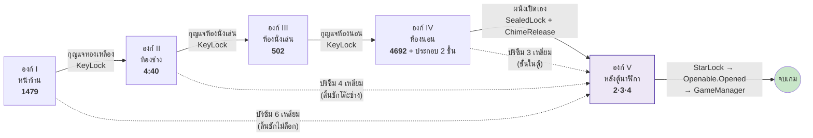
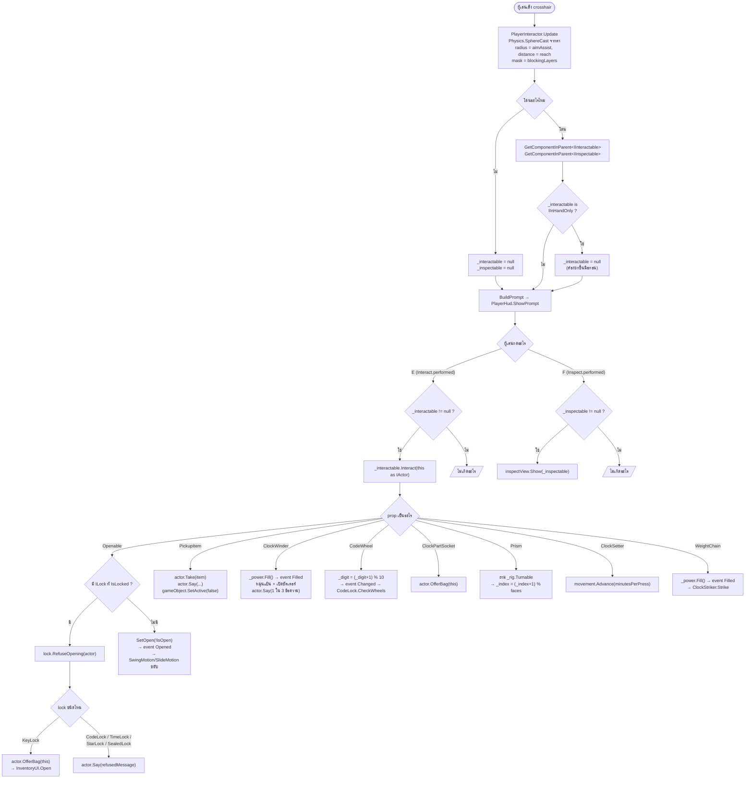
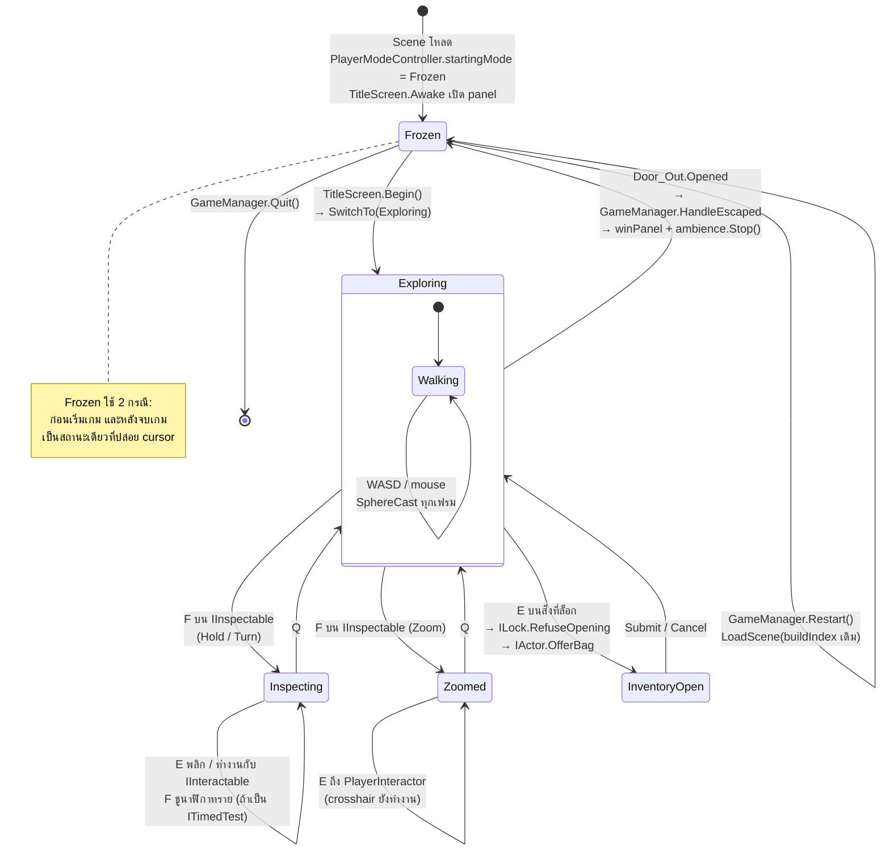
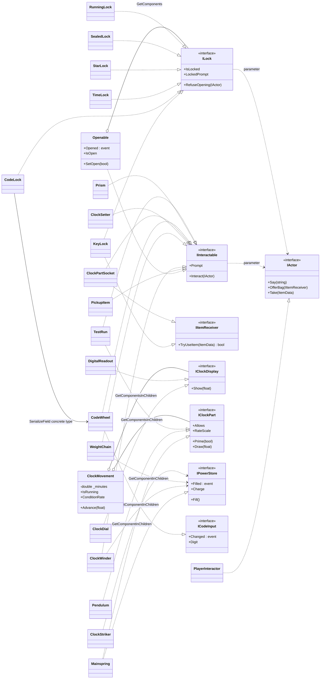

# Escape Room Game — Technical Research for Internship Report

> **สถานะเอกสาร:** เฟส 1 — บันทึกข้อเท็จจริงและหลักฐานจากการสำรวจโปรเจกต์จริง **ยังไม่ใช่รายงาน**
> **วันที่สำรวจ:** 2026-11-05
> **โปรเจกต์:** `C:\Users\User\Desktop\work\project\EscapeRoom`
> **ไฟล์นี้อยู่ที่:** `C:\Users\User\Desktop\EscapeReport\md\ESCAPE_ROOM_REPORT_RESEARCH.md`
>
> **หมายเหตุเรื่องตำแหน่งไฟล์:** คำสั่งเฟส 1 ระบุให้วางไฟล์นี้ที่ root ของโปรเจกต์ แต่กฎ read-only
> ข้อแรก (“ห้ามแก้ไขโปรเจกต์เกมไม่ว่ากรณีใด”) และข้อตกลงเรื่องโฟลเดอร์ `EscapeReport` ที่ตั้งไว้ก่อนหน้า
> ขัดกัน จึงเลือกวางไว้ใน `EscapeReport/md/` เพื่อให้โฟลเดอร์โปรเจกต์ไม่มีไฟล์เพิ่มแม้แต่ไฟล์เดียว
> ถ้าต้องการให้ย้ายไปไว้ที่ root ของโปรเจกต์ แจ้งได้ (เป็นการ copy ไฟล์เดียว)

**วิธีอ่านเอกสารนี้**

- `Finding` = ข้อเท็จจริงที่อ่านได้จากไฟล์จริง
- `Analysis` = การตีความเชิงสถาปัตยกรรม (เป็นความเห็น ไม่ใช่ข้อเท็จจริง)
- `Confidence` = **Verified** (อ่านจากไฟล์โดยตรง) / **Partially Verified** (อ่านบางส่วน หรืออนุมานจากหลักฐานข้างเคียง) / **Unverified** (ยังไม่มีหลักฐาน)
- `[ต้องถาม]` = ข้อมูลที่ไม่มีในโปรเจกต์ ต้องให้เจ้าของโปรเจกต์ตอบ (รวมอยู่ในหัวข้อ 15)
- เลขบรรทัดอ้างอิงจากไฟล์ ณ วันที่สำรวจ

---

## 1. Project Overview

### 1.1 ข้อมูลพื้นฐานที่ตรวจสอบได้

| รายการ | ค่า | หลักฐาน |
|---|---|---|
| Unity Editor version | `6000.3.5f2` (revision `3fa8bc678cb0`) | `ProjectSettings/ProjectVersion.txt` |
| Render Pipeline | Universal RP `17.3.0` | `Packages/manifest.json` |
| Input | Input System `1.17.0` | `Packages/manifest.json` |
| Test Framework | `com.unity.test-framework 1.6.0` | `Packages/manifest.json` |
| Scene ใน Build Settings | 1 scene: `Assets/Scenes/Main.unity` (buildIndex 0) | `ProjectSettings/EditorBuildSettings.asset` |
| Version control | **ไม่มี** — ไม่มีโฟลเดอร์ `.git` | ตรวจด้วย `Test-Path .git` → false |
| จำนวนไฟล์ `.cs` ทั้งโปรเจกต์ | 78 ไฟล์ / 10,604 บรรทัด | นับจาก `Assets/**/*.cs` |
| จำนวน prefab | 33 | `Assets/Prefabs/**` |
| จำนวน material | 115 | `Assets/**/*.mat` |
| จำนวน ScriptableObject asset | 12 (10 × ItemData, 1 × HousePlan, 1 × ClockRecipe) | `Assets/Scenes/Items/`, `Assets/Recipes/` |

### 1.2 ลักษณะของเกม (อ่านจากโค้ดและ scene)

- **ประเภท:** First-person escape room เดินสำรวจบ้านนาฬิกาเก่า แก้ปริศนา 5 ห้องต่อเนื่องกัน
- **การควบคุม:** เดิน (ไม่มีกระโดด/ย่อ/วิ่ง), `F` = ดูใกล้ ๆ (inspect), `E` = โต้ตอบ/เก็บของ, `Q` = ออกจากมุมมองย่อย
  - *หลักฐาน:* `PlayerMovement.cs` มีเฉพาะ walk + gravity ไม่มี jump/crouch/sprint (grep แล้วไม่พบทั้งสามคำ); `PlayerInteractor.OnInteract` ส่ง E ไปยัง `IInteractable` ที่ `PlayerInteractor.cs:127` และ `OnInspect` ส่ง F ที่ `:130-133` · ข้อความ `[F] ดูใกล้ๆ` อยู่ที่ `PlayerInteractor.cs:114,120` ส่วนข้อความ `[E] …` **ไม่ได้อยู่ในไฟล์นี้** แต่เป็นของ prop แต่ละชิ้น เช่น `Openable.cs:49`, `PickupItem.cs:10`, `CodeWheel.cs:34` (**แก้จากฉบับก่อนหน้าที่อ้าง `PlayerInteractor.cs:114` ว่าเป็นที่มาของ `[E]` ซึ่งไม่ถูก — ตรวจซ้ำ 2026-11-06**); action map 3 ชุด (`Player`, `Inspect`, `Inventory`) ใน `PlayerModeController.SwitchTo()` ที่ `PlayerModeController.cs:53-74`
- **ภาษาใน UI:** ไทยทั้งหมด (prompt, message, ชื่อไอเทม) — เป็น string ที่ฝังในโค้ดและใน `[SerializeField]`
  - *หลักฐาน:* `Openable.cs:14` `label = "ประตู"`, `PickupItem.cs:10` `$"[E] เก็บ{item.DisplayName}"`, `Scenes/Items/BrassKey.asset` → `displayName: "กุญแจทองเหลือง"`
- **โครงบ้าน:** 5 ห้อง ทางเดินเส้นเดียว I → II → III → IV → V
  - *หลักฐาน (scene):* `House/Props` มีลูก 6 ตัว — `Room_I_Showroom`, `Room_II_Workshop`, `Room_III_Parlour`, `Room_IV_Bedroom`, `SecretPanel`, `Room_V_Behind`
  - *หลักฐาน (ประตู):* `House/Doors` มีลูก 5 ตัว — `Door_I_to_II`, `Door_II_to_III`, `Door_III_to_IV`, `Door_Out`, `Door_Front`
- **สถานะ scene ขณะสำรวจ:** `isDirty: false` (ไม่มีการแก้ไขค้างอยู่) — ยืนยันว่าการสำรวจไม่ได้แตะ scene

### 1.3 ขนาดงานแยกตามชนิดของโค้ด

| ชนิด | ไฟล์ | บรรทัด | หมายเหตุ |
|---|---:|---:|---|
| Runtime gameplay script (`Assets/Scripts/` ยกเว้น `Editor/`) | 63 | 3,481 | โค้ดที่ทำงานในเกมจริง |
| Editor / procedural builder (`Assets/Scripts/Editor/`) | 11 | 5,772 | เครื่องมือสร้าง asset ไม่ติดไปกับเกม |
| PlayMode test (`Assets/Tests/PlayMode/`) | 3 | 393 | 15 test cases |
| Input action generated (`Assets/PlayerControls.cs`) | 1 | 958 | Unity generate ให้ ไม่ใช่โค้ดที่เขียนเอง |
| **รวม** | **78** | **10,604** | |

- **Finding:** โค้ดกว่าครึ่ง (5,772 / 10,604 บรรทัด = 54%) เป็น **Editor script** ที่ไม่ได้ทำงานตอนเล่นเกม แต่ใช้ generate geometry, texture และ prefab
- **⚠️ วิธีนับบรรทัด — ต้องระบุทุกครั้งที่อ้างตัวเลขเหล่านี้:** ตัวเลขทั้งหมดในตารางนี้ **นับบรรทัดที่ไม่ว่าง** (`grep -cve '^[[:space:]]*$'`) ตรวจซ้ำแล้วเมื่อ 2026-11-06 ตรงกันทุกค่า ถ้านับทุกบรรทัดด้วย `wc -l` จะได้ **12,623** รวม แยกเป็น runtime 4,196 · editor 6,954 · test 484 · generated 989 · และ `InspectView.cs` ได้ 384 ไม่ใช่ 317 · ถ้าตัดคอมเมนต์บรรทัดเดียวออกด้วยจะได้ runtime 2,658 · editor 4,570 · test 329 · `InspectView` 251 — **สามวิธีให้สามชุดตัวเลข รายงานต้องระบุว่าใช้วิธีใด** ไม่เช่นนั้นผู้ตรวจที่รัน `wc -l` จะสรุปว่ารายงานผิด
- **Evidence:** ตารางข้างบน; ไฟล์ใหญ่สุดคือ `Assets/Scripts/Editor/PuzzleBuilder.cs` (1,727 บรรทัด) และ `DressingBuilder.cs` (966 บรรทัด)
- **Analysis:** นี่คือ *procedural content generation pipeline* ที่ทำเอง — asset ในเกมถูกสร้างจากโค้ดแทนการปั้นมือใน 3D software ซึ่งเป็นประเด็นวิศวกรรมที่ควรเขียนในรายงาน (ลด asset ที่ต้องเก็บ, แก้ขนาด/สัดส่วนได้จากตัวเลขเดียว, แต่แลกกับการที่ geometry แก้มือไม่ได้ — รีบิลด์ทับ)
- **Confidence:** Verified

---

## 2. Research Scope & Inspection Method

### 2.1 เครื่องมือที่ใช้

| เครื่องมือ | ใช้ทำอะไร | เป็นการอ่านอย่างเดียวหรือไม่ |
|---|---|---|
| Filesystem read (`Get-Content`, `Select-String`) | อ่าน `.cs`, `.asmdef`, `.asset`, `.meta`, `manifest.json`, `.unity`, `.prefab` | ใช่ |
| Unity MCP — `manage_scene` action `get_active`, `get_hierarchy` | อ่าน hierarchy ของ scene ที่เปิดอยู่จริง | ใช่ (เป็น read-only action ตาม schema) |
| Unity MCP — `find_gameobjects` (`by_component`, `by_name`) | นับจำนวน component instance จริงใน scene | ใช่ (คืนค่า instance ID เท่านั้น) |
| Unity MCP — `read_console` action `get` | ดู error/warning ที่ค้างใน console | ใช่ |

**เครื่องมือที่ตั้งใจไม่ใช้** ตามกฎ read-only: `manage_gameobject`, `manage_components`, `manage_asset` (write), `execute_code`, `execute_menu_item`, `run_tests`, `refresh_unity`, `manage_build`, `manage_scene` action `save`/`load`, การเข้า Play Mode ทุกรูปแบบ

### 2.2 สถานะเริ่มต้นและการยืนยันว่าไม่มีไฟล์ถูกเปลี่ยน

- **Finding:** โปรเจกต์นี้ **ไม่ได้อยู่ภายใต้ git** จึงใช้ `git status` ตรวจไม่ได้
- **Evidence:** ไม่มี `C:\Users\User\Desktop\work\project\EscapeRoom\.git`; environment ของ session รายงาน `Is a git repository: false`
- **วิธีแทน:** บันทึก snapshot ของทุกไฟล์ในโปรเจกต์ (ยกเว้น `Library/`, `Temp/`, `Logs/`, `obj/`, `.vscode/`, `UserSettings/` ซึ่ง Unity เขียนทับเองตลอด) เก็บ path + ขนาด + เวลาแก้ไขล่าสุด
  - ไฟล์ baseline: `C:\Users\User\AppData\Local\Temp\claude\d92a50d90ff4cf7b\e98f2a7a-3588-49cc-95df-492ed8216c39\scratchpad\baseline.csv`
  - จำนวนไฟล์ที่เก็บ: **797 ไฟล์**
  - SHA256 ของไฟล์ baseline: `7EEB3BEBA2A93C45E4D95C4EEAD2BA821CAF8247E65C815CC808B9B03C01F5A6`
- **ผลตรวจตอนจบ:** ดูหัวข้อ 2.5
- **Confidence:** Verified

### 2.3 ขอบเขตที่อ่านครบ

**อ่านครบทั้งไฟล์ (61 จาก 63 runtime script):** ทุกไฟล์ใน `Scripts/Clock/` (ยกเว้น `Sandglass.cs`), `Scripts/Interaction/`, `Scripts/Items/`, `Scripts/Player/`, `Scripts/Puzzle/`, `Scripts/UI/`, `Scripts/World/`, `Scripts/Game/` และ test ทั้ง 3 ไฟล์

**อ่านบางส่วน / ไม่ได้อ่าน — และเหตุผล:**

| ไฟล์ / กลุ่ม | จำนวน | อ่านไปเท่าไร | เหตุผล |
|---|---:|---|---|
| `Scripts/Clock/Sandglass.cs` | 1 ไฟล์ (221 บรรทัด) | บรรทัด 1–90 | ส่วนที่เหลือเป็น procedural mesh generation ของกองทราย ไม่ใช่ตรรกะเกมหรือ seam ทางสถาปัตยกรรม |
| `Scripts/Editor/*.cs` | 11 ไฟล์ (5,772 บรรทัด) | ไม่ได้อ่านเต็ม | เป็น builder สร้าง geometry/texture ไม่ทำงานตอนเล่น หน้าที่ของแต่ละไฟล์ยืนยันจากชื่อ class + การที่ไม่มี GUID ของไฟล์เหล่านี้ปรากฏใน scene/prefab ใด ๆ |
| `Assets/PlayerControls.cs` | 1 ไฟล์ (958 บรรทัด) | ไม่ได้อ่านเต็ม | Unity generate จาก `.inputactions` ไม่ใช่โค้ดที่เขียนด้วยมือ |

### 2.4 สิ่งที่ยังยืนยันไม่ได้ในเฟสนี้ (ข้อจำกัดของการสำรวจ)

1. **ค่าใน Inspector ของแต่ละ instance ส่วนใหญ่ยังไม่ได้ตรวจทีละตัว** — อ่านค่าเริ่มต้นจากโค้ด (`[SerializeField]` default) และอ่าน component list จาก scene ได้ แต่ค่าที่ override ไว้จริงในแต่ละ GameObject (เช่น นาฬิกาเรือนไหนตั้ง `condition` เป็นอะไร, `revealedDigit` ของแต่ละเรือนเป็นเลขอะไร) **ยังไม่ได้ตรวจครบ** เพราะต้องอ่านทีละ instance จาก 46 เรือน
   - ผลกระทบ: **เฉลยของปริศนาที่ 1 และ 2 ยังยืนยันจาก scene ไม่ได้** (ข้อจำกัดของเฟส 1 · ต่อมายืนยันครบทั้งห้าองก์แล้วเมื่อ 2026-11-06 ดูหัวข้อ 12.9) ตัวเลขที่บันทึกไว้ในหัวข้อ 8 มาจาก `CLAUDE.md` ซึ่งเป็นเอกสารในโปรเจกต์ ไม่ใช่จากค่าใน Inspector → ทำเครื่องหมาย **Partially Verified**
2. **ไม่ได้รัน test** (กฎห้าม) จึงยืนยันได้แค่ว่า test *มีอยู่* และ *เขียนตรวจอะไร* ไม่ยืนยันว่า *ผ่าน*
3. **ไม่ได้เข้า Play Mode** จึงไม่มีหลักฐานเรื่อง performance, frame rate, bug ที่เกิดตอนเล่น หรือความรู้สึกในการเล่น
4. **ไม่มี git history** จึงไม่มีหลักฐานเรื่องลำดับการพัฒนา ระยะเวลา หรือจำนวนครั้งที่แก้ — ต้องให้เจ้าของโปรเจกต์เล่า `[ต้องถาม]`
5. **Warning ที่ค้างใน Unity Console** มี 2 รายการ (ซ้ำกัน) เรื่อง shadow atlas — ดูหัวข้อ 12.3 **ไม่พบ compile error**

### 2.5 ผลตรวจไฟล์ตอนจบ

เก็บ snapshot ใหม่หลังสำรวจเสร็จ ด้วยเงื่อนไขเดียวกับ baseline แล้วเทียบ path + ขนาด + เวลาแก้ไข:

```
baseline files: 797
after    files: 797
ADDED   (0):
REMOVED (0):
CHANGED (0):
```

- **ผล: ไม่มีไฟล์ใดในโปรเจกต์ถูกเพิ่ม ลบ หรือแก้ไข** และ `Main.unity` รายงาน `isDirty: false` ทั้งก่อนและหลัง
- ไฟล์ snapshot ใหม่: `C:\Users\User\AppData\Local\Temp\claude\d92a50d90ff4cf7b\e98f2a7a-3588-49cc-95df-492ed8216c39\scratchpad\after.csv`
- **Confidence:** Verified

---

## 3. Unity Project Structure

### 3.1 โครงสร้างโฟลเดอร์ `Assets/`

```
Assets/
├── PlayerControls.cs          ← Input System generated (อยู่นอก Scripts/ โดยเจตนา)
├── Scripts/
│   ├── Clock/        23 ไฟล์  EscapeRoom.Clock.asmdef
│   ├── Interaction/  11 ไฟล์  EscapeRoom.Interaction.asmdef
│   ├── Items/         2 ไฟล์  EscapeRoom.Items.asmdef
│   ├── Puzzle/        8 ไฟล์  EscapeRoom.Puzzle.asmdef
│   ├── World/         3 ไฟล์  EscapeRoom.World.asmdef
│   ├── Player/       10 ไฟล์  (ไม่มี asmdef → Assembly-CSharp)
│   ├── UI/            3 ไฟล์  (ไม่มี asmdef → Assembly-CSharp)
│   ├── Game/          3 ไฟล์  (ไม่มี asmdef → Assembly-CSharp)
│   └── Editor/       11 ไฟล์  (ไม่มี asmdef → Assembly-CSharp-Editor)
├── Tests/PlayMode/    3 ไฟล์  EscapeRoom.Tests.asmdef
├── Prefabs/
│   ├── Clocks/       10 prefab + Cases/ (1) + Parts/ (2)
│   ├── House/         3 prefab
│   └── Puzzle/       17 prefab
├── Recipes/           HousePlan.asset, PlankClock.asset
├── Scenes/
│   ├── Main.unity     scene เดียวใน build (2.35 MB)
│   └── Items/         10 × ItemData.asset
├── Meshes/            mesh ที่ builder generate แล้ว save เป็น asset
├── Materials/ Textures/ Fonts/ Sound/ Settings/
└── Character Models/  โมเดลตัวละคร (asset นำเข้า)
```

- **Finding:** การจัดโฟลเดอร์แบ่งตาม **โดเมนของระบบ** (`Clock`, `Interaction`, `Puzzle`, `Player`, `UI`, `Game`, `World`, `Items`) ไม่ได้แบ่งตามชนิดของ Unity object
- **Evidence:** โครงสร้างข้างบน
- **Analysis:** เป็นการแบ่งแบบ *feature/domain-based* ซึ่งอ่านง่ายกว่าแบบ *type-based* (`Managers/`, `Controllers/`) และสำคัญกว่านั้นคือ **โฟลเดอร์ 6 ใน 9 มี `.asmdef` กำกับ** ทำให้การแบ่งโมดูลไม่ใช่แค่ข้อตกลงการตั้งชื่อ แต่เป็น compile-time boundary (ดูหัวข้อ 5.3)
- **Confidence:** Verified

### 3.2 Scene ในโปรเจกต์

| Scene | อยู่ใน Build Settings | หมายเหตุ |
|---|---|---|
| `Assets/Scenes/Main.unity` | ✅ buildIndex 0 | scene เดียวของเกมทั้งเกม |
| `Assets/InitTestScene855cb578-5e59-4f44-aa4a-008404e0b48a.unity` | ❌ ไม่อยู่ | ไฟล์ที่ Unity สร้างค้างไว้ (ชื่อมี GUID) **ไม่ใช่ส่วนหนึ่งของเกม** |

- **Finding:** เกมทั้งเกมอยู่ใน scene เดียว ไม่มีการโหลด scene ข้ามห้อง
- **Evidence:** `EditorBuildSettings.asset` มี `m_Scenes` รายการเดียว; `GameManager.Restart()` (`Scripts/Game/GameManager.cs:30`) เรียก `SceneManager.LoadScene(SceneManager.GetActiveScene().buildIndex)` คือโหลด scene เดิมซ้ำ — ไม่มี scene อื่นให้ไป
- **Analysis:** การใช้ scene เดียวทำให้ไม่ต้องมีระบบ persist state ข้าม scene (`DontDestroyOnLoad` = 0 ครั้งในโปรเจกต์) แต่ก็หมายความว่า **ไม่มีระบบ save/load และไม่มี main menu แยก scene** — title card เป็น UI panel ใน scene เดียวกัน
- **Confidence:** Verified

### 3.3 Package ที่ใช้งานจริง vs. ที่ติดตั้งมาเฉย ๆ

`manifest.json` มี dependency 46 รายการ แต่ส่วนใหญ่เป็น built-in module ที่ Unity ใส่มาตามเทมเพลต **package ที่มีหลักฐานว่าถูกใช้จริง:**

| Package | หลักฐานการใช้ |
|---|---|
| `com.unity.render-pipelines.universal` 17.3.0 | `Settings/UniversalRenderPipelineGlobalSettings.asset`; `RoomLighting.cs:62` ตั้ง `RenderSettings.reflectionIntensity`; material ใช้ `_BaseMap` / `_EmissionMap` (URP property) |
| `com.unity.inputsystem` 1.17.0 | `PlayerControls.cs` generated; `using UnityEngine.InputSystem` ใน `PlayerInteractor`, `InspectView`, `InventoryUI`; `EventSystem` ใช้ `InputSystemUIInputModule` |
| `com.unity.test-framework` 1.6.0 | `EscapeRoom.Tests.asmdef` อ้าง `UnityEngine.TestRunner`, `nunit.framework.dll` |
| `com.unity.ugui` 2.0.0 | `using UnityEngine.UI`; ใช้ legacy `Text`, `Graphic`, `Canvas`, `RectTransform` |
| `com.coplaydev.unity-mcp` (git) | `.mcp.json` ชี้ `http://127.0.0.1:8080/mcp` — เครื่องมือ dev ไม่ใช่ feature ของเกม |

- **Finding:** `com.unity.ai.navigation`, `com.unity.timeline`, `com.unity.visualscripting`, `com.unity.multiplayer.center` **ไม่พบการใช้งานในโค้ดเลย**
- **Evidence:** ไม่พบ `using Unity.AI.Navigation`, `using UnityEngine.Timeline`, `NavMeshAgent`, `PlayableDirector` ในไฟล์ `.cs` ใด; ไม่มี component เหล่านี้ใน scene
- **Analysis:** เป็น package ที่มาจากเทมเพลตโปรเจกต์ ไม่ใช่การตัดสินใจทางเทคนิค **ในรายงานไม่ควรเคลมว่าใช้ NavMesh หรือ Timeline**
- **Confidence:** Verified

---

## 4. Software Architecture Overview

### 4.1 ข้อความสรุปสถาปัตยกรรม (ตามที่โค้ดทำจริง)

สถาปัตยกรรมของโปรเจกต์นี้วางอยู่บนหลักเดียวคือ **Component Composition แทน Inheritance** พร้อม **Interface-based discovery** กล่าวคือ:

> ของแต่ละชิ้นในเกม “เป็นอะไร” ถูกกำหนดด้วย *ชุด component ที่แปะอยู่บน GameObject นั้น* ไม่ใช่ด้วย *คลาสลูกที่สืบทอดมา*
> และตัวที่ควบคุม (เช่น `ClockMovement`, `Openable`) จะ **ค้นหา** collaborator ของตัวเองผ่าน interface ด้วย `GetComponents<T>()` แทนการถือ reference ที่ลากใน Inspector

**หลักฐานเชิงปริมาณที่ยืนยันข้อนี้:**

| ตัวชี้วัด | ค่าที่วัดได้ | วิธีวัด |
|---|---:|---|
| `abstract` keyword | **0** | grep `\babstract\b` ใน 63 runtime script |
| `virtual` keyword | **0** | grep `\bvirtual\b` |
| `override` keyword | **0** | grep `\boverride\b` |
| class ที่สืบทอดจาก `MonoBehaviour` ตรง ๆ | **51 คลาส ใน 51 ไฟล์** | grep `:\s*MonoBehaviour` |
| interface ที่ประกาศ | **12 interface ใน 6 ไฟล์** | grep `^\s*public interface ` |
| Singleton (`static … Instance`) | **0** | grep `static\s+\w+\s+Instance` |
| `FindObjectOfType` / `FindAnyObjectByType` | **0** | grep |
| `GameObject.Find` | **0** | grep |
| `SendMessage` | **0** | grep |
| `UnityEvent` | **0** | grep |
| `DontDestroyOnLoad` | **0** | grep |
| `delegate` keyword | **0** | grep |
| `event Action` | **5** (3 ตัวจริง + 2 ประกาศใน interface) | grep หา `event Action` และ `event System.Action` |
| `[SerializeField]` | **215 ครั้ง ใน 53 ไฟล์** (แก้จาก 214/52 เมื่อ 2026-11-06) | grep `[SerializeField` แล้วนับทุก occurrence ไม่ใช่นับบรรทัด |
| `GetComponent<…>` ตระกูลทั้งหมด | 22 + 5 + 6 + 10 = **43 ครั้ง** | grep แยก 4 แบบ |
| `StartCoroutine` | **0** | grep |

- **Analysis:** ตัวเลขชุด “0” นี้มีความหมายในเชิงวิศวกรรมมากกว่าค่าที่ไม่เป็นศูนย์ — มันบอกว่าโปรเจกต์นี้ **ไม่ใช้ anti-pattern ที่พบบ่อยในโปรเจกต์ Unity ระดับนักศึกษา** คือไม่มี Singleton `GameManager.Instance` ที่ทุกคลาสเรียกถึง, ไม่มี `FindObjectOfType` ที่ผูก object ด้วยชื่อ/ชนิดตอน runtime, ไม่มี `SendMessage` ที่เรียกเมธอดด้วย string, และไม่มี inheritance hierarchy ให้ต้องไล่
- **Confidence:** Verified

### 4.2 แผนภาพภาพรวมระบบ



**อ่านแผนภาพนี้อย่างไร:** ลูกศรคือ “โค้ดในกล่องต้นทางอ้างถึงชนิดข้อมูลที่ประกาศในกล่องปลายทาง” วัดจากการ grep ชื่อ type ทุกตัวในแต่ละโมดูล โดยตัด comment ออกก่อน (ดูวิธีวัดในหัวข้อ 5.3)
`EscapeRoom.World` ไม่มีลูกศรเข้าหรือออกเลย — เป็นโมดูลที่ไม่พึ่งใครและไม่มีใครพึ่ง

### 4.3 กลไกการสื่อสาร 4 แบบที่พบในโปรเจกต์นี้

| กลไก | ใช้ที่ไหน | หลักฐาน |
|---|---|---|
| **A. Interface-based discovery** (ค้นหา collaborator ด้วย interface) | `ClockMovement` หา display/part, `Openable` หา lock, `ClockWinder`/`WeightChain`/`ClockStriker` หา power store | `ClockMovement.cs:112,116`; `Openable.cs:20`; `ClockWinder.cs:59`; `WeightChain.cs:36`; `ClockStriker.cs:73` |
| **B. Observer / C# event** | `Openable.Opened` → `GameManager`; `IPowerStore.Filled` → `ClockStriker`; `CodeWheel.Changed` → `CodeLock` | `Openable.cs:37`; `GameManager.cs:25-26`; `IPowerStore.cs:19`; `ClockStriker.cs:76,106`; `CodeWheel.cs:30,63`; `CodeLock.cs:43,49` |
| **C. Serialized direct reference** (`[SerializeField]` ลากใน Inspector) | 215 จุด — เช่น `PlayerInteractor.hud/inspectView/inventoryUI`, `TimeLock.movement`, `CodeLock.wheels` | `PlayerInteractor.cs:31-33`; `TimeLock.cs:10`; `CodeLock.cs:17` |
| **D. Input System callback** (`performed +=`) | ปุ่มกดทุกปุ่มที่เป็น discrete press | `PlayerInteractor.cs:51-52`; `InspectView.cs:121-123`; `InventoryUI.cs:43-45` |

- **Finding:** **ไม่มี** การสื่อสารแบบ Singleton, Service Locator, `FindObjectOfType`, UnityEvent, หรือ global event bus เลย
- **Analysis:** กลไก A คือจุดที่ทำให้โปรเจกต์นี้ modular จริง เพราะผู้เรียกไม่รู้จักคลาสปลายทาง / กลไก C คือจุดที่ coupling ยังสูง เพราะเป็น reference ไปยัง **concrete class** และมองจากโค้ดไม่เห็น (ต้องเปิด Inspector ดู) — รายละเอียดในหัวข้อ 5.7
- **Confidence:** Verified

---

## 5. Modular Software Design Analysis

> หัวข้อนี้คือหัวใจของรายงาน จึงแยกข้อเท็จจริงกับการประเมินให้ชัด และ **บันทึกจุดอ่อนไว้ด้วยทุกข้อ**

### 5.1 Module Identification

โปรเจกต์นี้มีโมดูล **9 กลุ่ม** โดย 6 กลุ่มมีขอบเขตระดับ compile (มี `.asmdef`) และ 3 กลุ่มไม่มี

| # | โมดูล | โฟลเดอร์ | Assembly | ไฟล์ | บรรทัด |
|---|---|---|---|---:|---:|
| 1 | Items | `Scripts/Items/` | `EscapeRoom.Items` | 2 | 37 |
| 2 | Interaction | `Scripts/Interaction/` | `EscapeRoom.Interaction` | 11 | 373 |
| 3 | Clock | `Scripts/Clock/` | `EscapeRoom.Clock` | 23 | 1,334 |
| 4 | Puzzle | `Scripts/Puzzle/` | `EscapeRoom.Puzzle` | 8 | 384 |
| 5 | World | `Scripts/World/` | `EscapeRoom.World` | 3 | 162 |
| 6 | Player | `Scripts/Player/` | *Assembly-CSharp* | 10 | 830 |
| 7 | UI | `Scripts/UI/` | *Assembly-CSharp* | 3 | 216 |
| 8 | Game | `Scripts/Game/` | *Assembly-CSharp* | 3 | 145 |
| 9 | Editor tooling | `Scripts/Editor/` | *Assembly-CSharp-Editor* | 11 | 5,772 |
| — | PlayMode tests | `Tests/PlayMode/` | `EscapeRoom.Tests` | 3 | 393 |

- **Finding:** **ไม่มี `namespace` เลยทั้งโปรเจกต์** ทุกคลาสอยู่ใน global namespace
- **Evidence:** ไม่พบคำ `namespace` ในไฟล์ `.cs` ใด; ทุก `.asmdef` ตั้ง `"rootNamespace": ""`
- **Analysis:** การแบ่งโมดูลที่นี่ **ไม่ได้ใช้ namespace เป็นเครื่องมือ** แต่ใช้ `.asmdef` แทน ซึ่งเข้มกว่า: namespace แค่จัดกลุ่มชื่อ (ข้าม namespace ได้ด้วย `using`) ส่วน `.asmdef` **บล็อกการอ้างถึงระดับคอมไพล์** ข้อเสียคือถ้านำ asset จากภายนอกเข้ามาแล้วมีคลาสชื่อซ้ำ (เช่น `Door`, `Inventory`) โปรเจกต์จะคอมไพล์ไม่ผ่านทันที — เป็นความเสี่ยงที่รับไว้โดยรู้ตัว (`CLAUDE.md` หัวข้อ Code style ระบุไว้ตรง ๆ)
- **Confidence:** Verified

### 5.2 Module Responsibilities

| โมดูล | หน้าที่เดียวที่รับผิดชอบ | คลาส/interface หลัก |
|---|---|---|
| **Items** | นิยามว่า “ของชิ้นหนึ่ง” คืออะไร และผู้เล่นถืออะไรอยู่ | `ItemData` (ScriptableObject), `Inventory` |
| **Interaction** | สัญญากลางของการโต้ตอบ + กลไกเปิด/ปิด/ล็อกทั่วไป | 8 interface (`IActor`, `IInteractable`, `IItemReceiver`, `IInspectable`, `IInHandOnly`, `ITimedTest`, `IReadable`, `ILock`), `Openable`, `KeyLock`, `SealedLock`, `SwingMotion`, `SlideMotion`, `PickupItem`, `Inspectable`, `WrittenPage` |
| **Clock** | นาฬิกาทุกชนิด: เก็บเวลา, แสดงเวลา, กลไกที่ทำให้เดิน/ไม่เดิน | `ClockMovement` + `IClockDisplay` / `IClockPart` / `IPowerStore` + implementation |
| **Puzzle** | ปริศนาเฉพาะเรื่อง: รหัสตัวเลข และกลไกแสง | `CodeLock`, `CodeWheel`, `ICodeInput`, `Horologium`, `Prism`, `StarLock`, `StampedNumber`, `StampedCombination` |
| **World** | สภาพแวดล้อมที่ไม่เกี่ยวกับปริศนา + ผังบ้านในรูปข้อมูล | `HousePlan` (ScriptableObject), `CompassNeedle`, `Flicker` |
| **Player** | ร่างผู้เล่น: อ่าน input, เดิน, มอง, เล็ง, ยกของขึ้นดู, สลับโหมด | `InputReader`, `PlayerModeController`, `PlayerMovement`, `MouseLook`, `PlayerInteractor`, `InspectView`, `BorrowedProp`, `HeldSandglass`, `HeadBob`, `PlayerAnimation` |
| **UI** | แสดงผลบนจอ: crosshair/prompt/message, กระเป๋า, แผ่นอ่าน | `PlayerHud`, `InventoryUI`, `PagePanel` |
| **Game** | เริ่มเกม จบเกม และบรรยากาศแสงของห้อง | `TitleScreen`, `GameManager`, `RoomLighting` |
| **Editor tooling** | สร้าง geometry / texture / prefab จากโค้ด (ไม่ติดไปกับเกม) | `HouseBuilder`, `PuzzleBuilder`, `DressingBuilder`, `ClockBuilder`, `ClockVariants`, `ClockAssembler`, `TextureKit`, `BuildKit`, `MissingThingsBuilder`, `NewspaperBuilder`, `InterfaceBuilder` |

### 5.3 Module Dependencies

**วิธีวัด:** สำหรับโฟลเดอร์โมดูลแต่ละอัน ลบ comment (`//…`) ออกจากทุกบรรทัดก่อน แล้ว grep หาชื่อ type ทุกตัวที่ประกาศในโมดูลอื่น ถ้าพบ = มี dependency จริงในโค้ด

#### 5.3.1 Dependency ที่วัดได้จากโค้ดจริง

| จากโมดูล | ไปโมดูล | ตัวอย่างหลักฐาน (file:line) |
|---|---|---|
| Items | **(ไม่พึ่งใครเลย)** | — |
| World | **(ไม่พึ่งใครเลย)** | — |
| Interaction | Items | `IActor.cs:25`, `Interactions.cs:20`, `KeyLock.cs:11,26`, `PickupItem.cs:8` |
| Clock | Items | `ClockPartSocket.cs:13,43` |
| Clock | Interaction | `ChimeRelease.cs:20,35,41`, `ClockPartSocket.cs:10`, +15 จุด |
| Puzzle | Interaction | `CodeLock.cs:12,13,29,37`, +7 จุด |
| Player | Interaction | `InspectView.cs:57,61,72,83`, +20 จุด |
| Player | Items | `HeldSandglass.cs:13,14,27`, `PlayerInteractor.cs:12`, +4 จุด |
| Player | UI | `InspectView.cs:25`, `PlayerInteractor.cs:31,33,40` |
| Player | **Clock** | `HeldSandglass.cs:12` |
| UI | Player | `InventoryUI.cs:18,19,63,70` |
| UI | Items | `InventoryUI.cs:20,29,42,50`, +3 จุด |
| UI | Interaction | `InventoryUI.cs:31,56`, `PagePanel.cs:21` |
| Game | Player | `GameManager.cs:17,45`, `TitleScreen.cs:12,22` |
| Game | Interaction | `GameManager.cs:15` |

**ผลสำคัญ 3 ข้อ:**

1. **`Clock` และ `Puzzle` ไม่อ้างถึง `Player` หรือ `UI` แม้แต่ครั้งเดียว** — ยืนยันด้วย grep หา `PlayerInteractor|PlayerHud|PlayerMode|InspectView|InputReader|InventoryUI` ในโฟลเดอร์ `Clock/` → **0 hit**
   - **Analysis:** นี่คือผลลัพธ์ที่วัดได้ของการมี `IActor` — ปริศนาและนาฬิกาถูกทำงานผ่าน interface 3 เมธอด ไม่ใช่ผ่านคลาสผู้เล่น
2. **`Player` → `Clock` มีอยู่จริง 1 จุด** คือ `HeldSandglass.cs:12` `[SerializeField] private Sandglass glass;`
   - **ข้อขัดแย้งกับเอกสารในโปรเจกต์:** ตาราง dependency ใน `CLAUDE.md` (หัวข้อ Modularity) เขียนว่า `Player → Items, Interaction, UI` **ไม่มี Clock** → เอกสารไม่ตรงกับโค้ด
3. **`EscapeRoom.World` เป็นโมดูลที่แยกสมบูรณ์** ไม่พึ่งใครและไม่มีใครพึ่ง — ย้ายไปโปรเจกต์อื่นได้ทันที

#### 5.3.2 Dependency ระดับ compile (`.asmdef`) เทียบกับที่โค้ดใช้จริง

| Assembly | ประกาศ reference ไว้ | โค้ดใช้จริง | ประเมิน |
|---|---|---|---|
| `EscapeRoom.Items` | (ว่าง) | — | ✅ ตรง |
| `EscapeRoom.Interaction` | `Items` | `Items` | ✅ ตรง |
| `EscapeRoom.Clock` | `Items`, `Interaction` | `Items`, `Interaction` | ✅ ตรง |
| `EscapeRoom.World` | (ว่าง) | — | ✅ ตรง |
| `EscapeRoom.Puzzle` | `Items`, `Interaction`, **`Clock`** | `Interaction` **เท่านั้น** | ⚠️ **ประกาศเกิน 2 รายการ** |
| `EscapeRoom.Tests` | `Items`, `Interaction`, `Clock`, **`Puzzle`** + TestRunner + nunit | `Items`, `Interaction`, `Clock` | ⚠️ **ประกาศเกิน 1 รายการ** (`Puzzle`) |

- **Finding:** `EscapeRoom.Puzzle.asmdef` อ้าง `EscapeRoom.Items` และ `EscapeRoom.Clock` แต่โค้ดในโฟลเดอร์ `Puzzle/` ไม่ได้ใช้ type จากสองโมดูลนั้นเลย (hit เดียวที่เจอคือคำว่า `IClockDisplay` ใน **comment** ที่ `ICodeInput.cs:5`)
- **Evidence:** `Assets/Scripts/Puzzle/EscapeRoom.Puzzle.asmdef` (`"references": ["EscapeRoom.Items","EscapeRoom.Interaction","EscapeRoom.Clock"]`) เทียบกับ grep ที่ตัด comment แล้ว
- **Analysis:** ไม่ใช่บั๊ก และไม่กระทบการทำงาน แต่ **ทำให้ขอบเขตโมดูลหลวมกว่าที่โค้ดต้องการ**: ถ้าวันหน้ามีคนเขียน `Horologium` ให้ไปอ่าน `ClockMovement` ตรง ๆ คอมไพเลอร์จะไม่ร้อง เพราะ reference เปิดไว้แล้ว การตัด `Items` และ `Clock` ออกจะทำให้ `.asmdef` เป็น *executable documentation* ของ dependency จริง ซึ่งเป็นเหตุผลที่ตั้งใจใช้ `.asmdef` ตั้งแต่แรก — เรื่องเดียวกันกับ `Puzzle` ที่ค้างอยู่ใน `EscapeRoom.Tests.asmdef`
- **Confidence:** Verified

#### 5.3.3 ทำไม Player / UI / Game ไม่มี `.asmdef`

- **Finding:** ชั้นบน (Player, UI, Game) ถูกปล่อยไว้ใน predefined assembly `Assembly-CSharp` โดยเจตนา
- **Evidence:** ไม่มี `.asmdef` ใน 3 โฟลเดอร์นั้น; `PlayerControls.cs` อยู่ที่ `Assets/` ไม่ใช่ใน `Scripts/`; มี cycle `Player ⇄ UI` อยู่จริง (ดู 5.3.1 ข้อ UI → Player และ Player → UI)
- **Analysis:** มีเหตุผลทางเทคนิคบังคับอยู่ 2 ข้อ
  1. **`.asmdef` ห้าม circular reference เด็ดขาด** — `Player ⇄ UI` จึงใส่ `.asmdef` ไม่ได้ ต้องรวมเป็น assembly เดียวหรือตัด cycle ก่อน
  2. `PlayerControls.cs` อยู่นอก `Scripts/` ถ้าสร้าง `EscapeRoom.Player.asmdef` คลาสในนั้นจะมองไม่เห็น `PlayerControls` (คนละ assembly) ต้องย้ายไฟล์ input ก่อน
  และกฎของ Unity คือ **predefined assembly อ้าง `.asmdef` ได้ แต่ `.asmdef` อ้าง predefined assembly ไม่ได้** ดังนั้นการวางชั้นล่างใน `.asmdef` และชั้นบนใน `Assembly-CSharp` จึงบังคับทิศทาง dependency ให้เป็นทางเดียวโดยอัตโนมัติ — เขียน `GetComponent<PlayerMovement>()` ใน `ClockDial` จะคอมไพล์ไม่ผ่าน
- **Confidence:** Verified (กฎ Unity assembly เป็นความรู้ทั่วไปของเอนจิน แต่โครงไฟล์ที่ยืนยันข้อนี้อ่านจากโปรเจกต์)

#### 5.3.4 Dependency graph (Mermaid)



### 5.4 Inter-module Communication

#### 5.4.1 Interface-based discovery — จุดแข็งที่แท้จริงของโปรเจกต์นี้

**Pattern:** ตัวควบคุมไม่ถือ reference ไปยัง collaborator แต่ `GetComponents<Interface>()` หาเอาตอน `Awake` → “การแปะ component ลงไปคือการติดตั้งทั้งหมด ไม่ต้องลากสายใน Inspector”

ตัวอย่างที่ชัดที่สุด — `ClockMovement`:

```csharp
// Assets/Scripts/Clock/ClockMovement.cs:112-116
_displays = GetComponentsInChildren<IClockDisplay>(true);
// Inactive ones included: a part that is switched off is one the player has not
// fitted yet, and it has to be in the list so it can start saying no.
_parts = GetComponentsInChildren<IClockPart>(true);
```

```csharp
// Assets/Scripts/Clock/ClockMovement.cs:53-77  (veto + rate scaling)
private bool PartsAllow { get { foreach (IClockPart part in _parts) if (!part.Allows) return false; return true; } }
private float Rate { get { float rate = ConditionRate; foreach (IClockPart part in _parts) rate *= part.RateScale; return rate; } }
```

`Openable` ใช้แบบเดียวกันกับ lock:

```csharp
// Assets/Scripts/Interaction/Openable.cs:20-35
private ILock[] Locks => _locks ?? (_locks = GetComponents<ILock>());
private ILock BlockingLock { get { foreach (ILock fitted in Locks) if (fitted.IsLocked) return fitted; return null; } }
```

และ `IPowerStore` ถูกค้นหาโดย 3 คลาสที่ไม่รู้จักกัน:

```csharp
// ClockWinder.cs:59 / WeightChain.cs:36 / ClockStriker.cs:73 — บรรทัดเดียวกันทั้งสามที่
_power = movement.GetComponentInChildren<IPowerStore>(true);
```

- **Finding:** จุดที่ใช้ discovery แบบนี้มี 4 seam: `IClockDisplay`, `IClockPart`, `ILock`, `IPowerStore`
- **Analysis:** นี่คือ **Dependency Inversion Principle** ที่เกิดขึ้นจริง: `ClockMovement` (high-level) ไม่พึ่ง `ClockDial` (low-level) ทั้งสองพึ่ง `IClockDisplay` และหลักฐานที่พิสูจน์ว่ามันทำงานจริงไม่ใช่แค่ทฤษฎีคือ **test ที่เขียนคลาส display ขึ้นใหม่หลังจาก `ClockMovement` คอมไพล์ไปแล้ว แล้วมันยังได้รับเวลา** (`ClockSeamTests.cs:41-67`)
- **Confidence:** Verified

#### 5.4.2 Observer Pattern — C# `event Action` 3 จุด

| ผู้ประกาศ event | ผู้ subscribe | ความหมาย | หลักฐาน |
|---|---|---|---|
| `Openable.Opened` | `GameManager.HandleEscaped` | ประตูทางออกเปิด → จบเกม | `Openable.cs:37,76`; `GameManager.cs:25-26,42-47` |
| `IPowerStore.Filled` (impl: `Mainspring.Filled`) | `ClockStriker.Strike` | มีคนเติมพลังนาฬิกา → นกคุกคูออกมาขัน | `IPowerStore.cs:19`; `Mainspring.cs:25,46`; `ClockStriker.cs:76,106,110` |
| `CodeWheel.Changed` (impl ของ `ICodeInput.Changed`) | `CodeLock.CheckWheels` | หมุนเลข → ตรวจรหัสทันที | `CodeWheel.cs:30,63`; `CodeLock.cs:43,49,65-76` |

```csharp
// Assets/Scripts/Game/GameManager.cs:25-26 — subscribe/unsubscribe เป็นคู่
private void OnEnable() => wayOut.Opened += HandleEscaped;
private void OnDisable() => wayOut.Opened -= HandleEscaped;
```

- **Finding:** ทุก event ที่ subscribe มีการ unsubscribe ใน `OnDisable` ครบทั้ง 3 คู่ (`GameManager.cs:26`, `ClockStriker.cs:106`, `CodeLock.cs:46-50`)
- **Analysis:** `IPowerStore.Filled` เป็นตัวอย่าง Observer ที่มีประโยชน์เชิงสถาปัตยกรรมจริง — `ClockStriker` ฟังว่า “ถูกเติมพลัง” ไม่ได้ฟังว่า “มีคนหมุนไขลาน” ดังนั้นตอนที่นาฬิกาคุกคูเปลี่ยนจากไขลาน (`ClockWinder`) ไปเป็นดึงโซ่ถ่วง (`WeightChain`) `ClockStriker` **ไม่ต้องแก้เลย** เพราะทั้งคู่เรียก `IPowerStore.Fill()` เหมือนกัน (`ClockWinder.cs:100`, `WeightChain.cs:55`)
- **Confidence:** Verified

#### 5.4.3 Composition ของ lock — “ประตูที่ต้องทั้งกุญแจและนาฬิกาเดิน ไม่ต้องเขียนคลาสใหม่”

`Openable` ถาม `ILock` ทุกตัวที่แปะอยู่ ดังนั้น “ชนิดของการล็อก” จึงเป็นการ**เพิ่ม component** ไม่ใช่การ**เพิ่มคลาสลูก**

| `ILock` implementation | เงื่อนไขปลด | จำนวน instance ใน scene |
|---|---|---:|
| `KeyLock` | ใช้ `ItemData` ที่ถูกต้อง | 3 |
| `CodeLock` | ตั้งตัวเลขบน `ICodeInput` ให้ตรง | 3 |
| `TimeLock` | `ClockMovement` แสดงเวลาที่กำหนด | 1 |
| `StarLock` | `Horologium.Solved` เป็นจริง | 1 |
| `SealedLock` | ปลดจากฝั่งตรงข้ามเท่านั้น — กดไม่ได้ | 1 |
| `RunningLock` | `ClockMovement.IsRunning` เป็นจริง | **0** |

- **Finding:** `RunningLock` **ไม่ถูกใช้ใน scene หรือ prefab ใด ๆ เลย**
- **Evidence:** `find_gameobjects(by_component=RunningLock, include_inactive=true)` → `totalCount: 0`; grep GUID ของ `RunningLock.cs` ใน `Main.unity` และทุก `.prefab` → 0 hit
- **Analysis:** เป็น **dead code ในเกมที่เล่นจริง** แต่ยัง *มีประโยชน์* เพราะ `ActorSeamTests.cs:91-130` ใช้มันพิสูจน์ว่า lock สองชนิดต่างกันทำงานร่วมกันบน `Openable` เดียวได้ **ในรายงานต้องระบุสถานะนี้** ห้ามนับเป็นกลไกที่ผู้เล่นเจอ
- **Confidence:** Verified

#### 5.4.4 `IActor` — การตัด coupling ที่วัดผลได้

```csharp
// Assets/Scripts/Interaction/IActor.cs:15-26 — ทั้ง interface มีแค่ 3 เมธอด
public interface IActor
{
    void Say(string message);
    void OfferBag(IItemReceiver to);
    void Take(ItemData item);
}
```

```csharp
// Assets/Scripts/Player/PlayerInteractor.cs:105-109 — implementation ทั้งหมด 3 บรรทัด
public void Say(string message) => hud.ShowMessage(message);
public void OfferBag(IItemReceiver to) => inventoryUI.Open(to);
public void Take(ItemData item) => Inventory.Add(item);
```

- **Finding:** `IInteractable.Interact()` รับพารามิเตอร์เป็น `IActor` ไม่ใช่ `PlayerInteractor` (`Interactions.cs:13`) ทำให้ prop ทุกชิ้นคอมไพล์ได้โดยไม่รู้ว่ามีผู้เล่นอยู่
- **Evidence:** `Interactions.cs:13`; grep หา type ของ Player ในโฟลเดอร์ `Clock/` → 0 hit; `ActorSeamTests.cs:18-27` สร้าง `RecordingActor` เป็น **plain C# class ขนาด 10 บรรทัด ไม่ใช่ MonoBehaviour** แล้วใช้มันเปิดตู้ ไขกุญแจ และใส่ชิ้นส่วนนาฬิกาได้
- **Analysis:** นี่คือ **Interface Segregation Principle** — prop ได้เห็นเฉพาะ 3 เมธอดที่มันต้องใช้ ไม่ได้เห็น `reach`, `aimAssist`, `InspectView` หรือความเร็วเดินของผู้เล่น ผลที่วัดได้มี 2 อย่าง: (1) `Clock` และ `Puzzle` ใส่ `.asmdef` ที่ไม่อ้าง Player ได้ (2) ทดสอบได้โดยไม่ต้องเปิด scene
- **Confidence:** Verified

#### 5.4.5 ตารางสรุปรูปแบบที่ใช้สื่อสาร

| รูปแบบ | พบจริง? | จำนวน | หมายเหตุ |
|---|---|---:|---|
| Interface (contract) | ✅ | 12 interface, 29 ความสัมพันธ์ implement, 22 คลาส | ดู 5.6.1 |
| Component Composition | ✅ | ทั้งโปรเจกต์ | 51 MonoBehaviour, 0 inheritance |
| Observer (C# `event`) | ✅ | 3 คู่ | 5.4.2 |
| ScriptableObject แยกข้อมูลจากตรรกะ | ✅ | 3 คลาส / 12 asset | `ItemData`, `HousePlan`, `ClockRecipe` |
| Input System callback (`performed +=`) | ✅ | 3 คลาส | `PlayerInteractor`, `InspectView`, `InventoryUI` |
| Serialized direct reference | ✅ | 215 field | coupling สูงสุดในโปรเจกต์ (5.7) |
| State/Mode controller (switch บน enum) | ✅ | 1 คลาส | `PlayerModeController` (5 โหมด) |
| **Abstract class / Inheritance** | ❌ | 0 | |
| **Singleton** | ❌ | 0 | |
| **Service Locator / `FindObjectOfType`** | ❌ | 0 | |
| **UnityEvent** | ❌ | 0 | |
| **Delegate ที่ประกาศเอง** | ❌ | 0 | ใช้ `System.Action` แทน |
| **Message bus / event aggregator** | ❌ | 0 | |
| **Coroutine** | ❌ | 0 | ใช้ `Update` + ตัวนับเวลาแทน |

### 5.5 Separation of Concerns

#### 5.5.1 การแยก “สถานะ” ออกจาก “การเคลื่อนไหว”

```
Openable           ถือสถานะ shut/open, ถาม ILock, ยิง event Opened — ไม่ขยับอะไรเลย
   ├── SwingMotion  อ่าน IsOpen แล้วหมุนบานพับ      (12 instance ใน scene)
   └── SlideMotion  อ่าน IsOpen แล้วเลื่อนออกตรง ๆ   (3 instance ใน scene)
```

- **Evidence:** `Openable.cs:1-78` ไม่มีการเขียน `transform` เลย; `SwingMotion.cs:25-31` และ `SlideMotion.cs:25-30` อ่าน `_openable.IsOpen` อย่างเดียว
- **Analysis:** แยกแล้วได้อะไร — `Openable` ตัวเดียวใช้ได้กับประตู, ลิ้นชัก, ฝาตู้โชว์, และผนังลับ ส่วน `SlideMotion` รับ `Vector3 openOffset` ทำให้ “ฝาที่ยกขึ้น” เป็น component เดิมแค่ชี้เวกเตอร์ขึ้น (`SlideMotion.cs:11` + tooltip บรรทัด 9-10)
- **Confidence:** Verified

#### 5.5.2 การแยก “เวลา” ออกจาก “การแสดงเวลา”

- `ClockMovement` เก็บจำนวนนาทีใน `double _minutes` และเรียก `display.Show((float)_minutes)` (`ClockMovement.cs:155-159`)
- `ClockDial` แปลงนาทีเป็นมุมของเข็ม (`ClockDial.cs:22-37`)
- `DigitalReadout` แปลงนาทีเดียวกันเป็นเลข 4 หลักบนแถบกระดาษ (`DigitalReadout.cs:44-57`)
- ทั้งสอง **ไม่แชร์โค้ดกันเลยแม้บรรทัดเดียว** และ `ClockMovement` ไม่มี field ชื่อ `dial`

- **Finding:** มี `DigitalReadout` **1 instance** ใน scene และ `ClockDial` **46 instance** → interface นี้มี implementation ที่ใช้งานจริง 2 แบบ ไม่ใช่ interface ที่มี implementation เดียว
- **Evidence:** `find_gameobjects(by_component=DigitalReadout)` → 1; `(by_component=ClockDial)` → 46
- **Analysis:** นี่คือข้อแตกต่างสำคัญ — interface ที่มี implementation เดียวมักเป็น over-engineering แต่ `IClockDisplay` มีสองแบบที่ทำงานต่างกันสิ้นเชิงและอยู่บน movement เดียวกันได้ (`ClockSeamTests.cs:70-81` ทดสอบว่า display สองตัวบน movement เดียวแสดงเวลาตรงกัน)
- **Confidence:** Verified

#### 5.5.3 การแยก “ตรรกะ” ออกจาก “การแสดงผล/เสียง”

| ตรรกะ | การแสดงผล | แยกหรือไม่ |
|---|---|---|
| `TestRun` (ช่วงเวลาทดสอบนาฬิกา) | `RunTicking` (เสียงติ๊กตอนทดสอบ) | ✅ แยก — `RunTicking.cs:39` อ่าน `_run.Allows` เท่านั้น ไม่มีตัวจับเวลาของตัวเอง |
| `Openable` (เปิด/ปิด) | `SwingMotion` / `SlideMotion` | ✅ แยก |
| `ClockMovement` (เวลา) | `ClockDial` / `DigitalReadout` | ✅ แยก |
| `ClockStriker` (นับชั่วโมง + เสียง) | `CuckooBird` (นกเลื่อนออกมา) | ✅ แยก — `CuckooBird.cs:34` อ่าน `door.IsOpen` ไม่ได้นับอะไรเอง |
| `Horologium` (ตรรกะปริศนาแสง) | `Transform[] lights` ที่มันเลื่อนเอง | ⚠️ **ไม่แยก** — `Horologium.Update()` เลื่อน transform ของจุดแสงด้วยตัวเอง (`Horologium.cs:94-106`) |
| `PlayerMovement` (เดิน) | `PlayerAnimation` (อนิเมชัน), `HeadBob` (กล้องโยก) | ✅ แยก — ทั้งสองอ่าน `_movement.enabled && IsMoving` / `body.velocity` |
| `InspectView` (ยกของขึ้นดู) | `PlayerHud.ShowHandPrompt`, `PagePanel.Show` | ⚠️ **ไม่แยก** — `InspectView` เรียก UI โดยตรง (`InspectView.cs:166,197,364-365`) |

- **Finding:** การแยกตรรกะ/การแสดงผลทำได้สม่ำเสมอในโมดูล `Clock` และ `Interaction` แต่ **ไม่ได้ทำใน `Horologium` และ `InspectView`**
- **Analysis:** `ClockStriker` + `CuckooBird` เป็นกรณีที่ออกแบบดี: `ClockStriker` ขยับแค่ `Openable` (ประตูบานเล็ก) แล้ว `CuckooBird` ตามประตูนั้น เหตุผลที่เขียนเป็นคลาสแยกไม่ใช่ `SlideMotion` ถูกอธิบายไว้ที่ `CuckooBird.cs:6-9` — `SlideMotion` ขยับตัวเองตาม `Openable` ที่อยู่บน object เดียวกัน แต่นกต้องตามประตูที่อยู่ *คนละ object* ไม่งั้นนกจะเหวี่ยงไปกับประตู
- **Confidence:** Verified

#### 5.5.4 ความรับผิดชอบเดียวของ `PlayerModeController` (จุดรวมอำนาจที่จงใจ)

```csharp
// Assets/Scripts/Player/PlayerModeController.cs:53-89 (ย่อ)
public void SwitchTo(PlayerMode mode)
{
    PlayerControls controls = _input.Controls;
    controls.Disable();                     // เคลียร์ทุก map ก่อนเสมอ
    switch (mode) { /* เปิด map ที่ต้องการ 1 ชุด */ }
    bool walking = mode == PlayerMode.Exploring;
    _look.enabled = walking;
    _movement.enabled = walking;
    _interactor.enabled = walking || mode == PlayerMode.Zoomed;
    bool playing = mode != PlayerMode.Frozen;
    Cursor.lockState = playing ? CursorLockMode.Locked : CursorLockMode.None;
    Cursor.visible = !playing;
}
```

- **Finding:** 3 สิ่งที่ต้องเปลี่ยนพร้อมกัน (action map, การเปิด/ปิด component, สถานะเคอร์เซอร์) ถูกรวมอยู่ในเมธอดเดียว และมีการประกาศไว้เป็นกฎว่าห้ามคลาสอื่นแตะ
- **Evidence:** `PlayerModeController.cs:12-15` (comment) ; `TitleScreen.cs:22` เรียก `modes.SwitchTo(PlayerMode.Exploring)` แทนการแตะ `MouseLook` เอง ; `GameManager.cs:45` เรียก `modes.SwitchTo(PlayerMode.Frozen)` ; `InventoryUI.cs:63,70` และ `InspectView.cs:202,220,359` ก็เรียกผ่าน `SwitchTo` ทั้งหมด
- **Analysis:** เป็น **Single Source of Truth** ของ “ตอนนี้ผู้เล่นทำอะไรได้” ค่าที่เกี่ยวข้องกัน 3 ตัวจึงไม่หลุดจากกัน (bug ที่ป้องกันคือ “เปิดกระเป๋าแล้วยังเดินได้”) โครงนี้ใกล้เคียง **State Pattern แบบ enum + switch** ไม่ใช่ State Pattern แบบคลาสต่อสถานะ — ซึ่งเหมาะกับขนาดงาน 5 สถานะ
- **Confidence:** Verified

### 5.6 Reusability & Extensibility

#### 5.6.1 สถิติ interface และ implementation

| Interface | โมดูล | จำนวน implementation (runtime) | รายชื่อ |
|---|---|---:|---|
| `IInteractable` | Interaction | 9 | `Openable`, `PickupItem`, `ClockWinder`, `ClockSetter`, `WeightChain`, `ClockPartSocket`, `TestRun`, `CodeWheel`, `Prism` |
| `ILock` | Interaction | 6 | `KeyLock`, `SealedLock`, `TimeLock`, `RunningLock`, `CodeLock`, `StarLock` |
| `IClockPart` | Clock | 3 | `Mainspring`, `Pendulum`, `TestRun` |
| `IItemReceiver` | Interaction | 2 | `KeyLock`, `ClockPartSocket` |
| `IClockDisplay` | Clock | 2 | `ClockDial`, `DigitalReadout` |
| `IActor` | Interaction | 1 | `PlayerInteractor` (+ `RecordingActor` ใน test) |
| `IInspectable` | Interaction | 1 | `Inspectable` |
| `IReadable` | Interaction | 1 | `WrittenPage` |
| `IPowerStore` | Clock | 1 | `Mainspring` |
| `ICodeInput` | Puzzle | 1 | `CodeWheel` |
| `IInHandOnly` | Interaction | 1 (marker interface — ว่างเปล่า) | `TestRun` |
| `ITimedTest` | Interaction | 1 | `TestRun` |
| **รวม** | | **29 ความสัมพันธ์** จาก **22 คลาส** | |

- **Finding:** `CLAUDE.md` ระบุ “twenty-eight implementations” แต่นับจากโค้ดได้ **29** ความสัมพันธ์ (22 คลาสที่ implement อย่างน้อย 1 interface)
- **Analysis:** ตัวเลขต่างกัน 1 พอดี ซึ่งอธิบายได้ถ้าเอกสารไม่นับ `PlayerInteractor : IActor` (เพราะอยู่นอก `.asmdef` ทั้ง 5 ชุด) แต่เป็นการเดาวิธีนับ **ในรายงานให้ใช้เลข 29 / 22 คลาส ที่นับเองได้ และอ้างวิธีนับไว้** จะปลอดภัยกว่า
- **Confidence:** Verified (ตัวเลขที่นับเอง) / Unverified (วิธีนับของเอกสาร)

#### 5.6.2 Reuse ที่เกิดขึ้นจริงข้ามปริศนา — หลักฐานที่แข็งที่สุด

**`ClockPartSocket` ถูกใช้ทั้งในปริศนาที่ 4 และปริศนาที่ 5**

- **Finding:** `ClockPartSocket` (คลาสในโมดูล **Clock** ที่เขียนไว้สำหรับ “ใส่ลูกตุ้ม/ตุ้มถ่วงเข้านาฬิกา”) ถูกนำไปใช้เป็น **ช่องเสียบปริซึม** ของปริศนาที่ 5 ด้วย
- **Evidence:**
  - `find_gameobjects(by_component=ClockPartSocket)` → **5 instance** ใน scene
  - grep GUID ของ `ClockPartSocket.cs` ในทุก prefab → พบใน **`Sundial.prefab` เท่านั้น** (3 ครั้ง = ช่องปริซึม 3 ช่อง)
  - grep GUID เดียวกันใน `Main.unity` → 2 ครั้ง (ช่องลูกตุ้ม + ช่องตุ้มถ่วง ของนาฬิกาตู้ยืน)
  - 3 + 2 = 5 ตรงกับจำนวน instance ที่ Unity รายงาน
- **Analysis:** นี่คือ reuse ที่ **ข้ามโมดูลและข้ามปริศนา** โดยไม่ได้แก้โค้ดเลย — `ClockPartSocket` รับ `ItemData` + `GameObject[] fitted` แล้วเปิด object เมื่อใส่ของถูก (`ClockPartSocket.cs:43-53`) ซึ่ง “ของที่เปิด” เป็น `Pendulum` (IClockPart) ในกรณีหนึ่ง และเป็น `Prism` (IInteractable ของโมดูล Puzzle) ในอีกกรณี คลาสนี้ไม่รู้ความต่างเลย
- **Confidence:** Verified

**Prefab ที่ถูก reuse ซ้ำมากที่สุด**

| Prefab | ใช้กับอะไร | จำนวนที่พบ |
|---|---|---:|
| `Prefabs/Clocks/ClockDial.prefab` | หน้าปัดนาฬิกาทุกเรือน | 46 instance ของ `ClockDial` ใน scene |
| `Prefabs/Clocks/Parts/Mainspring.prefab` | แหล่งพลังนาฬิกา | 45 instance ของ `Mainspring` |
| `Prefabs/House/DoorLeaf.prefab` | บานประตูภายใน 4 บาน | `SwingMotion` 12 instance (รวมฝาตู้/บานอื่น) |

- **Finding:** `CLAUDE.md` ระบุ “forty-seven clocks in the scene” แต่นับจาก scene จริงได้ **46** (`ClockMovement` = 46, `ClockDial` = 46)
- **Evidence:** `find_gameobjects(by_component=ClockMovement, include_inactive=true)` → `totalCount: 46`
- **Analysis:** ต่างกัน 1 เรือน อาจเป็นเพราะเอกสารเขียนไว้ก่อนมีการลบนาฬิกาออก 1 เรือน หรือเพราะนับ `DigitalReadout` (ซึ่งไม่มี `ClockDial`) รวมเป็นนาฬิกาเรือนที่ 47 **ในรายงานให้ใช้ 46** และถ้าจะเขียนว่า “นาฬิกา 46 เรือน” ควรระบุว่านับจาก component `ClockMovement`
- **Confidence:** Verified

#### 5.6.3 Extensibility — “เพิ่มของใหม่ต้องแก้ไฟล์เดิมไหม”

ประเมินตามเกณฑ์ **Open–Closed Principle**: ถ้าเพิ่มสิ่งใหม่ได้ด้วยการ *สร้างไฟล์ใหม่* เท่านั้น = เปิดให้ขยาย/ปิดการแก้ไข

| อยากเพิ่ม… | ต้องเขียนไฟล์ใหม่ | ต้องแก้ไฟล์เดิมไหม | ผล |
|---|---|---|---|
| วิธีแสดงเวลาแบบใหม่ (เช่น เสียงบอกเวลา) | 1 คลาส implement `IClockDisplay` | **ไม่ต้อง** — `ClockMovement` หาเจอเอง | ✅ ผ่าน (มี test ยืนยัน: `ClockSeamTests.cs:41-67`) |
| ชิ้นส่วนนาฬิกาแบบใหม่ (เช่น ฟันเฟืองสึก) | 1 คลาส implement `IClockPart` | **ไม่ต้อง** | ✅ ผ่าน |
| แหล่งพลังแบบใหม่ (เช่น แบตเตอรี่) | 1 คลาส implement `IPowerStore` | **ไม่ต้อง** — `ClockWinder`/`WeightChain`/`ClockStriker` หาด้วย interface | ✅ ผ่าน |
| กลอนแบบใหม่ | 1 คลาส implement `ILock` | **ไม่ต้อง** — `Openable` ถาม `ILock` ทุกตัว | ✅ ผ่าน |
| prop ที่โต้ตอบได้แบบใหม่ | 1 คลาส implement `IInteractable` | **ไม่ต้อง** — `PlayerInteractor` ไม่ branch ตามชนิด prop | ✅ ผ่าน |
| ชนิดนาฬิกาใหม่ (รวมร่าง case + ชิ้นส่วน) | **ไม่ต้องเขียนโค้ดเลย** — สร้าง `ClockRecipe.asset` | ไม่ต้อง | ✅ ผ่าน (มี test: `RecipeSeamTests.cs`) |
| ปริศนารหัสที่มี 5 หลัก | ไม่ต้องเขียนโค้ด — เพิ่ม `CodeWheel` + เพิ่มสมาชิกใน list | ไม่ต้อง | ✅ ผ่าน |
| **อุปกรณ์ใส่รหัสแบบใหม่ (เช่น ปุ่มกดตัวเลข)** | 1 คลาส implement `ICodeInput` | ⚠️ **ต้องแก้ `CodeLock`** | ❌ **ไม่ผ่าน** — ดู 5.7.1 |
| **วิธีมองของแบบใหม่ (นอกจาก Hold/Turn/Zoom)** | — | ⚠️ ต้องเพิ่ม case ใน `InspectStyle` **และ** แก้ `InspectView` | ❌ ไม่ผ่าน — ดู 5.7.3 |
| **สภาพนาฬิกาแบบใหม่ (ClockCondition ตัวที่ 6)** | — | ⚠️ ต้องเพิ่ม case ใน enum **และ** แก้ `ClockMovement.ConditionRate` | ❌ ไม่ผ่าน — ดู 5.7.3 |

#### 5.6.4 `ClockRecipe` — “ชนิดของนาฬิกาเป็น asset ไม่ใช่ method”

```csharp
// Assets/Scripts/Clock/ClockRecipe.cs:19-37 — สังเกตว่ามี list เดียว ไม่แยก display กับ part
[System.Serializable]
public struct Fitting { public GameObject Prefab; public Vector3 At; public Vector3 Turn; [Min(0.01f)] public float Scale; }

[SerializeField] private GameObject caseModel;   // "The empty case. Geometry only"
[SerializeField] private Fitting[] fittings;     // "Everything bolted to the case, in any order"
```

- **Finding:** `ClockRecipe` มี `fittings` เป็น list เดียว ไม่แยกว่าอะไรคือ display อะไรคือ part — `ClockMovement` แยกเองตอน `Awake` ด้วยการถามว่า implement interface อะไร
- **Evidence:** `ClockRecipe.cs:37`; `ClockMovement.cs:112,116`; `Assets/Recipes/PlankClock.asset`; prefab ผลลัพธ์ `Assets/Prefabs/Clocks/PlankClock.prefab`
- **Analysis:** นี่คือ **Data-Driven Design** ที่ปิดวงจรได้จริง — มี test (`RecipeSeamTests.cs`) โหลด prefab ที่ assemble จากไฟล์ข้อมูล แล้วตรวจ 3 อย่าง: มันบอกเวลาตามที่ recipe กำหนด (`:40-42`), ชิ้นส่วนที่ recipe ระบุ veto ได้จริง (`:50-65`), และ display ที่ recipe ระบุถูกขับเคลื่อนจริง (`:70-88`) หมายความว่าคำว่า “นาฬิกาชนิดใหม่ = asset ใหม่” **ถูกพิสูจน์ ไม่ใช่เคลม**
- **Confidence:** Verified

### 5.7 Architectural Limitations

> หัวข้อนี้คือสิ่งที่อาจารย์จะตรวจ **ทุกข้อมีหลักฐานบรรทัดต่อบรรทัด** และไม่มีข้อไหนที่ประเมินให้ดูดีเกินจริง

#### 5.7.1 ⚠️ สำคัญ: `ICodeInput` เป็น interface ที่ยังผูกกับคลาสรูปธรรม

```csharp
// Assets/Scripts/Puzzle/CodeLock.cs:15-17
[SerializeField]
[Tooltip("Left to right, as the player reads them. Anything implementing ICodeInput.")]
private CodeWheel[] wheels;          // ← ชนิดเป็น CodeWheel ไม่ใช่ ICodeInput
```

```csharp
// Assets/Scripts/Puzzle/CodeLock.cs:65-72
private void CheckWheels()
{
    for (int i = 0; i < wheels.Length; i++)
    {
        ICodeInput input = wheels[i];     // ← cast ขึ้นเป็น interface ตอนใช้
        if (input.Digit != combination[i]) return;
    }
    ...
```

- **Finding:** field `wheels` ประกาศเป็น `CodeWheel[]` (คลาสรูปธรรม) ส่วน tooltip บรรทัด 16 และ comment บรรทัด 8-10 บอกว่า “a keypad or a row of levers would drop in beside them without a line of this changing”
- **Analysis:** **ข้อความนั้นไม่เป็นจริงตามที่โค้ดเขียนอยู่** ถ้าเขียนคลาส `Keypad : MonoBehaviour, ICodeInput` ขึ้นมาใหม่ จะใส่ลงใน array นี้ไม่ได้เลย ต้องแก้ `CodeLock.cs` ให้เปลี่ยนชนิด field ก่อน และการเปลี่ยนเป็น `ICodeInput[]` ตรง ๆ ก็ทำไม่ได้ เพราะ **Unity serialize interface ไม่ได้** (ต้องใช้ `[SerializeReference]`, หรือเก็บเป็น `MonoBehaviour[]` แล้ว cast, หรือ `GetComponentsInChildren<ICodeInput>()` เหมือนที่โมดูล Clock ทำ)
  สังเกตว่า **โมดูล Clock แก้ปัญหานี้แล้ว** (ใช้ `GetComponentsInChildren<IClockDisplay>`) แต่โมดูล Puzzle ยังไม่ได้แก้ → ความสม่ำเสมอของสถาปัตยกรรมยังไม่ทั่วถึง
- **ผลต่อรายงาน:** ถ้าจะเขียนว่า “ออกแบบให้เปลี่ยนอุปกรณ์ใส่รหัสได้” ต้องเขียนเป็น **“ออกแบบ contract ไว้แล้ว (`ICodeInput`) แต่จุดเชื่อมยังผูกกับ `CodeWheel` การเปลี่ยนจริงต้องแก้ 1 บรรทัดใน `CodeLock`”** ซึ่งซื่อสัตย์และยังเป็นข้อดีในการออกแบบ
- **Confidence:** Verified

เรื่องเดียวกันเกิดที่ `Horologium`:
```csharp
// Assets/Scripts/Puzzle/Horologium.cs:15-17 — ผูกกับคลาส Prism โดยตรง
[SerializeField] private Prism[] prisms;
```
และ `Prism` ก็ผูกกลับไปหา `Horologium` โดยตรง (`Prism.cs:24,48` → `GetComponentInParent<Horologium>()`) → **คู่นี้ coupling สองทางและไม่มี interface คั่น**

#### 5.7.2 ⚠️ `InspectView` เป็น God-ish class — ใหญ่สุดและรับผิดชอบหลายอย่าง

- **Finding:** `InspectView.cs` มี **317 บรรทัด** ใหญ่กว่าคลาส runtime อื่นเกือบเท่าตัว (`Sandglass` 221, `ClockMovement` 141, `InventoryUI` 119) และถือ `[SerializeField]` ไปยังคลาสรูปธรรม **7 ตัว**
- **Evidence:**
  ```csharp
  // Assets/Scripts/Player/InspectView.cs:20-26
  [SerializeField] private Transform anchor;
  [SerializeField] private Camera eyes;
  [SerializeField] private InputReader input;
  [SerializeField] private PlayerModeController modes;
  [SerializeField] private PlayerInteractor interactor;
  [SerializeField] private PagePanel page;
  [SerializeField] private HeldSandglass glass;
  ```
- **ความรับผิดชอบที่นับได้ 8 อย่างในคลาสเดียว:**
  1. ย้าย prop มาที่ตา + คำนวณระยะตามขนาดของ prop (`HoldDistanceFor`, `CentreOffsetOf`, `Size`, `BoundsOf` — บรรทัด 226-253)
  2. ย้ายกล้องไปหา prop สำหรับโหมด Zoom (`AimCameraAt` — บรรทัด 261-289)
  3. จัดการการพลิกหน้า/หลังของ prop (`_showingBack` — บรรทัด 311-323)
  4. ตัดสินว่า E จะไปถึง `IInteractable` ตัวไหน และกฎ `IInHandOnly` (บรรทัด 211-218)
  5. เขียนข้อความ prompt ลง HUD (`HeldPrompt`, `WorkPrompt`, บรรทัด 79-111, 166)
  6. สั่งเปิด/ปิด `PagePanel` (บรรทัด 197, 365)
  7. ยก/หมุน/เก็บนาฬิกาทราย (บรรทัด 329-345, 366)
  8. สลับโหมดผู้เล่น (บรรทัด 202, 220, 359)
- **Analysis:** **Cohesion ต่ำที่สุดในโปรเจกต์** และเป็นที่เดียวที่เห็นชัดว่าขัดกับกฎ “Keep classes to one job” ที่ `CLAUDE.md` ตั้งไว้เอง ถ้าจะแยก ตัวที่แยกออกได้สะอาดที่สุดคือข้อ 1-2 (การคำนวณตำแหน่ง/ระยะ ซึ่งเป็น static method อยู่แล้ว 3 ตัว) และข้อ 7 (นาฬิกาทรายเป็นเรื่องของปริศนาที่ 2 เท่านั้น)
  อย่างไรก็ตาม `BorrowedProp` (72 บรรทัด, plain C# class ไม่ใช่ MonoBehaviour) **ถูกแยกออกมาแล้ว** และเป็นการแยกที่ดี — มันรับผิดชอบเรื่องเดียวคือ “จำสภาพเดิมของ prop (collider/layer/renderingLayerMask/ตำแหน่ง) แล้วคืนให้ครบ” (`BorrowedProp.cs:13-19, 64-85`)
- **Confidence:** Verified

#### 5.7.3 ⚠️ enum + switch ทำให้ 2 จุดไม่ผ่าน Open–Closed

| enum | ใครอ่าน | เพิ่ม case ใหม่แล้วต้องแก้อะไร |
|---|---|---|
| `InspectStyle` (3 ค่า) | `InspectView` (`:72,83,103,109,199,217,311,319`), `PlayerInteractor` (ผ่าน `IInspectable`) | ต้องแก้ `InspectView` หลายจุด |
| `ClockCondition` (5 ค่า) | `ClockMovement.ConditionRate` (`:83-95`), `ClockMovement.Awake` (`:121-123`) | ต้องแก้ `ClockMovement` |
| `PlayerMode` (5 ค่า) | `PlayerModeController.SwitchTo` (`:60-74`) | ต้องแก้ `PlayerModeController` |
| `RoomBrightness` (3 ค่า) | `RoomLighting.LevelFor` (`:74-81`) | ต้องแก้ `RoomLighting` |

- **Analysis:** นี่เป็น **การตัดสินใจที่ตั้งใจ ไม่ใช่ความพลาด** — `CLAUDE.md` เขียนไว้ชัดว่า “A new way of looking at something is a new case in that enum, not a new class” และ “A sixth behaviour should be a new enum case, or a new part; not a new class” กล่าวคือ *เลือก* enum+switch แทน polymorphism สำหรับมิติที่คาดว่าจะมีค่าน้อยและคงที่ ส่วนมิติที่คาดว่าจะเพิ่มเรื่อย ๆ (display, part, lock, interactable) ใช้ interface
  **ในรายงานเขียนได้ว่าเป็น trade-off ที่รู้ตัว** พร้อมเกณฑ์ตัดสิน: มิติที่ปิด (closed set, รู้ครบแล้ว) → enum; มิติที่เปิด (open set) → interface ซึ่งเป็นหลักที่ถูกต้องในวิศวกรรมซอฟต์แวร์ ไม่ใช่ข้ออ้าง
- **Confidence:** Verified

#### 5.7.4 ⚠️ Circular dependency `Player ⇄ UI`

- **Finding:** `Player` อ้าง `UI` (`PlayerInteractor.cs:31-33` ถือ `PlayerHud`, `InspectView`, `InventoryUI`) และ `UI` อ้าง `Player` กลับ (`InventoryUI.cs:18-19` ถือ `InputReader`, `PlayerModeController`)
- **Evidence:** ตาราง 5.3.1; `PlayerInteractor.cs:40` เปิด `public PlayerHud Hud => hud;` ให้ `InspectView` เรียกใช้ (`InspectView.cs:166,364`)
- **Analysis:** วงจรนี้คือ **เหตุผลทางเทคนิคที่ทำให้ `Player` และ `UI` ใส่ `.asmdef` ไม่ได้** (Unity ห้าม circular assembly reference) จึงถูกบังคับให้อยู่ใน `Assembly-CSharp` ด้วยกัน
  วิธีตัดวงจรที่เป็นไปได้คือให้ UI ไม่รู้จัก Player เลย แล้วให้ Player ป้อน input/โหมดเข้า UI ผ่าน interface (เช่น `IMenuHost`) หรือย้ายการสลับโหมดออกจาก `InventoryUI` ไปให้ `PlayerModeController` เป็นผู้ตัดสิน — แต่ทั้งสองทางเพิ่มความซับซ้อนให้โค้ด 216 บรรทัด
  **เอกสารในโปรเจกต์ยอมรับข้อนี้ไว้แล้ว** (`CLAUDE.md`: “The one loop left is `Player ⇄ UI`, and it is deliberate”) → เป็นข้อจำกัดที่รู้ตัว ควรเขียนในรายงานตามจริง
- **Confidence:** Verified

#### 5.7.5 ⚠️ Serialized reference 215 จุด = dependency ที่มองจากโค้ดไม่เห็น และไม่มี version control คุ้มกัน

- **Finding:** มี `[SerializeField]` 215 ครั้งใน 53 ไฟล์ โดยส่วนมากเป็น reference ไปยัง component/transform/asset ที่ต้องลากใน Inspector
- **Evidence:** grep นับ 215; ตัวอย่าง `TimeLock.cs:10`, `CodeLock.cs:17`, `Horologium.cs:15-32`, `GameManager.cs:15-18`
- **Analysis:** นี่คือข้อจำกัดเชิงบำรุงรักษาที่ใหญ่สุดของโปรเจกต์ เพราะ
  1. **มองจากโค้ดไม่รู้ว่าใครต่อกับใคร** — ต้องเปิด Unity ดู Inspector; โค้ด `GameManager` ไม่บอกว่า `wayOut` คือ `Door_Out` (รู้จากการอ่าน scene เท่านั้น)
  2. **ไม่มี git** → การลากสายผิด 1 เส้นใน Inspector แล้ว scene เสีย ไม่มี history ให้ย้อน
  3. โปรเจกต์มีกฎชัดว่า “Do not null-check something that cannot be null… Let it throw” (`CLAUDE.md`) ซึ่งถูกปฏิบัติจริง (ไม่มี null-check ป้องกันใน `PlayerInteractor`, `ClockWinder`, `GameManager`) ดังนั้น **ถ้าลืมลากสายเส้นหนึ่ง เกมจะโยน `NullReferenceException` ทันทีตอนเล่น** ไม่มี fallback
- **ความเห็นเชิงประเมิน:** ข้อ 3 เป็น trade-off ที่มีเหตุผล (fail fast ดีกว่า fail silent) แต่ข้อ 2 เป็นความเสี่ยงล้วน ๆ และเป็นข้อเสนอแนะที่ควรใส่ในบทสรุป
- **Confidence:** Verified

#### 5.7.6 ⚠️ ไม่มีการจัดการสถานะเกมแบบรวมศูนย์ (no progression state)

- **Finding:** ความก้าวหน้าของผู้เล่นไม่ได้เก็บไว้ที่ใดที่หนึ่ง แต่ **กระจายเป็น boolean ที่ latch อยู่ในแต่ละ lock**
- **Evidence:** `KeyLock._turned` (`:16`), `CodeLock._sprung` (`:30`), `TimeLock._sprung` (`:19`), `RunningLock._sprung` (`:16`), `SealedLock._released` (`:30`), `Horologium.Solved` (`:79`), `ClockPartSocket._fitted` (`:23`), `ChimeRelease._released` (`:37`), `Openable.IsOpen` (`:39`) — ทั้งหมดเป็น private/property ในแต่ละ instance
- **Analysis:** ผลที่ตามมา 3 ข้อ
  1. **ไม่มีคลาสใดตอบได้ว่า “ผู้เล่นอยู่องก์ที่เท่าไร”** — ถ้าอยากทำ hint system, achievement, หรือ progress bar ต้องเขียนระบบใหม่
  2. **ไม่มี save/load** (`DontDestroyOnLoad` 0 ครั้ง, ไม่มี `PlayerPrefs`, `JsonUtility`, หรือการเขียนไฟล์ใด ๆ) — ปิดเกมคือเริ่มใหม่หมด
  3. `GameManager` ไม่ใช่ game state machine จริง มันทำแค่ **เงื่อนไขจบเกม** 1 อย่าง (42 บรรทัด, subscribe `Openable.Opened` ของประตูทางออกเดียว)
- **ผลต่อรายงาน:** **ห้ามเขียนว่ามี “Game State Management System”** สิ่งที่มีคือ `PlayerModeController` (จัดการ *โหมดการควบคุม* 5 โหมด) + สถานะปริศนาแบบกระจาย latch ในแต่ละ lock ซึ่งต่างกันและต้องเขียนแยกให้ชัด
- **Confidence:** Verified

#### 5.7.7 ⚠️ `Sandglass` อยู่ในโมดูล Clock แต่ถูกใช้โดย Player โดยตรง

- **Finding:** `HeldSandglass.cs:12` `[SerializeField] private Sandglass glass;` เป็น dependency เดียวที่ทำให้ `Player → Clock`
- **Analysis:** `Sandglass` จงใจไม่ implement interface ใดเลย (comment ที่ `Sandglass.cs:10-11` อธิบายว่า prop นี้มี `PickupItem` อยู่แล้ว ถ้าใส่ `IInteractable` อีกตัวจะเกิดความกำกวมว่า E ไปถึงตัวไหน) จึงต้องเรียก `glass.Turn()` เป็น method call ตรง ๆ — เป็นเหตุผลที่สมเหตุสมผลในระดับ gameplay แต่ **ผลข้างเคียงทางสถาปัตยกรรมคือชั้น Player ทะลุไปรู้จักคลาสรูปธรรมในโมดูล Clock** และเอกสาร dependency ของโปรเจกต์เองก็พลาดข้อนี้ไป
- **Confidence:** Verified

#### 5.7.8 ตารางสรุปการประเมินสถาปัตยกรรม

| เกณฑ์ | คะแนนเชิงคุณภาพ | หลักฐานสนับสนุน | ข้อจำกัดที่พบ |
|---|---|---|---|
| **Separation of Concerns** | **ดี** | สถานะ/การเคลื่อนไหวแยก (`Openable` + `SwingMotion`/`SlideMotion`); เวลา/การแสดงเวลาแยก (`ClockMovement` + `IClockDisplay`); ตรรกะ/เสียงแยก (`TestRun` + `RunTicking`) | `InspectView` รวม 8 ความรับผิดชอบ (5.7.2); `Horologium` ขยับ transform ของจุดแสงเอง (5.5.3) |
| **Modularity** | **ดี–ดีมาก** | 6 โมดูลมี `.asmdef` บังคับขอบเขตระดับคอมไพล์; `Clock`/`Puzzle` อ้าง `Player`/`UI` = 0 ครั้ง; `World` แยกสมบูรณ์ | `Player`/`UI`/`Game` ไม่มี `.asmdef` เพราะมี cycle (5.7.4); `Puzzle.asmdef` ประกาศ reference เกิน 2 รายการ (5.3.2) |
| **Coupling** | **ต่ำในชั้นล่าง / ปานกลาง–สูงในชั้นบน** | 4 seam ใช้ interface discovery (`IClockDisplay`, `IClockPart`, `ILock`, `IPowerStore`); `IActor` มี 3 เมธอด; Singleton/`FindObjectOfType`/`SendMessage` = 0 | 215 serialized reference ไปยังคลาสรูปธรรม (5.7.5); `CodeLock`↔`CodeWheel` และ `Horologium`↔`Prism` ผูกกันสองทาง (5.7.1); `Player ⇄ UI` เป็นวง (5.7.4) |
| **Cohesion** | **สูงเกือบทั้งหมด** | คลาส runtime 63 ไฟล์ เฉลี่ย 55 บรรทัด/ไฟล์; `ClockDial` 32 บรรทัดทำเรื่องเดียว; `AlarmHand` 34 บรรทัด; `Pendulum` 61 บรรทัด | `InspectView` 317 บรรทัด (5.7.2) |
| **Reusability** | **ดีมาก (มีหลักฐานข้ามปริศนา)** | `ClockPartSocket` ใช้ทั้งองก์ 4 และ 5 โดยไม่แก้โค้ด (5.6.2); `ClockDial.prefab` 1 ตัวใช้ 46 เรือน; `ClockRecipe` ทำนาฬิกาใหม่ได้โดยไม่เขียนโค้ด (5.6.4) | reuse ได้เฉพาะ seam ที่ใช้ interface discovery; `ICodeInput` ยัง reuse จริงไม่ได้ (5.7.1) |
| **Maintainability** | **ปานกลาง** | ไม่มี inheritance ให้ไล่; comment อธิบาย *เหตุผล* ไม่ใช่ *สิ่งที่โค้ดทำ*; มี `CLAUDE.md`/`MODULARITY.md`/`MODULE-PLAN.md` รวม 178 KB | **ไม่มี version control เลย** (2.2); dependency 215 จุดมองจากโค้ดไม่เห็น; นโยบายไม่ null-check ทำให้ลืมลากสาย = crash (5.7.5); เอกสารกับโค้ดไม่ตรงกัน 3 จุด (ดู 13.3) |
| **Extensibility** | **ดีในมิติที่ออกแบบไว้** | 6 ใน 9 สถานการณ์ “เพิ่มของใหม่” ทำได้โดยไม่แก้ไฟล์เดิม (5.6.3) | 3 สถานการณ์ต้องแก้ไฟล์เดิม — enum+switch 4 จุด (5.7.3) และ `ICodeInput` (5.7.1) |
| **Testability** | **ดีเฉพาะชั้นล่าง** | 15 PlayMode test รันได้โดยไม่เปิด scene และไม่ต้องมีผู้เล่น; `RecordingActor` 10 บรรทัดทำงานแทนผู้เล่นได้ | ไม่มี test ครอบ `Player`, `UI`, `Game`, `Puzzle` เลย (ดู 12.2) |

---

## 6. Script & Class Technical Inventory

**หมายเหตุวิธีนับคอลัมน์ “instance ใน scene”:** ตัวเลขมาจาก `find_gameobjects(by_component=…, include_inactive=true)` ซึ่งนับ instance ที่ *มีอยู่จริงใน scene ที่โหลดแล้ว* รวมที่มาจาก prefab instance ด้วย ต่างจากการ grep GUID ในไฟล์ `.unity` ที่จะนับได้แค่ component ที่เพิ่มในระดับ scene เท่านั้น — `—` หมายถึงไม่ได้วัด (ไม่ใช่ MonoBehaviour หรือไม่ได้ query)

### 6.1 โมดูล Items (`EscapeRoom.Items`)

| Path | Class | ชนิด | หน้าที่ | Public API สำคัญ | Lifecycle | พึ่งพา | ถูกเรียกโดย | instance |
|---|---|---|---|---|---|---|---|---:|
| `Scripts/Items/ItemData.cs` | `ItemData` | ScriptableObject | นิยามของ 1 ชิ้น: ชื่อที่แสดง + ใช้กับของอื่นได้หรือไม่ | `DisplayName`, `UsedOnThings` | — | — | `Inventory`, `KeyLock`, `PickupItem`, `ClockPartSocket`, `InventoryUI`, `HeldSandglass`, `IActor` | 10 asset |
| `Scripts/Items/Inventory.cs` | `Inventory` | MonoBehaviour | เก็บรายการของที่ผู้เล่นถือ | `Items` (IReadOnlyList), `Add`, `Remove` | — | `ItemData` | `PlayerInteractor`, `InventoryUI`, `HeldSandglass` | 1 |

### 6.2 โมดูล Interaction (`EscapeRoom.Interaction`)

| Path | Class / Interface | ชนิด | หน้าที่ | Public API สำคัญ | Lifecycle | พึ่งพา | instance |
|---|---|---|---|---|---|---|---:|
| `Interaction/IActor.cs` | `IActor` | interface | สัญญา 3 เมธอดที่ prop ขอจาก “ผู้ที่มาทำงานกับมัน” | `Say`, `OfferBag`, `Take` | — | `ItemData`, `IItemReceiver` | — |
| `Interaction/Interactions.cs` | `IInteractable` | interface | อะไรก็ได้ที่ crosshair จับได้ และ E ทำงานด้วยได้ | `Prompt`, `Interact(IActor)` | — | `IActor` | — |
| `Interaction/Interactions.cs` | `IItemReceiver` | interface | สิ่งที่รับของไปใช้ (กลอน, ช่องเสียบ) | `TryUseItem(ItemData) : bool` | — | `ItemData` | — |
| `Interaction/Interactions.cs` | `IInspectable` | interface | สิ่งที่ F ยกขึ้นมาดูใกล้ ๆ ได้ | `Style`, `InspectModel`, `InspectRotation`, `InspectBackRotation`, `Focus`, `Viewpoint` | — | `InspectStyle` | — |
| `Interaction/Interactions.cs` | `IInHandOnly` | interface (marker, ว่าง) | “ทำงานได้เฉพาะเมื่ออยู่ในมือ” — crosshair จะไม่ยื่น E ให้ | (ไม่มีสมาชิก) | — | — | — |
| `Interaction/Interactions.cs` | `ITimedTest` | interface | prop ที่ถูกจับเวลา → F ยื่นนาฬิกาทรายให้, Q ยกเลิกการวัด | `Abandon()` | — | — | — |
| `Interaction/Interactions.cs` | `IReadable` | interface | สิ่งที่มีตัวหนังสืออ่านได้ | `Heading`, `Body` | — | — | — |
| `Interaction/Interactions.cs` | `ILock` | interface | สิ่งที่ยึด `Openable` ไว้ไม่ให้เปิด | `IsLocked`, `LockedPrompt`, `RefuseOpening(IActor)` | — | `IActor` | — |
| `Interaction/InspectStyle.cs` | `InspectStyle` | enum (3) | `Hold` / `Turn` / `Zoom` | — | — | — | — |
| `Interaction/Openable.cs` | `Openable` | MonoBehaviour, `IInteractable` | ถือสถานะเปิด/ปิด, ถาม `ILock` ทุกตัว, ยิง event — **ไม่ขยับอะไร** | `Opened` (event), `IsOpen`, `Prompt`, `Interact`, `SetOpen(bool)` | — | `ILock`, `IActor` | 15 |
| `Interaction/KeyLock.cs` | `KeyLock` | MonoBehaviour, `ILock`, `IItemReceiver` | ล็อกจนกว่าจะใช้ `ItemData` ที่ถูกต้อง | `IsLocked`, `LockedPrompt`, `RefuseOpening`, `TryUseItem` | — | `ItemData`, `IActor` | 3 |
| `Interaction/SealedLock.cs` | `SealedLock` | MonoBehaviour, `ILock` | ล็อกที่ผู้เล่นปลดไม่ได้เลย ปลดจากฝั่งตรงข้ามเท่านั้น และ latch หลังเปิดแล้ว | `IsLocked`, `LockedPrompt`, `RefuseOpening` | — | `Openable` (`[RequireComponent]`) | 1 |
| `Interaction/SwingMotion.cs` | `SwingMotion` | MonoBehaviour | หมุนตาม `Openable.IsOpen` | — | `Awake`, `Update` | `Openable` | 12 |
| `Interaction/SlideMotion.cs` | `SlideMotion` | MonoBehaviour | เลื่อนตาม `Openable.IsOpen` ตามเวกเตอร์ที่กำหนด | — | `Awake`, `Update` | `Openable` | 3 |
| `Interaction/PickupItem.cs` | `PickupItem` | MonoBehaviour, `IInteractable` | E → ของเข้ากระเป๋า, ซ่อน GameObject | `Prompt`, `Interact` | — | `ItemData`, `IActor` | 9 |
| `Interaction/Inspectable.cs` | `Inspectable` | MonoBehaviour, `IInspectable` | ประกาศว่า prop นี้ F ได้ และดูแบบไหน | 6 property ตาม `IInspectable` | — | `InspectStyle` | 66 |
| `Interaction/WrittenPage.cs` | `WrittenPage` | MonoBehaviour, `IReadable` | เก็บหัวเรื่อง + เนื้อความของกระดาษเป็น **text ไม่ใช่รูป** | `Heading`, `Body` | — | — | 4 |

### 6.3 โมดูล Clock (`EscapeRoom.Clock`)

| Path | Class / Interface | ชนิด | หน้าที่ | Public API สำคัญ | Lifecycle | พึ่งพา | instance |
|---|---|---|---|---|---|---|---:|
| `Clock/IClockDisplay.cs` | `IClockDisplay` | interface | อะไรก็ได้ที่แสดงเวลาได้ | `Show(float minutes)` | — | — | — |
| `Clock/IClockPart.cs` | `IClockPart` | interface | ชิ้นส่วนที่มีสิทธิ veto และปรับอัตราเดินของ movement | `Allows`, `RateScale`, `Prime(bool)`, `Draw(float)` | — | — | — |
| `Clock/IPowerStore.cs` | `IPowerStore` | interface | ที่เก็บพลังงานของนาฬิกา (ตั้งชื่อตามบทบาท ไม่ใช่กลไก) | `Filled` (event), `Charge`, `Fill()` | — | — | — |
| `Clock/ClockCondition.cs` | `ClockCondition` | enum (5) | `Running`/`Slow`/`Reversed`/`Stopped`/`Broken` | — | — | — | — |
| `Clock/ClockMovement.cs` | `ClockMovement` | MonoBehaviour | **แกนกลางของโมดูล** — เก็บเวลาใน `double`, ถาม `IClockPart` ทุกตัว, แจกเวลาให้ `IClockDisplay` ทุกตัว | `ConditionRate`, `Condition`, `IsRunning`, `Minutes`, `Hour`, `Minute`, `Advance(float)` | `Awake`, `Update` | `IClockDisplay`, `IClockPart`, `ClockCondition` | 46 |
| `Clock/ClockDial.cs` | `ClockDial` | MonoBehaviour, `IClockDisplay` | หมุนเข็มชั่วโมง/นาที/วินาทีตามเวลาที่ได้รับ | `Show` | — | — | 46 |
| `Clock/DigitalReadout.cs` | `DigitalReadout` | MonoBehaviour, `IClockDisplay` | แสดงเวลาเป็นเลข 4 หลักด้วยการเลื่อน texture offset | `Show` | `Awake` | — | 1 |
| `Clock/Mainspring.cs` | `Mainspring` | MonoBehaviour, `IClockPart`, `IPowerStore` | ลานที่ถูกไข: เป็นทั้งชิ้นส่วนที่ veto ได้และที่เก็บพลัง | `Filled`, `Allows`, `RateScale`, `Charge`, `Prime`, `Draw`, `Fill` | — | — | 45 |
| `Clock/Pendulum.cs` | `Pendulum` | MonoBehaviour, `IClockPart` | ลูกตุ้ม: veto ได้ (`seized` หรือถูกปิด) + แกว่งเมื่อ movement เดิน | `Allows`, `RateScale`, `Prime`, `Draw` | `Awake`, `Update` | `ClockMovement` (`GetComponentInParent`) | 11 |
| `Clock/TestRun.cs` | `TestRun` | MonoBehaviour, `IClockPart`, `IInteractable`, `IInHandOnly`, `ITimedTest` | ช่วงเวลาทดสอบบนโต๊ะช่าง: veto ไว้ตลอด ปลดเฉพาะช่วง run | `Allows`, `RateScale`, `Prompt`, `Interact`, `Abandon`, `Prime`, `Draw` | `Awake`, `Start`, `LateUpdate` | `ClockMovement`, `IActor` | 12 |
| `Clock/RunTicking.cs` | `RunTicking` | MonoBehaviour | เสียงติ๊กระหว่าง run — ไม่มีตัวจับเวลาของตัวเอง อ่าน `TestRun.Allows` | — | `Awake`, `Update`, `OnDisable` | `TestRun`, `AudioSource` | 12 |
| `Clock/ClockWinder.cs` | `ClockWinder` | MonoBehaviour, `IInteractable` | ไขลาน: เติม `IPowerStore` + หมุนแป้นเลขให้เห็นตัวเลขของนาฬิกาเรือนนั้น | `RevealedDigit`, `IsTurning`, `Prompt`, `Interact` | `Awake`, `Update` | `ClockMovement`, `IPowerStore`, `IActor` | 12 |
| `Clock/WeightChain.cs` | `WeightChain` | MonoBehaviour, `IInteractable` | ดึงโซ่ถ่วง: เติม `IPowerStore` เดียวกัน + ตุ้มลอยตามระดับ `Charge` | `Prompt`, `Interact` | `Awake`, `Update` | `ClockMovement`, `IPowerStore`, `IActor` | 3 |
| `Clock/ClockStriker.cs` | `ClockStriker` | MonoBehaviour | เปิด/ปิดประตูนกคุกคูให้ตรงกับ playhead ของไฟล์เสียง, จำนวนครั้ง = ชั่วโมงบนหน้าปัด | `IsStriking`, `Strikes` | `Awake`, `OnEnable`, `Update`, `OnDisable` | `ClockMovement`, `IPowerStore`, `Openable`, `AudioSource` | 3 |
| `Clock/CuckooBird.cs` | `CuckooBird` | MonoBehaviour | นกเลื่อนออก/เข้าตาม `Openable.IsOpen` ของประตูที่อยู่ *คนละ object* | — | `Awake`, `Update`, `OnDisable` | `Openable` | — |
| `Clock/ClockSetter.cs` | `ClockSetter` | MonoBehaviour, `IInteractable` | ปุ่มหมุนเข็ม: E = เดินหน้า n นาที | `Prompt`, `Interact` | — | `ClockMovement`, `IActor` | 2 |
| `Clock/ClockPartSocket.cs` | `ClockPartSocket` | MonoBehaviour, `IInteractable`, `IItemReceiver` | ช่องใส่ชิ้นส่วนที่หายไป: ใส่ของถูก → `SetActive(true)` ให้ object ที่ลงทะเบียนไว้ | `IsFitted`, `Prompt`, `Interact`, `TryUseItem` | `Awake` | `ItemData`, `IActor` | 5 |
| `Clock/TimeLock.cs` | `TimeLock` | MonoBehaviour, `ILock` | ล็อกจนกว่านาฬิกาจะอ่านได้เวลาที่กำหนด (latch) | `IsLocked`, `LockedPrompt`, `RefuseOpening` | — | `ClockMovement`, `IActor` | 1 |
| `Clock/RunningLock.cs` | `RunningLock` | MonoBehaviour, `ILock` | ล็อกจนกว่านาฬิกาจะ *เดิน* (latch) — **ไม่ถูกใช้ในเกม ใช้แค่ใน test** | `IsLocked`, `LockedPrompt`, `RefuseOpening` | — | `ClockMovement`, `IActor` | **0** |
| `Clock/ChimeRelease.cs` | `ChimeRelease` | MonoBehaviour | เฝ้าดู `ClockMovement.IsRunning` → ตีระฆัง → เรียก `Openable.SetOpen(true)` ให้ผนังลับเปิดเอง | — | `Awake`, `Update` | `ClockMovement`, `Openable`, `AudioSource` | 1 |
| `Clock/AlarmHand.cs` | `AlarmHand` | MonoBehaviour | เข็มปลุก + คันโยกว่าตั้งปลุกไว้หรือไม่ — **ไม่รู้จัก movement เลย** | `Armed`, `Hour`, `Minute` | `Awake` | — | 12 |
| `Clock/ClockRecipe.cs` | `ClockRecipe` | ScriptableObject | สูตรนาฬิกา: case + list ของสิ่งที่แปะ (ไม่แยก display/part) + สภาพ + เวลาเริ่ม | `CaseModel`, `Fittings`, `Condition`, `StartHour`, `StartMinute`, `MinutesPerSecond` | — | `ClockCondition` | 1 asset |
| `Clock/Sandglass.cs` | `Sandglass` | MonoBehaviour | นาฬิกาทราย 10 วินาที: สร้าง mesh ของกองทรายใหม่ทุกเฟรมที่ระดับเปลี่ยน | `Running`, `Turn()` | `Awake`, `Update` | — (ไม่ implement interface ใดเลยโดยเจตนา) | 1 |

### 6.4 โมดูล Puzzle (`EscapeRoom.Puzzle`)

| Path | Class / Interface | ชนิด | หน้าที่ | Public API สำคัญ | Lifecycle | พึ่งพา | instance |
|---|---|---|---|---|---|---|---:|
| `Puzzle/ICodeInput.cs` | `ICodeInput` | interface | ที่หนึ่งที่ผู้เล่นใส่เลขได้ 1 หลัก | `Changed` (event), `Digit` | — | — | — |
| `Puzzle/CodeWheel.cs` | `CodeWheel` | MonoBehaviour, `IInteractable`, `ICodeInput` | ล้อเลขหมุนทีละหลัก (เลื่อน texture) + ยิง `Changed` | `Changed`, `Digit`, `Prompt`, `Interact` | `Awake`, `Update` | `IActor` | 11 |
| `Puzzle/CodeLock.cs` | `CodeLock` | MonoBehaviour, `ILock` | ตรวจรหัสทุกครั้งที่ล้อเปลี่ยน ไม่มีปุ่มยืนยัน; เปิด `Openable` เองเมื่อถูก | `IsLocked`, `LockedPrompt`, `RefuseOpening`, `SetCombination(int[])` | `Awake`, `OnEnable`, `OnDisable` | `CodeWheel` (**concrete**), `ICodeInput`, `Openable`, `IActor` | 3 |
| `Puzzle/StampedNumber.cs` | `StampedNumber` | MonoBehaviour | เลขบนป้ายติดหลังของ 1 ชิ้น — รู้แค่เลขของตัวเอง | `Digit` | `Awake`, `OnValidate` | — | 4 |
| `Puzzle/StampedCombination.cs` | `StampedCombination` | MonoBehaviour | รวบรวม `StampedNumber` ตามลำดับในภาพถ่าย แล้วบอกรหัสให้ `CodeLock` | — | `Awake` | `StampedNumber`, `CodeLock` (`[RequireComponent]`) | 1 |
| `Puzzle/Horologium.cs` | `Horologium` | MonoBehaviour | กลไกแสง: อ่านตำแหน่งปริซึม 3 ตัว → เลื่อน/หมุน/ขยายจุดแสง 6 จุด → ตรวจว่าตรงกับเครื่องหมาย 6 จุดค้างไว้ 2 วินาที | `Ready`, `Solved`, `Turnable` | `Awake`, `Update` | `Prism` (**concrete**) | 1 |
| `Puzzle/Prism.cs` | `Prism` | MonoBehaviour, `IInteractable` | ปริซึม n เหลี่ยม หมุนได้ n ตำแหน่ง; ถาม rig ว่าหมุนได้หรือยัง | `Faces`, `Index`, `Prompt`, `Interact` | `Awake`, `Update` | `Horologium` (**concrete**, `GetComponentInParent`), `IActor` | 3 |
| `Puzzle/StarLock.cs` | `StarLock` | MonoBehaviour, `ILock` | ล็อกจนกว่า `Horologium.Solved` | `IsLocked`, `LockedPrompt`, `RefuseOpening` | — | `Horologium`, `IActor` | 1 |

### 6.5 โมดูล Player (`Assembly-CSharp`)

| Path | Class | ชนิด | หน้าที่ | Public API สำคัญ | Lifecycle | พึ่งพา | instance |
|---|---|---|---|---|---|---|---:|
| `Player/InputReader.cs` | `InputReader` | MonoBehaviour `[DefaultExecutionOrder(-100)]` | **เจ้าของ `PlayerControls` ตัวเดียวของเกม**; เปิดเผยค่า Move/Look แบบ polling | `Controls`, `Move`, `Look` | `Awake`, `OnDestroy` | `PlayerControls` | 1 |
| `Player/PlayerModeController.cs` | `PlayerModeController` | MonoBehaviour | **เจ้าของเดียวของ “ผู้เล่นทำอะไรได้”**: action map + เปิด/ปิด component + cursor | `SwitchTo(PlayerMode)` | `Awake`, `Start`, `OnDisable` | `InputReader`, `MouseLook`, `PlayerMovement`, `PlayerInteractor` | 1 |
| `Player/PlayerModeController.cs` | `PlayerMode` | enum (5) | `Exploring`/`Inspecting`/`Zoomed`/`InventoryOpen`/`Frozen` | — | — | — | — |
| `Player/PlayerMovement.cs` | `PlayerMovement` | MonoBehaviour | เดิน + แรงโน้มถ่วง ผ่าน `CharacterController`; เคลียร์ความเร็วใน `OnDisable` | `IsMoving` | `Awake`, `Update`, `OnDisable` | `CharacterController`, `InputReader` | 1 |
| `Player/MouseLook.cs` | `MouseLook` | MonoBehaviour | yaw ที่ตัว, pitch ที่ pivot, จำกัดมุมก้ม 60° แยกจากมุมเงย 85° | — | `Awake`, `LateUpdate` | `InputReader` | 1 |
| `Player/PlayerInteractor.cs` | `PlayerInteractor` | MonoBehaviour, **`IActor`** | SphereCast จากตาทุกเฟรม, ส่ง E/F ให้สิ่งที่เจอ, เขียน prompt; เป็น `IActor` ของเกมนี้ | `Inventory`, `Hud`, `PressInteract()`, `Say`, `OfferBag`, `Take` | `Awake`, `OnEnable`, `Update`, `OnDisable` | `InputReader`, `Inventory`, `PlayerHud`, `InspectView`, `InventoryUI`, `IInteractable`, `IInspectable`, `IInHandOnly` | 1 |
| `Player/InspectView.cs` | `InspectView` | MonoBehaviour | **คลาสใหญ่สุด (317 บรรทัด)** — ยกของมาที่ตา / ซูมกล้อง / พลิกหน้า-หลัง / ส่ง E ต่อ / เขียน prompt / เปิดแผ่นอ่าน / ยกนาฬิกาทราย / สลับโหมด | `Show(IInspectable)` | `Awake`, `OnEnable`, `LateUpdate`, `OnDisable` | 7 serialized ref + `IInspectable`, `IInteractable`, `IReadable`, `IInHandOnly`, `ITimedTest`, `BorrowedProp` | 1 |
| `Player/BorrowedProp.cs` | `BorrowedProp` | **plain C# class** (ไม่ใช่ MonoBehaviour) | จำสภาพเดิมของ prop ที่ยืมออกจากโลก (collider, layer, renderingLayerMask, ตำแหน่ง) แล้วคืนให้ครบ | ctor, `Prop`, `HomePosition`, `HomeRotation`, `Return()` | — | — | — |
| `Player/HeldSandglass.cs` | `HeldSandglass` | MonoBehaviour | นาฬิกาทรายในมืออีกข้าง (instance แยกจากตัวในห้อง) | `Carried`, `Raised`, `Raise()`, `Lower()`, `Turn()` | `Awake`, `Start` | **`Sandglass` (โมดูล Clock)**, `ItemData`, `Inventory` | 1 |
| `Player/HeadBob.cs` | `HeadBob` | MonoBehaviour | กล้องขยับตามจังหวะเดิน อ่าน `CharacterController.velocity` + เช็ค `PlayerMovement.enabled` | — | `Awake`, `LateUpdate`, `OnDisable` | `CharacterController`, `PlayerMovement` | 1 |
| `Player/PlayerAnimation.cs` | `PlayerAnimation` | MonoBehaviour | ตั้ง `Animator` bool `Walking` จาก `enabled && IsMoving` | — | `Awake`, `Update` | `Animator`, `PlayerMovement` | 1 |

### 6.6 โมดูล UI (`Assembly-CSharp`)

| Path | Class | หน้าที่ | Public API สำคัญ | Lifecycle | พึ่งพา | instance |
|---|---|---|---|---|---|---:|
| `UI/PlayerHud.cs` | `PlayerHud` | crosshair + บรรทัด prompt (ย้ายตำแหน่งได้) + ข้อความชั่วคราว 2 วินาที | `ShowPrompt`, `ShowHandPrompt`, `ShowMessage` | `Awake`, `Start`, `Update` | `Text`, `Graphic` (uGUI) | 1 |
| `UI/InventoryUI.cs` | `InventoryUI` | กระเป๋าที่เปิด “เพื่อตอบคำถามของสิ่งหนึ่ง” — เปิดได้จาก `IItemReceiver` เท่านั้น; เก็บ list ที่เสนอแยกจาก `Inventory.Items` | `Open(IItemReceiver)`, `Close()` | `Awake`, `OnEnable`, `OnDisable` | `InputReader`, `PlayerModeController`, `Inventory`, `PlayerHud`, `ItemData`, `IItemReceiver` | 1 |
| `UI/PagePanel.cs` | `PagePanel` | แผงแสดงข้อความของกระดาษที่ยกขึ้นดู | `Show(IReadable)`, `Hide()` | `Start` | `IReadable`, `Text` | 1 |

### 6.7 โมดูล Game (`Assembly-CSharp`)

| Path | Class | หน้าที่ | Public API สำคัญ | Lifecycle | พึ่งพา | instance |
|---|---|---|---|---|---|---:|
| `Game/TitleScreen.cs` | `TitleScreen` | เปิด panel หน้าปกใน `Awake`; `Begin()` ปิด panel แล้วคืนการควบคุมผ่าน `SwitchTo` | `Begin()` | `Awake` | `PlayerModeController` | 1 |
| `Game/GameManager.cs` | `GameManager` | **เงื่อนไขจบเกมอย่างเดียว** — subscribe `Openable.Opened` ของประตูทางออก → แสดง panel, freeze ผู้เล่น, หยุดเสียง | `Restart()`, `Quit()` | `Awake`, `OnEnable`, `OnDisable` | `Openable`, `PlayerModeController`, `AudioSource` | 1 |
| `Game/RoomLighting.cs` | `RoomLighting` | ระดับความสว่างของห้อง 3 ระดับ โดยคูณจาก intensity ที่ author ไว้ + ตั้ง ambient/reflection | `Current`, `SetBrightness`, `Cycle()` | `Awake`, `Start` | `Light`, `RenderSettings` | 1 |
| `Game/RoomLighting.cs` | `RoomBrightness` | enum (3) `Bright`/`Dim`/`Dark` | — | — | — | — |

### 6.8 โมดูล World (`EscapeRoom.World`)

| Path | Class | ชนิด | หน้าที่ | Public API สำคัญ | Lifecycle | instance |
|---|---|---|---|---|---|---:|
| `World/HousePlan.cs` | `HousePlan` | ScriptableObject | ผังบ้านเป็นข้อมูล: `Room[]` (สี่เหลี่ยม + สีพื้น + ไม่มีฝ้า) และ `Line[]` (แนวผนัง + ช่องเปิด) + ขนาดมาตรฐานของประตู/หน้าต่าง | `Rooms`, `Walls`, `DoorWidth`, `DoorTop`, `WindowWidth`, `WindowSill`, `WindowHead`, `WidthOf`, `BottomOf`, `TopOf`, `LeftOf`, `RightOf`, `IsGlazed` | — | 1 asset |
| `World/CompassNeedle.cs` | `CompassNeedle` | MonoBehaviour | เข็มทิศที่ชี้ทิศใน **world** เสมอ ไม่ว่าของที่ถือจะหันไปทางไหน (project ลงบนระนาบหน้าเหรียญ) | — | `LateUpdate` | 1 |
| `World/Flicker.cs` | `Flicker` | MonoBehaviour | แสงวูบวาบจากคลื่น sine 2 ความถี่ + ส่ายตำแหน่ง; คืนค่า intensity เดิมใน `OnDisable` | — | `Awake`, `Update`, `OnDisable` | 8 |

### 6.9 โมดูล Editor tooling (`Assembly-CSharp-Editor`) — ไม่ติดไปกับเกม

**หลักฐานว่าไม่ใช่ส่วนหนึ่งของเกมที่เล่นจริง:** GUID ของทั้ง 11 ไฟล์นี้ **ไม่ปรากฏใน `Main.unity` หรือ `.prefab` ใด ๆ เลย** (ตรวจด้วยการ map GUID จาก `.cs.meta` ทั้ง 78 ไฟล์ แล้ว grep หา `guid: … , type: 3`)

| Path | บรรทัด | หน้าที่ (จากชื่อคลาสและเมนู `Tools > Escape Room > …`) | ระดับการยืนยัน |
|---|---:|---|---|
| `Editor/PuzzleBuilder.cs` | 1,727 | สร้าง prop ของปริศนา: ตู้โชว์, กุญแจ, แผ่นกระดาษ, เหรียญ, นาฬิกาทราย, กรงนก, Horologium | Partially Verified (ไม่ได้อ่านเต็ม) |
| `Editor/DressingBuilder.cs` | 966 | จัดเฟอร์นิเจอร์/ของตกแต่งทุกห้อง (1 กลุ่ม `Dressing` ต่อห้อง) | Partially Verified |
| `Editor/ClockVariants.cs` | 581 | นิยามรูปแบบนาฬิกาแต่ละชนิด (wall, mantel, longcase, cuckoo, carriage, pocket, wrist, alarm) | Partially Verified |
| `Editor/ClockBuilder.cs` | 442 | สร้าง prefab `ClockDial` และชิ้นส่วนนาฬิกา | Partially Verified |
| `Editor/TextureKit.cs` | 439 | วาด texture ทุกใบลง `Assets/Textures` เป็นสีขาว แล้วให้ material ใส่สี | Partially Verified |
| `Editor/HouseBuilder.cs` | 414 | อ่าน `HousePlan.asset` → สร้างพื้น/ผนัง/ฝ้า/ช่องเปิด/คิ้ว ลง `House/Shell` | Partially Verified |
| `Editor/MissingThingsBuilder.cs` | 404 | สร้างของ 4 ชิ้นของปริศนาที่ 4 + ถ่ายรูป “ภาพถ่ายเก่า” จาก renderer ของ prop จริง | Partially Verified |
| `Editor/NewspaperBuilder.cs` | 360 | สร้างหนังสือพิมพ์บนโต๊ะ + รักษาข้อความที่เขียนไว้เมื่อ rebuild | Partially Verified |
| `Editor/BuildKit.cs` | 200 | ฟังก์ชันช่วยสร้าง mesh/วัสดุ/การ tile texture ตามขนาดจริงของวัตถุ | Partially Verified |
| `Editor/InterfaceBuilder.cs` | 158 | สร้าง UI (HUD/panel) | Partially Verified |
| `Editor/ClockAssembler.cs` | 81 | อ่าน `ClockRecipe` → ประกอบเป็น prefab นาฬิกา | Partially Verified |

- **Analysis:** โครงนี้คือ **build-time code generation**: โค้ด 5,772 บรรทัดนี้ผลิต asset ที่ runtime ใช้ แล้วตัวมันเองไม่ติดไปใน build ประโยชน์คือเปลี่ยนตัวเลขเดียวแล้ว rebuild ได้ทั้งบ้าน (เช่น ย้ายห้องด้วยการแก้ 2 ตัวเลขใน `HousePlan.asset`) ข้อเสียคือ **แก้ geometry ด้วยมือใน Unity แล้วรีบิลด์จะถูกเขียนทับ** ซึ่งเป็นข้อจำกัดเชิง workflow ที่ควรบันทึก
- **Confidence:** Verified (เรื่องการไม่ติดไปกับ build) / Partially Verified (หน้าที่ของแต่ละไฟล์)

---

## 7. Gameplay Systems Analysis

### 7.1 ระบบ Input

| หัวข้อ | รายละเอียด | หลักฐาน |
|---|---|---|
| **หน้าที่** | สร้างและถือ `PlayerControls` ตัวเดียวของเกม และเปิดเผยค่าแบบ polling | `InputReader.cs:10-20` |
| **วิธีทำงาน** | `Awake` → `new PlayerControls()`; `OnDestroy` → `Dispose()`; `[DefaultExecutionOrder(-100)]` เพื่อให้ `Controls` มีอยู่ก่อนที่คลาสอื่น subscribe ใน `OnEnable` ของตัวเอง | `InputReader.cs:8,19,20` |
| **Input / Output** | In: Input System actions. Out: `Controls` (ให้คนอื่น subscribe), `Move`, `Look` (ให้ poll) | `InputReader.cs:12,16,17` |
| **กฎการใช้ 2 แบบที่แยกกันชัด** | ค่าต่อเนื่อง (เดิน, มอง) = **poll ด้วย `ReadValue()`** / ปุ่มกดครั้งเดียว (E, F, Q, Submit, Navigate) = **subscribe `performed`** | poll: `PlayerMovement.cs:43`, `MouseLook.cs:35` — subscribe: `PlayerInteractor.cs:51-52`, `InspectView.cs:121-123`, `InventoryUI.cs:43-45` |
| **การล้างสถานะ** | Action ที่ถูก disable คืนค่า `default` อยู่แล้ว จึงไม่ต้องเคลียร์ ส่วนค่าที่ *สะสมใน field* ต้องเคลียร์ใน `OnDisable` และโปรเจกต์ทำจริง | `PlayerMovement.cs:59-63` (เคลียร์ `_velocity`, `_fallSpeed`), `HeadBob.cs:71-76`, `Flicker.cs:47-53`, `CuckooBird.cs:41-44`, `RunTicking.cs:51-56` |

- **Analysis:** การแยกกฎ poll/subscribe ตามชนิดของค่า (ต่อเนื่อง vs. เหตุการณ์) เป็นเรื่องถูกต้องทางวิศวกรรม: ปุ่มที่ poll ทุกเฟรมจะอ่านซ้ำหรือพลาด ส่วนค่าต่อเนื่องที่ subscribe จะได้แค่ขณะที่ค่าเปลี่ยน และที่สำคัญคือ **`InputReader` เป็นเจ้าของ instance เดียว** — ถ้ามีคลาสอื่น `new PlayerControls()` ขึ้นมาอีกตัว action map ที่ `PlayerModeController` คิดว่าปิดแล้วจะยังเปิดอยู่ (bug class หนึ่งที่โครงนี้ป้องกันไว้ด้วยการออกแบบ)
- **Confidence:** Verified

### 7.2 ระบบ Player Mode (การจัดการสถานะการควบคุม)

| โหมด | Action map ที่เปิด | `MouseLook` | `PlayerMovement` | `PlayerInteractor` | Cursor |
|---|---|---|---|---|---|
| `Exploring` | `Player` | ✅ | ✅ | ✅ | locked, ซ่อน |
| `Inspecting` | `Inspect` | ❌ | ❌ | ❌ | locked, ซ่อน |
| `Zoomed` | `Inspect` | ❌ | ❌ | **✅** | locked, ซ่อน |
| `InventoryOpen` | `Inventory` | ❌ | ❌ | ❌ | locked, ซ่อน |
| `Frozen` | **ไม่เปิดเลย** | ❌ | ❌ | ❌ | unlocked, แสดง |

- **Evidence:** `PlayerModeController.cs:60-88`
- **Finding:** `Zoomed` ต่างจาก `Inspecting` แค่จุดเดียว — `_interactor.enabled = walking || mode == PlayerMode.Zoomed` (`:82`)
- **Analysis:** นี่คือการใช้ enum เพื่อแยก “สถานะที่คล้ายกันแต่ไม่เหมือนกัน” อย่างประหยัด: โหมด Zoom ต้องให้ crosshair ยังตอบ (เพื่อให้ไขลานนาฬิกาตู้ยืนได้ขณะซูมเข้าไปดู) แต่ห้ามให้เดิน ถ้าใช้ boolean หลายตัวแทน enum จะเกิด combination ที่ไม่ถูกต้องได้ (เดินได้พร้อมกับกระเป๋าเปิด)
- **Confidence:** Verified

### 7.3 ระบบ Interaction (crosshair → prop)

**หน้าที่:** หาว่าอะไรอยู่ใต้ crosshair แล้วส่ง E / F ให้สิ่งนั้น โดย **ไม่รู้ว่าสิ่งนั้นเป็นอะไร**

```csharp
// Assets/Scripts/Player/PlayerInteractor.cs:57-78
Ray ray = new Ray(eyes.transform.position, eyes.transform.forward);
if (Physics.SphereCast(ray, aimAssist, out RaycastHit hit, reach, blockingLayers, QueryTriggerInteraction.Ignore))
{
    _interactable = hit.collider.GetComponentInParent<IInteractable>();
    _inspectable  = hit.collider.GetComponentInParent<IInspectable>();
    if (_interactable is IInHandOnly) _interactable = null;
}
else { _interactable = null; _inspectable = null; }
hud.ShowPrompt(BuildPrompt());
```

ประเด็นออกแบบ 4 ข้อที่อ่านได้จากโค้ดนี้:

1. **ยิงไปที่ “ทุกอย่างที่เป็นของแข็ง” ไม่ใช่แค่ layer ของ interactable** — `blockingLayers` เป็น mask ที่รวมผนัง; tooltip ที่ `:26-27` อธิบายว่าถ้า mask เฉพาะ interactable ผู้เล่นจะหยิบกุญแจออกจากลิ้นชักที่ปิดอยู่ทะลุผนังตู้ได้
2. **ใช้ `SphereCast` ไม่ใช่ `Raycast`** — `aimAssist` (ค่า default 0.05 m) ทำให้ prop เล็กเล็งง่ายกว่าความเป็นจริง (`:21-23`)
3. **ไล่หา interface ขึ้นไปทาง parent** (`GetComponentInParent`) — collider ลูกตัวใดก็ส่งต่อถึง component บน root ได้ ทำให้ prop ที่มีหลายชิ้นไม่ต้องแปะ script ทุกชิ้น
4. **`IInHandOnly` ถูกคัดออกที่นี่** — prop บางชิ้น (เช่น `TestRun` บนนาฬิกาพกที่แขวนผนัง) ต้องถูกยกขึ้นมือก่อน จึงบังคับลำดับ F → E โดยโครงสร้าง ไม่ใช่ด้วยข้อความบอกผู้เล่น

- **Analysis:** คลาสนี้ยาว 109 บรรทัดแต่ cohesion สูง และสำคัญที่สุดคือ **ไม่มี `if (hit is Door)` หรือ `switch` บนชนิดของ prop แม้แต่ที่เดียว** — prop ชนิดใหม่จึงไม่ต้องแก้ไฟล์นี้ ส่วนที่ยังผูกแน่นคือ 3 serialized reference ไปยัง UI (`:31-33`) ซึ่งเป็นต้นเหตุของ cycle `Player ⇄ UI` (5.7.4)
- **Confidence:** Verified

### 7.4 ระบบ Inspect (ยกของขึ้นดู)

3 รูปแบบ เลือกโดย prop ไม่ใช่โดยผู้เล่น:

| Style | เกิดอะไรขึ้น | ใช้กับ | โหมดที่สลับไป |
|---|---|---|---|
| `Hold` | prop ลอยมาที่ตา และอยู่นิ่ง | โน้ต, เหรียญ, กุญแจ, ปริซึม | `Inspecting` |
| `Turn` | เหมือน Hold แต่ E มี 2 จังหวะ — กดแรกพลิกไปดูด้านหลัง กดต่อไปทำงานกับสิ่งที่อยู่ด้านหลัง | นาฬิกาแขวน/ตั้งโต๊ะ/พก, ของ 4 ชิ้นที่มีป้ายเลขหลังของ | `Inspecting` |
| `Zoom` | **prop ไม่ขยับเลย — กล้องเดินเข้าไปหา** | นาฬิกาตู้ยืน, กลไกที่ยึดติดกับที่ | `Zoomed` |

**กลไกที่น่าบันทึกไว้ 4 อย่าง:**

1. **`BorrowedProp` — การยืมคืนที่บันทึกสภาพเดิมไว้จริง** (ไม่ใช่สมมติว่าเดิมเป็นอะไร)
   ```csharp
   // Assets/Scripts/Player/BorrowedProp.cs:42-61
   foreach (Collider c in prop.GetComponentsInChildren<Collider>()) {
       if (!c.enabled) continue;        // ← ตัวที่ปิดอยู่แล้วก่อนเรายืม ไม่บันทึก ไม่คืน
       c.enabled = false; _silenced.Add(c);
   }
   foreach (Transform t in prop.GetComponentsInChildren<Transform>(true)) { _layers[t] = t.gameObject.layer; t.gameObject.layer = overlayLayer; }
   foreach (Renderer rr in prop.GetComponentsInChildren<Renderer>(true)) { _renderLayers[rr] = rr.renderingLayerMask; rr.renderingLayerMask = overlayRenderingMask; }
   ```
   - **Analysis:** คลาสนี้คือตัวอย่างที่ดีของ *Memento*-like responsibility: จำสภาพ 3 อย่าง (collider, layer, renderingLayerMask) + ตำแหน่ง/การหมุน แล้วคืนให้ครบ และคืน **ตำแหน่งแบบ local เทียบ parent** ไม่ใช่ world ที่ freeze ไว้ (`:27-31`) → กุญแจที่ยกออกจากลิ้นชักจะกลับลงลิ้นชักแม้ลิ้นชักเลื่อนไปแล้ว
2. **ระยะที่ของลอยมาหยุด คิดจากขนาดของ prop** — `HoldDistanceFor` = `clamp(Size(prop) × holdCloseness, nearestHold, farthestHold)` (`InspectView.cs:226-229`) นาฬิกาพกกับแผ่นกระดาษจึงอ่านได้ทั้งคู่โดยไม่ต้องตั้งเลขรายชิ้น
3. **ของถูกวางด้วย “จุดกลางของตัวมัน” ไม่ใช่ origin** — `CentreOffsetOf` คำนวณจาก `BoundsOf(prop).center` (`:234-238`) และ offset นั้นหมุนไปกับ prop (`:157`)
4. **โหมด Zoom เข้าหาตามแนวสายตาเดิม และไม่ถอยหลัง** — `Mathf.Min(framing, back.magnitude)` (`:287`) ป้องกัน bug ที่กล้องถูกผลักออกไปข้างหลังไหล่ผู้เล่นเมื่อยืนชิดวัตถุแล้วกด F

- **Confidence:** Verified

### 7.5 ระบบ Item / Inventory



- **Evidence:** `Openable.cs:53-64`; `KeyLock.cs:21-33`; `PlayerInteractor.cs:107`; `InventoryUI.cs:56-64, 73-95, 116-138`
- **Finding 2 ข้อที่เป็นการตัดสินใจออกแบบที่ชัดเจน:**
  1. **กระเป๋าเปิดได้เฉพาะเมื่อมีสิ่งหนึ่งถาม** — `InventoryUI.Open` รับ `IItemReceiver` เป็นพารามิเตอร์บังคับ (`:56`) ไม่มีปุ่มเปิดกระเป๋าลอย ๆ ดังนั้นทุกครั้งที่กระเป๋าเปิด มันจะปิดลงพร้อมคำตอบเสมอ
  2. **รายการที่เสนอ ≠ ของทั้งหมดในกระเป๋า** — `InventoryUI` เก็บ `_offered` แยกจาก `Inventory.Items` (`:29`) และกรองของที่ `UsedOnThings == false` ออก (`:82-83`) ซึ่งมีอยู่ชิ้นเดียวคือนาฬิกาทราย (`Scenes/Items/Sandglass.asset` → `usedOnThings: 0`)
     - *comment ที่ `:26-28` อธิบายว่าเคยอ่านตัวเลือกกลับจาก `Inventory.Items` ด้วย index ของแถว แล้วพังเมื่อเริ่มกรองของออก* → เป็นบั๊กที่เคยเกิดจริง และวิธีแก้คือเก็บ list คู่ขนาน
- **Analysis:** ข้อ 2 เป็นตัวอย่าง **index mismatch bug** ที่คลาสสิกในวิศวกรรมซอฟต์แวร์ (ใช้ index ของ view ไปอ้างอิง model ที่ถูกกรองแล้ว) และวิธีแก้ที่เลือกคือให้ view เก็บ projection ของตัวเอง — เป็นเนื้อหาที่เขียนในรายงานได้ดีในหัวข้อ “ปัญหาที่พบและการแก้ไข” **แต่ต้องยืนยันกับเจ้าของโปรเจกต์ว่าเกิดขึ้นจริงตอนไหน** `[ต้องถาม]`
- **Confidence:** Verified (โค้ด) / Unverified (ว่าบั๊กนี้เกิดเมื่อไรและพบอย่างไร)

### 7.6 ระบบ Door / Lock

ดู 5.4.3 และ 5.5.1 สำหรับโครงสร้าง — ตารางนี้คือการต่อสายจริงใน scene

| ประตู / ภาชนะ | Component ที่แปะอยู่จริง | ปลดด้วย |
|---|---|---|
| `House/Doors/Door_I_to_II` | `BoxCollider`, `Openable`, `SwingMotion`, `KeyLock` | กุญแจทองเหลือง (จากองก์ 1) |
| `House/Doors/Door_II_to_III` | `BoxCollider`, `Openable`, `SwingMotion`, `KeyLock` | กุญแจห้องนั่งเล่น (จากองก์ 2) |
| `House/Doors/Door_III_to_IV` | `BoxCollider`, `Openable`, `SwingMotion`, `KeyLock` | กุญแจห้องนอน (จากองก์ 3) |
| `House/Doors/Door_Out` | `BoxCollider`, `Openable`, `SwingMotion`, **`StarLock`** | ปริศนาแสง (องก์ 5) → จบเกม |
| `House/Doors/Door_Front` | **`BoxCollider` เท่านั้น** | **เปิดไม่ได้** — ไม่มี `Openable` จึงไม่มี prompt |
| `House/Props/SecretPanel` | `BoxCollider`, `Openable`, `SwingMotion`, **`SealedLock`**, **`ChimeRelease`** | เปิดเอง เมื่อนาฬิกาตู้ยืนเริ่มเดินแล้วตีระฆังจบ |
| `Room_II_Workshop/BenchDrawer` | `Openable`, `SlideMotion`, **`TimeLock`** | ตั้งเวลา 4:40 |
| `DisplayCase` (prefab) | `Openable`, `SwingMotion`, **`CodeLock`** + `CodeWheel` ×4 | ค่าในไฟล์ prefab = `4,7,1,9` แต่ฉาก override เป็น **`1479`** ซึ่งเป็นรหัสที่เกมใช้จริงและถูกต้องตามการออกแบบ · ดู A0.2 และ 12.9 |

- **Evidence:** `manage_scene get_hierarchy` ของ `House/Doors` และ `House/Props`; grep component ใน `DisplayCase.prefab`
- **Finding:** `Door_Front` ไม่มี `Openable` เลย — ยืนยันว่า “ประตูหน้าร้านเปิดไม่ได้” ถูกทำด้วยการ **ไม่แปะ component** ไม่ใช่ด้วยการเขียนเงื่อนไขพิเศษ
- **Analysis:** เป็นตัวอย่างที่ชัดของ composition: “ประตูที่ล็อกถาวร” = ประตูที่ไม่มี `Openable`; “ประตูที่ไม่เคยล็อก” = ประตูที่มี `Openable` แต่ไม่มี `ILock` ใด ๆ; “ผนังที่เปิดเองไม่ให้กด” = `Openable` + `SealedLock` + `ChimeRelease` — ทั้งสามกรณีไม่ต้องมีคลาสใหม่
- **Confidence:** Verified

### 7.7 ระบบ Clock (ระบบกลางที่ใหญ่ที่สุดของเกม)



**สมการกลางของระบบ** (`ClockMovement.cs:131-145`):

```csharp
private void Update()
{
    if (!IsRunning) return;                                       // IsRunning = PartsAllow && Rate != 0
    double advance = (double)minutesPerSecond * Rate * Time.deltaTime;
    foreach (IClockPart part in _parts) part.Draw((float)Math.Abs(advance));
    _minutes = OnDial(_minutes + advance);
    ShowTime();
}
```

- **Finding:** `Rate = ConditionRate × Π(part.RateScale)` และ `PartsAllow = AND(part.Allows)` — ทุก part มีสิทธิ veto และทุก part คูณอัตรา
- **Evidence:** `ClockMovement.cs:53-77, 98`
- **Analysis:** โครงนี้คือ **Chain of Responsibility แบบ AND-gate + multiplicative scaling** ซึ่งทำให้ “ชนิดของนาฬิกา” เป็นผลคูณของชิ้นส่วน ไม่ใช่คลาสลูก และมีกับดักที่ตามมาคือ **การไม่มีชิ้นส่วนเท่ากับไม่มีใคร veto** — นาฬิกาที่ไม่มี part อะไรเลยจะเดินตลอดกาล (มี test ยืนยันที่ `ClockSeamTests.cs:88-97`) ดังนั้นนาฬิกาที่อยากให้ “หยุด” ต้องมี `Mainspring` แปะไว้ ไม่ใช่แค่ตั้ง `condition = Stopped`
- **Confidence:** Verified

**ประเด็น numerical precision ที่บันทึกไว้ในโค้ด** (ควรใส่ในรายงานบทที่ 4-5 เพราะเป็นปัญหาวิศวกรรมจริง):

- **Finding:** `_minutes` เป็น `double` ไม่ใช่ `float` โดยเจตนา
- **Evidence:** `ClockMovement.cs:50` + comment บรรทัด 42-49 ซึ่งระบุตัวเลขไว้ว่า ที่เวลา 4:40 ยอดรวมคือ 280 นาที ระยะห่างระหว่าง float ที่จุดนั้นคือ 0.00003 นาที ขณะที่นาฬิกาที่เดินช้าขยับ 0.00017 นาทีต่อเฟรม → ประมาณ 1/5 ของทุกก้าวถูกปัดหาย
- **Analysis:** นี่คือ **accumulated floating-point error** แบบตำรา (running total ใหญ่ + increment เล็ก = increment จมหายใน epsilon ของ float) และวิธีแก้ที่เลือกคือ **ยกเฉพาะตัวสะสมเป็น double แต่คง public API เป็น float** (`Minutes`, `Advance`, `Show` ยังเป็น float — `:103,149`) พร้อมเขียน `Mathf.Repeat` เองในรูป double (`OnDial`, `:163-166`) เพราะ `Mathf.Repeat` รับ float
  **ตัวเลขผลลัพธ์ที่ comment อ้างไว้ (เข็มลงที่ 59.3°–61.3° ก่อนแก้ และ 60.00° หลังแก้) ยังยืนยันไม่ได้ในเฟสนี้** เพราะต้องรันวัดเอง → `[ต้องถาม]` / ต้องวัดเอง
- **Confidence:** Verified (ว่าโค้ดใช้ double และเหตุผลที่เขียนไว้) / Unverified (ตัวเลขผลการวัด)

### 7.8 ระบบ Audio

| เสียง | ไฟล์ | ติดที่ | เล่นโดย | 2D/3D |
|---|---|---|---|---|
| เสียงห้องเต็มไปด้วยนาฬิกา (ambience) | `Assets/Sound/clock-bg.mp3` | `Player/Ambience` (ลูกของ `Player`) | `AudioSource` เอง (`playOnAwake`) — **ไม่มี script** | 2D |
| ระฆังนาฬิกาตู้ยืน | `Assets/Sound/clock-bell.mp3` | `SecretPanel/LongcaseClock/Bell` | `ChimeRelease.cs:55` `bell.Play()` | 2D |
| เสียงติ๊กขณะทดสอบ | `Assets/Sound/clock-ticking-down.mp3` | ข้าง `TestRun` บนนาฬิกาพกทั้ง 12 เรือน | `RunTicking.cs:42,44,46` | 2D |
| นกคุกคู | `Assets/Sound/clock-cuckoo.mp3` | `AudioSource` บนนาฬิกาคุกคูทั้ง 3 เรือน | `ClockStriker.cs:117` | 2D |

- **Evidence:** `Player/Ambience` มี component `[Transform, AudioSource]` เท่านั้น (ไม่มี MonoBehaviour ของโปรเจกต์); `find_gameobjects(by_component=AudioSource)` → **17 instance**; `RunTicking` 12 + `ClockStriker` 3 + `Bell` 1 + `Ambience` 1 = 17 ✓
- **Finding:** `ClockStriker` ใช้ **playhead ของไฟล์เสียงเป็นนาฬิกาเดียวของการตี** ไม่มี stopwatch แยก
  ```csharp
  // Assets/Scripts/Clock/ClockStriker.cs:97-101
  float at = _voice.time;
  int nearest = Mathf.Clamp(Mathf.RoundToInt((at - firstCall) / callSpacing), 0, _calls - 1);
  float call = firstCall + nearest * callSpacing;
  door.SetOpen(at > call - openLead && at < call + openHold);
  ```
- **Analysis:** นี่คือการแก้ปัญหา **clock drift ระหว่างสองนาฬิกา** ด้วยการลบนาฬิกาตัวหนึ่งออก (single source of truth) ประตูไม่ได้ “นับ” ว่าตีไปกี่ครั้งแล้ว แต่ **อ่าน** ว่าขณะนี้ playhead อยู่ใกล้เสียงเรียกครั้งที่เท่าไร เป็นแนวคิดเดียวกับการ derive state จาก source แทนการ mirror state
  ค่าคงที่ 3 ตัว (`firstCall 1.035`, `callSpacing 0.805`, `callsInClip 11`) ถูกระบุว่า “วัดจากคลิปจริง” แต่ **เฟสนี้ยังไม่ได้ตรวจคลิปเสียงเพื่อยืนยัน** → Partially Verified
- **Confidence:** Verified (โครงสร้างโค้ด) / Partially Verified (ค่าคงที่ตรงกับคลิปจริง)

### 7.9 ระบบ UI / Feedback

| ช่องทางบอกผู้เล่น | ผู้รับผิดชอบ | ลักษณะ |
|---|---|---|
| **crosshair** เปลี่ยนความทึบเมื่อมีเป้า | `PlayerHud.ShowPrompt` (`:49`) | สัญญาณที่ทำงานแม้ไม่มีข้อความ |
| **บรรทัด prompt** บอกว่า E/F จะทำอะไร | `PlayerHud.ShowPrompt` / `ShowHandPrompt` | ย้ายลงล่างจอเมื่อถือของอยู่ (`handPromptY = -452`) เพราะของที่ถืออยู่กลางจอ |
| **ข้อความตอบสิ่งที่เพิ่งทำ** หายไปเองใน 2 วินาที | `PlayerHud.ShowMessage` (`:60-64`) + `Update` (`:36-40`) | ส่งผ่าน `IActor.Say` |
| **แผงข้อความของกระดาษ** ค้างอยู่ตราบที่ยังถืออยู่ | `PagePanel.Show/Hide` | แยกคลาสจาก HUD เพราะเป็นบล็อกข้อความที่ค้าง ไม่ใช่บรรทัดเดียวที่ตอบ |
| **ตู้/ประตูขยับ** | `SwingMotion` / `SlideMotion` | feedback ที่เป็นการเคลื่อนไหวจริง |
| **ลูกตุ้มแกว่ง** | `Pendulum.Update` (`:50-65`) | สัญญาณว่านาฬิกาเรือนนี้ยังเดิน — เป็น clue ของปริศนาที่ 1 |
| **ตุ้มถ่วงลอยตามพลังที่เหลือ** | `WeightChain.Update` (`:43-49`) | ตัวเดียวทำหน้าที่ทั้งจ่ายพลังและเป็นเกจ |

- **Finding:** `PlayerHud.Write` และ `PagePanel.Hide` มี null-check **ซึ่งเป็นข้อยกเว้นเดียวของนโยบาย “ห้าม null-check”** ของโปรเจกต์
  ```csharp
  // Assets/Scripts/UI/PlayerHud.cs:71-72  และ  PagePanel.cs:33-34
  if (promptLabel == null) return;     // "a destroyed object is not a null field"
  ```
- **Analysis:** เหตุผลที่เขียนไว้คือ ตอนออกจาก Play Mode, HUD ถูกทำลายก่อน `InspectView` ซึ่ง `OnDisable` ของมันสั่งเก็บทุกหน้ากระดาษ — object ที่ถูก destroy แล้วไม่เท่ากับ field ที่เป็น null และมีแต่ `==` ของ Unity เท่านั้นที่แยกได้ นี่เป็นความรู้เฉพาะของ Unity (`UnityEngine.Object` overload `operator ==`) และเป็นข้อยกเว้นที่มีเหตุผล
- **Confidence:** Verified

### 7.10 Game State Management — สิ่งที่มีจริง

> ⚠️ **ข้อควรระวังสำหรับรายงาน:** โปรเจกต์นี้ **ไม่มีคลาสที่เป็น game state machine กลาง** สิ่งที่มีคือ 3 อย่างที่ต่างกัน

| ชั้น | ใครถือสถานะ | ค่าที่เก็บ | ผู้เล่นเห็นผลอย่างไร |
|---|---|---|---|
| **1. โหมดการควบคุม** | `PlayerModeController` | `PlayerMode` 5 ค่า (ไม่เก็บเป็น field — ส่งผ่านพารามิเตอร์ของ `SwitchTo` และสะท้อนที่ `enabled` ของ 3 component) | เดินได้/ไม่ได้, crosshair ตอบ/ไม่ตอบ |
| **2. ความก้าวหน้าของปริศนา** | **กระจายอยู่ในแต่ละ lock/prop** — `KeyLock._turned`, `CodeLock._sprung`, `TimeLock._sprung`, `SealedLock._released`, `ClockPartSocket._fitted`, `Horologium.Solved`, `ChimeRelease._released`, `Openable.IsOpen` | boolean ที่ latch (ติดค้างถาวรหลังปลด) | ประตูที่เปิดแล้วไม่ล็อกกลับ |
| **3. จุดเริ่มและจุดจบ** | `TitleScreen` (เริ่ม), `GameManager` (จบ) | `panel.SetActive`, `winPanel.SetActive` | หน้าปก → เล่น → หน้าจบ |

- **Finding:** การ latch เป็นรูปแบบที่ใช้สม่ำเสมอทุก lock
  ```csharp
  // ตัวอย่าง: TimeLock.cs:21-35 — ตรวจตอนถูกถาม ไม่ใช่ตอน Update และ latch
  public bool IsLocked { get {
      if (!_sprung && movement.Hour == hour && movement.Minute == minute) _sprung = true;
      return !_sprung;
  } }
  ```
- **Analysis:** การตรวจใน getter (`IsLocked`) แทน `Update` มีเหตุผลทางวิศวกรรม 2 ข้อที่เขียนไว้ในโค้ด: (1) กลอนไม่ต้องรอให้เฟรมผ่านไปหนึ่งเฟรมหลังเข็มขยับ (2) ถ้าไม่ latch นาฬิกาที่ยังเดินต่อไปจะล็อกประตูกลับหลังผ่าน 4:40 ไปแล้วหนึ่งนาที — เป็นการแปลง *เงื่อนไขชั่วขณะ* ให้เป็น *เงื่อนไขที่เคยเป็นจริง* ซึ่งถูกต้องสำหรับ escape room
  **ข้อเสียคือ** สถานะกระจัดกระจาย → ไม่มีใครตอบได้ว่าผู้เล่นอยู่องก์ไหน, ทำ save/load ไม่ได้, ทำ hint system ไม่ได้ (ดู 5.7.6)
- **Confidence:** Verified

---

## 8. Puzzle Design & Implementation Analysis

### 8.0 ตารางยืนยันเฉลยจากไฟล์จริง (สำคัญ)

ก่อนหน้านี้เฉลยในเอกสารโปรเจกต์ (`CLAUDE.md`) ยังไม่ได้ตรวจเทียบกับค่าที่ตั้งไว้จริง **ตารางนี้ยืนยันจาก asset แล้วทั้งหมด**

| องก์ | เฉลย | ที่มาของหลักฐาน | ค่าที่อ่านได้ |
|---|---|---|---|
| I | **1479** ✅ ยืนยันแล้ว 2026-11-06 | `Scenes/Main.unity` override บน `CodeLock` ของ `DisplayCase` + อ่านค่าที่ประกอบเสร็จจาก Editor | prefab เก็บ `4,7,1,9` แต่ฉาก override `[0]=1 [1]=4 [2]=7` และ `[3]` คงค่า 9 → **`1,4,7,9`** · Editor รายงาน `combination: [1,4,7,9]` |
| II | **4:40** | `Scenes/Main.unity` → `TimeLock` บน `BenchDrawer` | `hour: 4`, `minute: 40` |
| III | **502** | `Scenes/Main.unity` → `CodeLock` (กรงนก, `m_GameObject: 841741329`) | `05000000 00000000 02000000` = `5,0,2` |
| IV | **4692** | `Scenes/Main.unity` → `CodeLock` (ตู้เสื้อผ้า, `m_GameObject: 1221625990`) | `04000000 06000000 09000000 02000000` = `4,6,9,2` |
| V | **2 · 3 · 4** (จำนวนหน้าที่ต้องหมุน) | `Prefabs/Puzzle/Sundial.prefab` → `Horologium.answer` | `02000000 03000000 04000000` = `2,3,4` |

> ไบต์เรียงแบบ little-endian 4 ไบต์ต่อหนึ่ง `int` ตามรูปแบบที่ Unity serialize `int[]` ลง YAML

**Confidence: Verified ทั้ง 5 องก์** — ตรวจซ้ำทั้งห้าค่าผ่าน Unity MCP เมื่อ 2026-11-06 ทุกค่าตรงกับที่อ่านจากไฟล์ และองก์ที่ IV ตรงกันสองทางอิสระ (ค่าบน `CodeLock` = `StampedNumber.digit` เรียงตาม `StampedCombination.asPictured`: Teacup 4 · Candlestick 6 · Vase 9 · HandMirror 2)

### 8.1 การจัดกลุ่มปริศนาตามกลไกที่พบจริง

| กลไก | องก์ที่ใช้ | ระบบกลางที่ใช้ร่วมกัน | เขียนแยกเฉพาะตัว |
|---|---|---|---|
| **Code / Combination** | I, III, IV | `CodeLock` + `CodeWheel` + `Openable` (ใช้ซ้ำทั้ง 3 องก์ ไม่มีโค้ดเฉพาะองก์) | องก์ IV เพิ่ม `StampedNumber` + `StampedCombination` |
| **Time-setting** | II | `TimeLock` + `ClockSetter` + `ClockMovement` | `TestRun` + `RunTicking` + `Sandglass` + `HeldSandglass` |
| **Item-based** | ทุกองก์ (กุญแจประตู) | `KeyLock` + `IItemReceiver` + `Inventory` + `PickupItem` | — |
| **Mechanism assembly** (ประกอบชิ้นส่วน) | IV, V | `ClockPartSocket` (**ใช้ซ้ำข้ามองก์ — ดู 5.6.2**) | — |
| **Spatial / Observation** (ปริศนาเชิงสังเกต) | V | `Openable` + `StarLock` | `Horologium` + `Prism` เขียนเฉพาะ |
| **Trigger-by-state** (เปิดเองเมื่อเงื่อนไขครบ) | IV | `Openable` + `SealedLock` | `ChimeRelease` |

- **Finding:** **ปริศนา 3 ใน 5 องก์ (I, III, IV) ใช้โค้ดชุดเดียวกันทั้งหมด** ต่างกันแค่ค่าใน Inspector และจำนวน `CodeWheel`
- **Evidence:** `CodeLock` 3 instance, `CodeWheel` 11 instance (4 + 3 + 4) ใน scene; ไม่มีคลาสชื่อ `Puzzle1`, `HallPuzzle` หรืออะไรที่ผูกกับองก์
- **Analysis:** นี่คือข้อพิสูจน์ของ reusability ที่วัดได้: 3 ปริศนาที่ผู้เล่นรู้สึกว่าต่างกัน (อ่านจากนาฬิกา / นับเสียงนก / เรียงตามภาพถ่าย) ใช้ implementation เดียวกัน ความต่างทั้งหมดอยู่ที่ **clue** ไม่ใช่ที่ **lock**
- **Confidence:** Verified

### 8.2 องก์ที่ 1 — ห้องหน้าร้าน: นาฬิกาแขวน 7 เรือน

| ข้อ | รายละเอียด |
|---|---|
| **1. ชื่อ** | ปริศนานาฬิกาในห้องโถง (`Room_I_Showroom/Clocks`) |
| **2. องค์ประกอบ** | นาฬิกาแขวน 7 เรือน (prefab `WallClock`), ตู้โชว์ `DisplayCase` + `CodeWheel` ×4, กุญแจทองเหลือง (`BrassKeyProp`), โน้ตใบปลิวบริการ (`Note` + `WrittenPage`), เหรียญเข็มทิศ (`CompassNeedle`), หนังสือพิมพ์ (`Newspaper` + `WrittenPage`) |
| **3. จุดประสงค์** | หารหัส 4 หลักเปิดตู้โชว์เพื่อเอากุญแจทองเหลืองไปเปิดประตูห้องถัดไป |
| **4. ผู้เล่นโต้ตอบ** | `F` ยกนาฬิกาลงมาดู (`InspectStyle.Turn`) → `E` พลิกดูด้านหลัง → `E` อีกครั้งไขลาน (`ClockWinder`) แล้วมีเลขโผล่ที่ช่องหน้าปัดเลข |
| **5. ขั้นตอนการแก้** | ดูว่าเรือนไหนลูกตุ้มแกว่ง (= ยังเดิน) → ไขลานทั้ง 7 เรือน จดเลข → เอาเฉพาะเลขของเรือนที่ลูกตุ้มแกว่ง → เรียงลำดับตามกฎ → ตั้งเลขบน `CodeWheel` 4 ล้อ |
| **6. เงื่อนไขสำเร็จ** | `CodeLock.CheckWheels()` พบว่าทุกล้อตรงกับ `combination = {4,7,1,9}` → `_sprung = true` → `Openable.SetOpen(true)` |
| **7. ผลลัพธ์** | ฝาตู้เปิด (`SwingMotion`) → `E` ที่กุญแจ (`PickupItem`) → กุญแจเข้ากระเป๋า → เปิด `Door_I_to_II` ได้ |
| **8. Script ที่รับผิดชอบ** | `ClockWinder`, `ClockMovement`, `Mainspring`, `Pendulum`, `ClockDial`, `Inspectable`, `InspectView`, `CodeWheel`, `CodeLock`, `Openable`, `SwingMotion`, `PickupItem`, `KeyLock`, `WrittenPage`, `CompassNeedle` |
| **9. ความสัมพันธ์กับระบบอื่น** | ใช้ `CodeLock`/`CodeWheel` ร่วมกับองก์ III และ IV; ใช้ `ClockMovement`+parts ร่วมกับทุกองก์ที่มีนาฬิกา |
| **10. การจัดการสถานะ** | `ClockWinder._revealed` (ชัตเตอร์เปิดค้าง), `Mainspring._left`, `CodeLock._sprung` (latch), `KeyLock._turned` (latch) — ไม่มี state object กลาง |

**ค่าที่ตั้งไว้จริงของนาฬิกาทั้ง 7 เรือน** (อ่านจาก `m_Modifications` ของ PrefabInstance ใน `Main.unity`; `WallClock.prefab` default = `condition: 0` (Running), `minutesPerSecond: 1`)

| ชื่อ GameObject | `revealedDigit` | `condition` override | สภาพที่ได้ | เวลาเริ่ม | `minutesPerSecond` |
|---|---:|---|---|---|---|
| `Clock_1_Study` | **9** | — | Running | 2:15 | 0.016666668 |
| `Clock_2_Vienna` | 8 | `4` | **Broken** | 11:57 | 0.016666668 |
| `Clock_3_Parlour` | **4** | — | Running | 5:30 | 0.016666668 |
| `Clock_4_Kitchen` | 2 | `4` | **Broken** | 9:05 | 0.016666668 |
| `Clock_5_Hall` | **1** | — | Running | 8:50 | 0.016666668 |
| `Clock_6_Cellar` | 6 | `4` | **Broken** | 3:20 | 0.016666668 |
| `Clock_7_Landing` | **7** | — | Running | 11:00 | 0.016666668 |

- **Finding A (ยืนยันแล้ว):** เลขของนาฬิกา 4 เรือนที่ **ไม่** Broken คือ **{9, 4, 1, 7}** ซึ่งเป็นชุดเดียวกับหลักของรหัส `{4,7,1,9}` พอดี และเลขของ 3 เรือนที่ Broken คือ **{8, 2, 6}** ซึ่งไม่มีอยู่ในรหัสเลย
- **Evidence:** ตารางข้างบน + `DisplayCase.prefab` → `combination: 04 07 01 09`
- **Analysis:** นี่คือหลักฐานตรงว่าโครงปริศนา “เลือกเฉพาะเรือนที่ยังเดิน” ถูกต้อง และ “ตัวหลอก 3 เรือน” ทำงานตามที่ออกแบบ
- **Confidence:** Verified

- **Finding B (ยังยืนยันไม่ได้):** **กฎการเรียงลำดับ** ที่ทำให้ {9,4,1,7} กลายเป็น 4-7-1-9 ยังหาหลักฐานในโค้ดหรือ asset ไม่ได้
  - เรียงตามเวลาบนหน้าปัดจากน้อยไปมาก (2:15 → 5:30 → 8:50 → 11:00) ได้ **9-4-1-7** ไม่ใช่ 1479
  - ลำดับที่ถูก (4-7-1-9) คือ Parlour(5:30) → Landing(11:00) → Hall(8:50) → Study(2:15) ซึ่ง**ไม่เรียงตามเวลา**
  - `CLAUDE.md` ระบุกฎว่า “read in the order their dials point to” และ “เหรียญบอกว่านับจากฝั่งไหน (ทิศตะวันออก)” — เป็นกฎเชิงเรขาคณิต (ทิศที่เข็มชี้ / ตำแหน่งบนผนัง) ซึ่งต้องคำนวณจากตำแหน่งและการหมุนของนาฬิกาแต่ละเรือนในโลก **และยังไม่ได้ทำในเฟสนี้**
- **Confidence:** Partially Verified — **นี่คือคำถามข้อแรกในหัวข้อ 15** `[ต้องถาม]`

- **Finding C (จุดออกแบบที่ตั้งใจ — “กับดักที่ห้ามแก้”):** `ClockWinder` แสดงเลขออกมา **แม้นาฬิกาจะ Broken**
  ```csharp
  // Assets/Scripts/Clock/ClockWinder.cs:96-118 (ย่อ)
  public void Interact(IActor actor) {
      bool wasStopped = !movement.IsRunning;
      _power.Fill();                       // ← เติมลานก่อนเสมอ ไม่เช็คว่าเดินได้ไหม
      _revealed = true;                    // ← ชัตเตอร์เปิด เลขโผล่ ไม่ว่านาฬิกาจะดีหรือเสีย
      ...
      string message = !wasStopped ? "ไขลานเพิ่มแล้ว"
          : movement.IsRunning ? "นาฬิกาเริ่มเดินแล้ว"
          : "ไขลานแล้ว แต่เข็มไม่ขยับ";
      actor.Say(message);
  }
  ```
- **Analysis:** `revealedDigit` เป็น field ของ `ClockWinder` ที่**ไม่ปรึกษา `movement` เลย** (`ClockWinder.cs:49,66,121-124`) นี่คือการออกแบบปริศนาที่ฝังอยู่ในสถาปัตยกรรม: ถ้าแป้นเลขไปถาม `movement.IsRunning` ก่อนแสดงเลข ตัวหลอกจะเปิดเผยตัวเองทันทีและปริศนาจะพังสนิท ข้อความที่พูดกลับมา 3 แบบจึงเป็น feedback ที่บอกผู้เล่นว่า “ไขแล้วแต่เข็มไม่ขยับ” โดยไม่บอกว่าเลขนี้ใช้ไม่ได้
- **Confidence:** Verified

- **Finding D:** นาฬิกาห้องโถง 7 เรือน override `minutesPerSecond` เป็น `0.016666668` (= 1/60, เวลาจริง) ทั้งหมด ขณะที่ `WallClock.prefab` default คือ `1`
- **Analysis:** ที่ค่า default `1` นาฬิกาจะเดิน 1 นาทีต่อวินาทีจริง → ภายในไม่กี่นาทีหน้าปัดของ 4 เรือนจะเลื่อนห่างกันเป็นชั่วโมงและ**ลำดับที่ปริศนาใช้จะเพี้ยนเอง** การ override เป็นเวลาจริงจึงเป็นเงื่อนไขที่ปริศนานี้อยู่ได้ **เป็นประเด็นที่ควรเขียนในรายงานหัวข้อ “ปัญหาที่พบ”** เพราะเป็น coupling ระหว่างค่า tuning กับความถูกต้องของปริศนา
- **Confidence:** Verified

### 8.3 องก์ที่ 2 — ห้องช่าง: หานาฬิกาพกที่เดินช้า

| ข้อ | รายละเอียด |
|---|---|
| **1. ชื่อ** | การทดสอบบนโต๊ะช่าง (`Room_II_Workshop`) |
| **2. องค์ประกอบ** | นาฬิกาพก 12 เรือนบนผนัง (`WatchWall`, 24 ลูก = 12 นาฬิกา + 12 อย่างอื่น), นาฬิกาทราย 10 วินาที (`Sandglass`), กลไกในปากกาจับ (`BenchMovement`), ปุ่มหมุนเข็ม 2 ปุ่ม (`SettingKnobs`), ลิ้นชักโต๊ะ (`BenchDrawer` + `TimeLock`), โน้ตของอาเธอร์ (`Note` + `WrittenPage`) |
| **3. จุดประสงค์** | หาว่านาฬิกาพกเรือนไหนเดินช้า แล้วอ่านเวลาบนหน้าปัดของเรือนนั้น ไปตั้งที่กลไกในปากกาจับ |
| **4. ผู้เล่นโต้ตอบ** | `E` เก็บนาฬิกาทราย → `F` ยกนาฬิกาพกลงมา → `F` อีกครั้งชูนาฬิกาทรายขึ้นข้าง ๆ → `E` เริ่มทั้งคู่พร้อมกัน → ดู → `Q` วาง |
| **5. ขั้นตอนการแก้** | ทดสอบไปเรื่อย ๆ จนพบเรือนที่เข็มวินาทียังไม่ถึงที่หมายเมื่อทรายหมด → อ่านเวลาบนหน้าปัดเรือนนั้น (4:40) → `E` ที่ปุ่มหมุนชั่วโมง/นาที (`ClockSetter`) ให้ `BenchMovement` อ่านได้ 4:40 |
| **6. เงื่อนไขสำเร็จ** | `TimeLock.IsLocked` getter เห็น `movement.Hour == 4 && movement.Minute == 40` → `_sprung = true` (latch) |
| **7. ผลลัพธ์** | `E` ที่ลิ้นชัก → `Openable` ไม่มี lock ที่ยัง locked → `SlideMotion` เลื่อนออก → ได้กุญแจห้องนั่งเล่น + ปริซึม 4 เหลี่ยม |
| **8. Script ที่รับผิดชอบ** | `TestRun`, `RunTicking`, `Sandglass`, `HeldSandglass`, `ClockMovement`, `ClockSetter`, `TimeLock`, `Openable`, `SlideMotion`, `InspectView`, `Inspectable`, `PickupItem`, `ITimedTest`, `IInHandOnly` |
| **9. ความสัมพันธ์** | `TestRun` เป็น `IClockPart` → ใช้ seam เดียวกับ `Mainspring`/`Pendulum`; `TimeLock` เป็น `ILock` → ใช้ seam เดียวกับ `KeyLock`/`CodeLock` |
| **10. การจัดการสถานะ** | `TestRun._running`, `_ran`, `_found`; `Sandglass._run`, `_turn`; `TimeLock._sprung` (latch) |

**ค่าที่ตั้งไว้จริงของนาฬิกาพกทั้ง 12 เรือน** (`PocketWatch.prefab` default: `condition: 0` Running, `minutesPerSecond: 0.016666668`, `slowRate: 0.4`)

| ชื่อ | `condition` override | สภาพ | เวลาที่หน้าปัด |
|---|---|---|---|
| `Watch_01` | `0` | Running | 2:10 |
| `Watch_02` | `0` | Running | 9:35 |
| `Watch_03` | `0` | Running | 6:05 |
| `Watch_04` | `0` | Running | 11:20 |
| `Watch_05` | `0` | Running | 3:50 |
| `Watch_06` | `0` | Running | 8:15 |
| **`Watch_07`** | **`1`** | **Slow (slowRate 0.4)** | **4:40** |
| `Watch_08` | `0` | Running | 0:55 |
| `Watch_09` | `0` | Running | 7:25 |
| `Watch_10` | `0` | Running | 10:45 |
| `Watch_11` | `0` | Running | 5:30 |
| `Watch_12` | `0` | Running | 1:05 |

- **Finding:** **ยืนยันครบวงจร** — `Watch_07` เป็นเรือนเดียวที่ `condition = 1` (Slow) และหน้าปัดอ่านได้ 4:40 ตรงกับ `TimeLock` บน `BenchDrawer` ที่ตั้ง `hour: 4, minute: 40`
- **Evidence:** ตารางข้างบน (จาก `Main.unity` m_Modifications) + `TimeLock` block ใน `Main.unity`
- **Confidence:** **Verified** — องก์นี้ยืนยันได้สมบูรณ์ที่สุดในทั้ง 5 องก์

**กลไกที่น่าบันทึก 4 อย่างขององก์นี้:**

1. **`TestRun` เป็น `IClockPart` ที่ “ไม่เริ่มอะไร — มันหยุดสิ่งต่าง ๆ”**
   ```csharp
   // Assets/Scripts/Clock/TestRun.cs:44
   public bool Allows => _running;        // ← veto ตลอดเวลา ยกเว้นช่วงที่กำลัง run
   ```
   - **Analysis:** นาฬิกาพกบนผนังทั้ง 12 เรือนมี `condition` เป็น Running/Slow (คือ *กลไกดี*) และ `Mainspring` ที่มีพลัง แต่มันยืนนิ่งเพราะ `TestRun` veto ไว้ — การ “กดเริ่มทดสอบ” จึงเท่ากับ *ปลด veto ชั่วคราว* ไม่ใช่ *สั่งให้เดิน* ซึ่งเป็นการใช้ seam `IClockPart` ให้ได้ความหมายใหม่โดยไม่แก้ `ClockMovement`
2. **ความยาวของ run ปรับตามอัตราของนาฬิกาเรือนนั้น**
   ```csharp
   // Assets/Scripts/Clock/TestRun.cs:35-42
   private float Length { get {
       float rate = _movement.ConditionRate;
       return rate > 0f ? runSeconds / rate : runSeconds;
   } }
   ```
   - `runSeconds = 10` ทั้ง 12 เรือน (ยืนยันจาก scene) → เรือนดี ๆ ใช้เวลาจริง 10 วินาที, เรือนที่ `slowRate 0.4` ใช้ 25 วินาที → **ทุกเรือนหยุดที่มุมเดียวกัน แต่ *เวลา* ที่ไปถึงต่างกัน** นั่นคือตัวบอกใบ้
   - `ConditionRate` เป็น `public` **เพื่อการนี้อย่างเดียว** และ comment ที่ `ClockMovement.cs:79-82` อธิบายว่าจงใจไม่รวม `RateScale` ของ parts เข้าไป เพราะ part หนึ่งในนั้นคือ `TestRun` ที่เป็นคนถาม → ถ้ารวมเข้าไปจะกลายเป็นถามตัวเอง
3. **เฟรมสุดท้ายของ run ถูกคิดเป็นเศษ**
   ```csharp
   // Assets/Scripts/Clock/TestRun.cs:52
   public float RateScale => _running ? Mathf.Clamp01((Length - _ran) / Time.deltaTime) : 1f;
   ```
   - **Analysis:** ถ้าไม่ทำ เฟรมที่คร่อมเส้นชัยจะถูกใช้เต็มเฟรม → เข็มเลยเป้าไปเล็กน้อยด้วยปริมาณที่ขึ้นกับ frame rate ของเครื่อง (ผลการวัดเปลี่ยนตามเครื่อง) การคืน `RateScale` เป็นเศษจึงเป็นการใช้ seam ที่มีอยู่แล้วแก้ปัญหา **determinism** โดยไม่ต้องให้ part ไปสั่ง movement
   - และ `TestRun` นับใน **`LateUpdate`** ไม่ใช่ `Update` (`:72`) เพราะลำดับ `Update` ระหว่าง component สองตัวไม่ถูกกำหนด → ใครรันก่อนจะตัดสินว่าเฟรมสุดท้ายถูกใช้หรือถูกข้าม นี่คือปัญหา **execution order dependency** ที่แก้โดยเลือก lifecycle hook ให้ถูก ไม่ใช่ตั้ง Script Execution Order
4. **`Q` ยกเลิกการทดสอบทันทีในเฟรมที่กด** ผ่าน `ITimedTest.Abandon()` (`InspectView.cs:355-356` → `TestRun.cs:107-112`) และคืนเข็มกลับที่เวลาเดิมที่เจอ (`_found`) → ทดสอบ 20 ครั้งหน้าปัดก็ยังอ่านได้ 4:40

### 8.4 องก์ที่ 3 — ห้องนั่งเล่น: นับเสียงนกคุกคู

| ข้อ | รายละเอียด |
|---|---|
| **1. ชื่อ** | การนับเสียงขันของนาฬิกาคุกคู (`Room_III_Parlour`) |
| **2. องค์ประกอบ** | นาฬิกาคุกคู 3 เรือน (`Cuckoo_1_Left`, `Cuckoo_2_Middle`, `Cuckoo_3_Right`), กรงนกทองเหลือง `StrikeBox` + `CodeWheel` ×3 + กุญแจห้องนอน, นาฬิกาตั้งโต๊ะ 5 เรือน, นาฬิกาหีบ 3 เรือน (ตัวหลอก/บรรยากาศ) |
| **3. จุดประสงค์** | หารหัส 3 หลักเปิดกรงนกเพื่อเอากุญแจห้องนอน |
| **4. ผู้เล่นโต้ตอบ** | `E` ที่โซ่ถ่วงใต้นาฬิกาแต่ละเรือน (`WeightChain`) → นกออกมาขันตามจำนวนชั่วโมงบนหน้าปัด → นับ |
| **5. ขั้นตอนการแก้** | ดึงโซ่ทั้ง 3 เรือน นับเสียงซ้าย-กลาง-ขวา = 5, 0, 2 → ตั้ง `CodeWheel` 3 ล้อบนฐานกรง |
| **6. เงื่อนไขสำเร็จ** | `CodeLock.combination = {5,0,2}` ตรง → `SetOpen(true)` |
| **7. ผลลัพธ์** | ประตูกรงเปิด → `E` ที่กุญแจ → เปิด `Door_III_to_IV` |
| **8. Script ที่รับผิดชอบ** | `WeightChain`, `Mainspring` (`IPowerStore`), `ClockStriker`, `CuckooBird`, `Openable` (ประตูนก), `ClockMovement`, `CodeWheel`, `CodeLock`, `PickupItem`, `KeyLock` |
| **9. ความสัมพันธ์** | ใช้ `CodeLock`/`CodeWheel` ชุดเดียวกับองก์ I และ IV; `WeightChain` เติม `IPowerStore` ตัวเดียวกับที่ `ClockWinder` เติมในองก์ I |
| **10. การจัดการสถานะ** | `ClockStriker._calls` (นับว่ากำลังตีอยู่กี่ครั้ง), `Mainspring._left`, `CodeLock._sprung` |

**ค่าที่ตั้งไว้จริง** (`CuckooClock.prefab` default: `condition: 0` Running, start 7:55)

| ชื่อ | `condition` override | สภาพ | เวลาเริ่ม | `Strikes` ที่คาดได้ | นกขันกี่ครั้ง |
|---|---|---|---|---:|---:|
| `Cuckoo_1_Left` | — | Running | **5:00** | 5 | **5** |
| `Cuckoo_2_Middle` | `4` | **Broken** | 9:00 | 9 | **0** (ไม่เดิน จึงไม่ตี) |
| `Cuckoo_3_Right` | — | Running | **2:00** | 2 | **2** |

- **Finding:** **ยืนยันครบวงจร** — `ClockStriker.Strikes => movement.Hour == 0 ? 12 : movement.Hour` (`:65`) ให้ 5 และ 2 สำหรับสองเรือนที่เดิน ส่วนเรือนกลางที่ `condition = Broken` จะไม่ผ่าน guard `if (!movement.IsRunning || IsStriking) return;` (`ClockStriker.cs:112`) จึงตีศูนย์ครั้ง → **5, 0, 2** ตรงกับ `CodeLock.combination = {5,0,2}` ที่อ่านจาก scene
- **Evidence:** ตารางข้างบน + `ClockStriker.cs:65,110-118` + `CodeLock` block ใน `Main.unity`
- **Confidence:** **Verified**

- **Finding (กับดักที่ตั้งใจ ข้อ 2 — ห้ามแก้):** เรือนกลางเป็น `Broken` **ตุ้มถ่วงยังลอยขึ้นเหมือนเรือนอื่น** แต่นกไม่ออก
- **Evidence:** `WeightChain.Update` (`:43-49`) อ่าน `_power.Charge` แล้วยกตุ้มตามทันที **โดยไม่เช็ค `movement.IsRunning` เลย**; `WeightChain.Interact` (`:51-63`) เรียก `_power.Fill()` ก่อน แล้วค่อยเลือกข้อความ 3 แบบ
- **Analysis:** ศูนย์เป็นเลขหนึ่งหลัก และกรงต้องการ 3 หลัก ผู้เล่นที่ข้ามเรือนที่ไม่ขันจะได้รหัสเพียง 2 หลักและเปิดไม่ได้ — การออกแบบนี้บังคับให้ผู้เล่นตีความ “ไม่มีเสียง” เป็นข้อมูล ไม่ใช่เป็นความผิดพลาด **เป็นตัวอย่าง puzzle design ที่ดีและมีผลต่อโค้ด** (ถ้า `WeightChain` ซ่อนตุ้มหรือเงียบเมื่อนาฬิกาเสีย กับดักนี้จะหายไป)
- **Confidence:** Verified

**กลไกที่น่าบันทึก:** `ClockStriker` ฟัง `IPowerStore.Filled` ไม่ใช่ฟัง `ClockWinder`

```csharp
// Assets/Scripts/Clock/ClockStriker.cs:73,76
_power = movement.GetComponentInChildren<IPowerStore>(true);
private void OnEnable() => _power.Filled += Strike;
```

- **Analysis:** ผลที่วัดได้คือ นาฬิกาคุกคูในเกมนี้ **ไม่มีที่ไขลานเลย** (`ClockWinder` 12 instance อยู่ที่นาฬิกาแขวน 7 เรือน + อื่น ๆ, ไม่มีบนคุกคู — ตรวจจาก `ClockWinder` ไม่ปรากฏใน `CuckooClock.prefab`) มันใช้ `WeightChain` แทน และ `ClockStriker` **ไม่ต้องแก้แม้บรรทัดเดียว** เพราะมันไม่เคยรู้ว่าใครเป็นคนเติมพลัง นี่คือประโยชน์ที่จับต้องได้ของการตั้งชื่อ interface ตามบทบาท (`IPowerStore`) ไม่ใช่ตามกลไก (`IMainspring`)
- **Confidence:** Verified

### 8.5 องก์ที่ 4 — ห้องนอน: ภาพถ่ายบอกลำดับ

| ข้อ | รายละเอียด |
|---|---|
| **1. ชื่อ** | ของที่หายไปจากภาพถ่าย (`Room_IV_Bedroom/MissingThings`) |
| **2. องค์ประกอบ** | ภาพถ่ายเก่าบนตู้ลิ้นชัก (`OldPhotograph`), ของ 4 ชิ้นที่กระจายอยู่ในห้อง (`TeacupProp`, `CandlestickProp`, `VaseProp`, `HandMirrorProp`) แต่ละชิ้นมี `StampedNumber`, ตู้เสื้อผ้า `Wardrobe` + `CodeLock` + `StampedCombination` + `CodeWheel` ×4, ลิ้นชักตู้ (ไม่ล็อก) มีตุ้มถ่วง, ชั้นในตู้มีลูกตุ้ม + ปริซึม 3 เหลี่ยม, นาฬิกาปลุก 12 เรือนบนชั้น, นาฬิกาข้อมือข้างเตียง |
| **3. จุดประสงค์** | เปิดตู้เสื้อผ้าเพื่อเอาลูกตุ้ม → ใส่ลูกตุ้ม + ตุ้มถ่วงให้นาฬิกาตู้ยืน → ผนังลับเปิด |
| **4. ผู้เล่นโต้ตอบ** | `F` ยกของแต่ละชิ้นขึ้นดู (`InspectStyle.Turn`) → `E` พลิกดูป้ายเลขด้านหลัง; `E` ที่ `CodeWheel`; `E` ที่ `ClockPartSocket` → เลือกของจากกระเป๋า |
| **5. ขั้นตอนการแก้** | ดูภาพถ่ายว่าของ 4 ชิ้นเรียงกันอย่างไร → หาของทั้ง 4 ในห้อง พลิกอ่านเลขหลังของ → ตั้งเลข **ตามลำดับในภาพ ไม่ใช่ตามลำดับที่เจอ** |
| **6. เงื่อนไขสำเร็จ** | `CodeLock` ตรงกับ `{4,6,9,2}` → ตู้เปิด → ใส่ลูกตุ้ม + ตุ้มถ่วงที่ `ClockPartSocket` 2 ช่อง → `ClockMovement.IsRunning` เป็นจริง → `ChimeRelease` ตีระฆัง 5 วินาที → `Openable.SetOpen(true)` |
| **7. ผลลัพธ์** | ผนังหลังนาฬิกาตู้ยืนเปิดเอง (**ไม่มีการกด `E`**) → เข้าห้อง V |
| **8. Script ที่รับผิดชอบ** | `StampedNumber`, `StampedCombination`, `CodeLock`, `CodeWheel`, `Inspectable`, `InspectView`, `ClockPartSocket`, `Pendulum`, `Mainspring`, `ClockMovement`, `ChimeRelease`, `SealedLock`, `Openable`, `SwingMotion`, `PickupItem` |
| **9. ความสัมพันธ์** | `ClockPartSocket` ที่นี่ = ตัวเดียวกับช่องเสียบปริซึมองก์ V; `CodeLock` = ตัวเดียวกับองก์ I/III |
| **10. การจัดการสถานะ** | `ClockPartSocket._fitted` ×2, `Pendulum.isActiveAndEnabled`, `Mainspring` (เปิดพร้อมตุ้ม), `ChimeRelease._ringingSince` + `_released` (latch คู่), `SealedLock._released` (latch) |

**ค่าที่ตั้งไว้จริง**

| ของ | prefab | `StampedNumber.digit` |
|---|---|---:|
| ถ้วยชา | `TeacupProp.prefab` | **4** |
| เชิงเทียน | `CandlestickProp.prefab` | **6** |
| แจกัน | `VaseProp.prefab` | **9** |
| กระจกส่องหน้า | `HandMirrorProp.prefab` | **2** |

- **Finding:** `CodeLock.combination` ที่ตั้งไว้ใน scene = `{4,6,9,2}` **และ** `StampedCombination` อยู่บน GameObject เดียวกัน (`m_GameObject: 1221625990`) ซึ่งจะเขียนทับ combination ใน `Awake` ด้วยเลขที่อ่านจาก `StampedNumber` ตามลำดับใน `asPictured`
  ```csharp
  // Assets/Scripts/Puzzle/StampedCombination.cs:21-28
  private void Awake() {
      var digits = new int[asPictured.Length];
      for (int i = 0; i < digits.Length; i++) digits[i] = asPictured[i].Digit;
      GetComponent<CodeLock>().SetCombination(digits);
  }
  ```
- **Analysis:** นี่คือ **single source of truth สำหรับคำตอบของปริศนา** — เลขอยู่ที่ตัว prop, ลำดับอยู่ที่ list เดียวใน `StampedCombination`, และกลอนไม่เก็บคำตอบของตัวเอง ผลคือเลขที่พิมพ์บนป้ายกับเลขที่กลอนต้องการ **ไม่มีทางไม่ตรงกัน** ซึ่งเป็น class ของบั๊กที่ถูกกำจัดด้วยการออกแบบ ไม่ใช่ด้วยการระวัง
  (ค่า `{4,6,9,2}` ที่ยังอยู่ใน `CodeLock` เป็นค่าที่ author ไว้และตรงกันพอดี จึงไม่สร้างความขัดแย้ง)
  **ยังยืนยันไม่ได้:** ลำดับใน `asPictured` ของ instance จริง (field นี้เป็น array ของ reference ซึ่งอ่านชื่อ GameObject ปลายทางจากไฟล์ยังไม่ได้ทำ) และลำดับที่ปรากฏในภาพถ่าย → `[ต้องถาม]` / ต้องดูใน Inspector
- **Confidence:** Verified (ค่าเลขและกลไก) / Partially Verified (ลำดับใน `asPictured`)

- **Finding:** `ChimeRelease` + `SealedLock` ทำให้เกิด “ประตูที่เปิดเอง”
  ```csharp
  // Assets/Scripts/Clock/ChimeRelease.cs:44-64 (ย่อ)
  if (_released) return;
  if (_ringingSince < 0f) { if (!movement.IsRunning) return; _ringingSince = Time.time; bell.Play(); return; }
  if (Time.time - _ringingSince < ringSeconds) return;
  _released = true; _wall.SetOpen(true);
  ```
- **Analysis:** `SealedLock` ปฏิเสธการกดทุกครั้ง (`RefuseOpening` แค่พูด) แต่ `Openable.SetOpen` **ขยับโดยไม่สนใจ lock** (`Openable.cs:66-77`) — นี่คือจุดที่การออกแบบ `Openable` จ่ายผลตอบแทน: “กลอนที่ปลดจากฝั่งตรงข้าม” เกิดขึ้นได้โดย**ไม่ต้องเพิ่มเมธอดใหม่ใน `Openable`** และ `SealedLock` ยัง stand down หลังเปิดแล้ว (`SealedLock.cs:38-39`) เพื่อไม่ให้ผู้เล่นที่ปิดผนังตามหลังตัวเองถูกขังไว้
  มี test ยืนยันทั้ง 2 พฤติกรรมนี้ (`ActorSeamTests.cs:139-165`)
- **Confidence:** Verified

- **Finding (ที่เป็นข้อควรระวังในการออกแบบ):** นาฬิกาปลุก 12 เรือนในห้องนี้ **`condition = 3` (Stopped) ทั้งหมด** และตั้งเวลาเดียวกัน
- **Evidence:** `Alarm_01` ถึง `Alarm_12` ทุกตัว override `condition=3`; `AlarmClock.prefab` default start = 6:40
- **Analysis:** `CLAUDE.md` อธิบายว่าเดิมนาฬิกาปลุกชุดนี้เคยเป็นปริศนาองก์ 4 (อ่านเข็มปลุกของเรือนที่คันโยกถูกยก) และถูกเลิกใช้ เพราะมันจะกลายเป็น**คำตอบที่สองที่ผิดและมองเห็นได้ชัด** ผู้เล่นที่หามันเจอจะคิดว่าเกมพัง การทำให้ทุกเรือนเหมือนกันหมดคือการลบคำตอบลวงนั้นออก — **เป็นประเด็น puzzle design ที่ดีมากสำหรับรายงาน** `[ต้องถาม]` ว่าเปลี่ยนด้วยเหตุผลนี้จริงหรือไม่
- **Confidence:** Verified (ค่าใน scene) / Unverified (เหตุผลและลำดับเวลาของการเปลี่ยน)

### 8.6 องก์ที่ 5 — ห้องหลังตู้นาฬิกา: Horologium

| ข้อ | รายละเอียด |
|---|---|
| **1. ชื่อ** | กลไกแสง Horologium (`Room_V_Behind`) |
| **2. องค์ประกอบ** | `Sundial` (armillary + `Horologium` + `ClockPartSocket` ×3 + `Prism` ×3), `StarScreen` (จอ + เครื่องหมาย 6 จุด + ไฟ 6 จุด), `MoonDome` (โดมพระจันทร์), `StarChart` (แผนภูมิดาว + `WrittenPage`), `Door_Out` + `StarLock` |
| **3. จุดประสงค์** | ใส่ปริซึม 3 ชิ้นที่เก็บมาตลอดเกม แล้วหมุนให้จุดแสง 6 จุดตรงกับเครื่องหมาย 6 จุดบนจอ |
| **4. ผู้เล่นโต้ตอบ** | `E` ที่ `ClockPartSocket` → เลือกปริซึมจากกระเป๋า; `E` ที่ `Prism` → หมุนทีละหน้า; `F` ที่ `StarChart` → อ่านรูปทรงที่ต้องการ |
| **5. ขั้นตอนการแก้** | ใส่ปริซึมครบ 3 → ลำแสงติด → หมุนปริซึมตัวหนึ่งแล้วดูว่าอะไรเปลี่ยน (ตัวแรกหมุนภาพ, ตัวที่สองเลื่อนภาพ, ตัวที่สามกางภาพ) → แก้แยกทีละตัว |
| **6. เงื่อนไขสำเร็จ** | จุดแสงทั้ง 6 อยู่ห่างจากเครื่องหมายไม่เกิน `tolerance` (0.018) **ค้างไว้ 2 วินาที** → `Solved = true` |
| **7. ผลลัพธ์** | `StarLock.IsLocked` เป็นเท็จ → `E` ที่ `Door_Out` → `Openable.Opened` ยิง → `GameManager.HandleEscaped` → แสดง win panel, `SwitchTo(Frozen)`, หยุดเสียง ambience → **จบเกม** |
| **8. Script ที่รับผิดชอบ** | `Horologium`, `Prism`, `StarLock`, `ClockPartSocket`, `Openable`, `SwingMotion`, `WrittenPage`, `InspectView`, `GameManager` |
| **9. ความสัมพันธ์** | `ClockPartSocket` = ตัวเดียวกับองก์ IV; `StarLock` = `ILock` ตัวที่ 6 ที่ `Openable` ไม่รู้จัก; ปริซึม 3 ชิ้นมาจากองก์ I (ลิ้นชักตู้ ไม่ล็อก), องก์ II (ลิ้นชักโต๊ะช่าง), องก์ IV (ชั้นในตู้เสื้อผ้า) |
| **10. การจัดการสถานะ** | `Prism._index` (หน้าที่หันออก), `Horologium._held` (นับวินาทีที่ค้าง), `Horologium.Solved` (latch) |

**ค่าที่ตั้งไว้จริง** (`Sundial.prefab`)

| field | ค่า | ค่า default ในโค้ด |
|---|---|---|
| `Horologium.answer` | `{2, 3, 4}` | `{2, 3, 4}` |
| `Horologium.slide` | **0.055** | 0.09 |
| `Horologium.spread` | **0.1** | 0.14 |
| `Horologium.tolerance` | **0.018** | 0.02 |
| `Horologium.hold` | 2 | 2 |
| `Prism.faces` (3 ตัวใน prefab, เรียงตามลำดับในไฟล์) | **4, 3, 6** | 3 |

- **Finding:** ปริซึมในกลไกมีจำนวนหน้า **{3, 4, 6}** และคำตอบคือหมุนไป **{2, 3, 4}** ตำแหน่ง
- **Analysis:** **การจับคู่ว่าปริซึมกี่หน้าต้องหมุนกี่ตำแหน่ง ยังยืนยันไม่ได้** เพราะลำดับใน array `Horologium.prisms` (ซึ่งเป็น serialized reference) กับลำดับที่ปริซึมปรากฏในไฟล์ prefab ไม่จำเป็นต้องตรงกัน และ tooltip ที่ `Horologium.cs:16` ระบุว่าลำดับคือ “ตามที่แสงผ่าน: ตัวหมุน, ตัวเลื่อน, ตัวกาง” ไม่ใช่ตามจำนวนหน้า → `[ต้องถาม]` / ต้องดู Inspector
- **Confidence:** Verified (ค่า answer และจำนวนหน้าที่มี) / Partially Verified (การจับคู่)

**กลไกที่เป็นหัวใจขององก์นี้** — แสงไม่ได้ถูก simulate

```csharp
// Assets/Scripts/Puzzle/Horologium.cs:120-136
private Vector3 PointFor(Vector3 mark)
{
    int turned = Off(0); int slid = Off(1); int opened = Off(2);
    Vector3 point = mark * (1f + opened * spread);                                 // ตัวที่ 3: กาง
    point = Quaternion.Euler(0f, 0f, turned * 360f / prisms[0].Faces) * point;      // ตัวที่ 1: หมุน
    return point + new Vector3(slid * slide, 0f, 0f);                               // ตัวที่ 2: เลื่อน
}
private int Off(int prism) {
    int faces = prisms[prism].Faces;
    return ((prisms[prism].Index - answer[prism]) % faces + faces) % faces;         // ระยะห่างจากคำตอบ
}
```

- **Analysis:** โครงนี้คือการออกแบบ **affine transform 3 ชั้นที่แยกมิติกันสนิท** โดยมี “ระยะห่างจากคำตอบ” เป็นตัวแปรเข้า ผลสองข้อ:
  1. **ถ้าปริซึมทุกตัวอยู่ที่คำตอบ → `Off()` คืน 0 ทั้งสามตัว → รูปทรงเท่ากับที่วาดไว้เป๊ะ** (ไม่มีความคลาดเคลื่อนสะสม)
  2. **ผู้เล่นแก้ปริศนาได้โดยการสังเกต ไม่ใช่การลองทุกกรณี** — ถ้าทั้งสามตัวมีผลผสมกัน ผู้เล่นต้องลอง 3×4×6 = 72 แบบ แต่เพราะแยกมิติกัน ผู้เล่นหมุนตัวหนึ่งแล้วเห็นว่า “ตัวนี้ทำให้ภาพหมุน” จึงแก้ได้ทีละตัว = 3+4+6 = 13 ครั้งอย่างมาก
  - นี่คือเนื้อหา **puzzle design ที่อธิบายเป็นคณิตศาสตร์ได้** และเหมาะกับรายงานมาก
- **Confidence:** Verified

- **Finding:** `Horologium` ตรวจระยะห่าง **เฉพาะ 2 มิติบนระนาบจอ** ไม่ใช่ 3 มิติ
  ```csharp
  // Assets/Scripts/Puzzle/Horologium.cs:100-105
  Vector2 apart = lights[i].localPosition - marks[i].localPosition;   // ← cast Vector3 → Vector2 ทิ้งแกน z
  if (apart.magnitude > tolerance) onTheMarks = false;
  ```
  และระยะยกออกจากจอถูก**อ่านจาก prop** ไม่ได้เขียนซ้ำ: `_lift = lights[0].localPosition.z` ใน `Awake` (`:60`)
- **Analysis:** จุดแสงลอยอยู่หน้าจอไม่กี่มิลลิเมตรเพื่อไม่ให้ z-fighting กับเครื่องหมาย และระยะนั้น**ต้องไม่ถูกนับเป็นความผิด** การ cast ลง `Vector2` จึงเป็นการแก้ที่ถูกต้อง ส่วนการอ่าน `_lift` จาก prop แทนการ hard-code คือการรักษา single source of truth เดียวกับที่ `SwingMotion` อ่านมุมปิดจาก transform
- **Confidence:** Verified

### 8.7 สรุปความสัมพันธ์ระหว่างองก์ (Puzzle Progression)



- **Finding:** โครงเป็นเส้นตรง (linear gating) 1 เส้น + **เส้นรองที่ข้ามองก์** คือปริซึม 3 ชิ้นที่เก็บได้ใน 3 ห้องต่างกัน แต่ใช้พร้อมกันในห้องสุดท้าย
- **Evidence:** `ItemData` 10 asset — `BrassKey`, `ParlourKey`, `BedroomKey` (กุญแจ 3 ดอก), `PrismSix`, `PrismFour`, `PrismThree`, `PendulumBob`, `ClockWeights`, `RustyCoin`, `Sandglass`; `PickupItem` 9 instance ใน scene
- **Analysis:** การกระจายปริซึมแบบนี้คือ **long-range dependency** ในการออกแบบเกม — ผู้เล่นถือของที่ยังไม่รู้ว่าใช้ทำอะไรเป็นเวลานาน แล้วห้องสุดท้ายเฉลยทั้งสามชิ้นพร้อมกัน ข้อดีคือห้องสุดท้ายไม่ต้องวาง “ของ 3 ชิ้นบนพื้นห้องเดียวกัน” ข้อเสี่ยงคือถ้าผู้เล่นพลาดเก็บชิ้นใดชิ้นหนึ่ง จะติดอยู่ที่ห้องสุดท้ายโดยไม่มีคำใบ้ว่าต้องย้อนกลับไปห้องไหน **เป็นประเด็นที่ควรถามว่าเคยทดสอบกับผู้เล่นจริงหรือไม่** `[ต้องถาม]`
- **Confidence:** Verified (โครงสร้าง) / Unverified (ผลการทดสอบกับผู้เล่น)

---

## 9. System Flowcharts

### 9.1 Interaction Flow (E และ F ตั้งแต่ปุ่มถึง prop)



### 9.2 Puzzle Execution Flow — องก์ที่ 2 (เลือกมาเพราะข้าม 4 โมดูลและใช้ seam ทั้ง 3 ชนิด)

```mermaid
sequenceDiagram
    autonumber
    actor P as ผู้เล่น
    participant PI as PlayerInteractor<br/><i>Player</i>
    participant IV as InspectView<br/><i>Player</i>
    participant TR as TestRun<br/><i>Clock</i> (IClockPart,<br/>IInHandOnly, ITimedTest)
    participant CM as ClockMovement<br/><i>Clock</i>
    participant RT as RunTicking<br/><i>Clock</i>
    participant HG as HeldSandglass<br/><i>Player</i>
    participant SG as Sandglass<br/><i>Clock</i>
    participant CD as ClockDial<br/><i>Clock</i> (IClockDisplay)

    Note over TR,CM: ก่อนเริ่ม: TestRun.Allows = false → CM.PartsAllow = false → เข็มนิ่ง
    P->>PI: เล็งนาฬิกาพกบนผนัง
    PI->>PI: SphereCast เจอ TestRun<br/>แต่เป็น IInHandOnly → ตัดออก
    PI-->>P: prompt = "[F] ดูใกล้ๆ" เท่านั้น
    P->>PI: กด F
    PI->>IV: Show(inspectable)
    IV->>IV: _work = GetComponentInChildren&lt;IInteractable&gt;()<br/>= TestRun (ผ่านเพราะ Style == Turn)
    IV->>IV: new BorrowedProp(...) ปิด collider / ย้าย layer
    IV->>PI: SwitchTo(Inspecting) ผ่าน modes
    IV-->>P: ShowHandPrompt("[E] พลิกดูด้านหลัง")

    P->>IV: กด E (จังหวะที่ 1)
    IV->>IV: _showingBack = true
    IV->>HG: ถาม Carried / Raised
    HG->>HG: วน Inventory.Items หา ItemData ของนาฬิกาทราย
    IV-->>P: prompt = "[E] เริ่มจับเวลา    [F] ชูนาฬิกาทราย"<br/>(F แสดงเพราะ _work is ITimedTest)

    P->>IV: กด F
    IV->>HG: Raise()
    HG->>SG: gameObject.SetActive(true)

    P->>IV: กด E (จังหวะที่ 2)
    IV->>TR: _work.Interact(interactor)
    TR->>TR: Abandon() แล้ว _running = true
    IV->>HG: glass.Turn()
    HG->>SG: Turn()
    Note over IV,SG: ทั้งสองเริ่มในการกดครั้งเดียว — ไม่มีช่องให้คลาดกัน

    loop ทุกเฟรมระหว่าง run
        CM->>TR: Allows ?
        TR-->>CM: true
        CM->>TR: RateScale ?
        TR-->>CM: 1 (หรือเศษ ถ้าเป็นเฟรมสุดท้าย)
        CM->>CM: _minutes += minutesPerSecond × Rate × dt
        CM->>CD: Show((float)_minutes)
        RT->>TR: Allows ?
        RT->>RT: เล่น/วนเสียงติ๊ก (segment 5.1 s)
        SG->>SG: ลดระดับทราย + สร้าง mesh ใหม่
        TR->>TR: LateUpdate: _ran += dt<br/>ถ้า _ran >= Length → _running = false
    end

    Note over TR,CM: Length = runSeconds / ConditionRate<br/>เรือนดี = 10 s, Watch_07 (0.4) = 25 s
    Note over P: ทรายหมดที่ 10 s — 11 เรือนหยุดแล้ว<br/>Watch_07 ยังเดินอยู่ ← นี่คือคำตอบ

    P->>IV: กด Q
    IV->>TR: (_work as ITimedTest).Abandon()
    TR->>CM: Advance(_found - Minutes) คืนเข็มที่เวลาเดิม
    IV->>PI: SwitchTo(Exploring)
    IV->>IV: _returning = true → prop บินกลับที่ → Park()
```

### 9.3 Game Flow (ทั้งเกม)



- **Finding:** `PlayerMode.Frozen` ใช้ซ้ำสำหรับทั้ง “ก่อนเริ่ม” และ “จบเกม”
- **Evidence:** `PlayerModeController.cs:25` default `startingMode`; `TitleScreen.cs:22`; `GameManager.cs:45`
- **Analysis:** ไม่มีสถานะ `Paused` และไม่มีเมนูหยุดเกม — **ห้ามเขียนในรายงานว่ามีระบบ pause** สิ่งที่ `Frozen` ทำคือไม่เปิด action map ใด ๆ และปล่อย cursor เพื่อให้กดปุ่มบน panel ได้
- **Confidence:** Verified

### 9.4 Class / Component Relationship (เฉพาะ seam หลัก)



> **จุดที่ต้องสังเกตในแผนภาพนี้:** เส้น `Openable o-- ILock`, `ClockMovement o-- IClockDisplay/IClockPart`, และ `… ..> IPowerStore` เป็นการ **ค้นหาด้วย interface** (ไม่รู้คลาสปลายทาง) ขณะที่เส้น `CodeLock --> CodeWheel` เป็น **serialized reference ไปยังคลาสรูปธรรม** ซึ่งเป็นข้อจำกัดที่บันทึกไว้ใน 5.7.1

---

## 10. Scene, Prefab & Component Structure

### 10.1 โครงสร้าง scene `Main.unity`

| ตัวชี้วัด | ค่า | วิธีวัด |
|---|---:|---|
| ขนาดไฟล์ | 2,354,093 bytes (~2.3 MB) | filesystem |
| Root GameObject | 8 | `manage_scene get_active` → `rootCount: 8` |
| บล็อก GameObject ในไฟล์ | 840 | นับ `--- !u!1 &` |
| บล็อก PrefabInstance | 73 | นับ `--- !u!1001 &` |
| บล็อก MonoBehaviour | 175 | นับ `--- !u!114 &` |
| `isDirty` ขณะสำรวจ | `false` | `manage_scene get_active` |

**Root 8 ตัว และ component บน root**

| Root | Component บน root | ลูก |
|---|---|---:|
| `Global Volume` | `Transform`, `Volume` (URP post-processing) | 0 |
| `Ground` | `Transform`, `MeshFilter`, `BoxCollider`, `MeshRenderer` | 0 |
| `Player` | `Transform`, `CharacterController`, `InputReader`, `MouseLook`, `PlayerMovement`, `PlayerAnimation`, `PlayerModeController`, `Inventory`, `PlayerInteractor`, `InspectView` | 3 |
| `HUD` | `RectTransform`, `Canvas`, `CanvasScaler`, `GraphicRaycaster`, `PlayerHud`, `InventoryUI`, `GameManager`, `TitleScreen`, `PagePanel` | 7 |
| `Lighting` | `Transform`, `RoomLighting` | 10 |
| `House` | `Transform` | 4 |
| `EventSystem` | `Transform`, `EventSystem`, `InputSystemUIInputModule` | 0 |
| `Cabinet` | `Transform` | 2 |

- **Finding:** **component ทั้ง 9 ตัวของ Player อยู่บน GameObject เดียว** และ **component UI/Game ทั้ง 5 ตัวอยู่บน `HUD` เดียว**
- **Analysis:** นี่คือผลตรงของการออกแบบแบบ composition — `Player` ไม่มีลูกที่เป็น “controller” แยก และ `[RequireComponent]` บน `PlayerModeController` (`:17-20`) บังคับให้ 4 ตัวอยู่ด้วยกันจริง ทำให้ `GetComponent<>` ใน `Awake` ไม่พลาด
  ข้อสังเกตเชิงประเมิน: การที่ `GameManager` และ `TitleScreen` อยู่บน `HUD` แทนที่จะอยู่บน root ของตัวเอง **ผูกวงจรชีวิตของตรรกะเกมไว้กับวงจรชีวิตของ Canvas** — ถ้า `HUD` ถูกปิด `GameManager` จะหยุด subscribe `Openable.Opened` ด้วย (`OnDisable` ที่ `:26`) เป็น coupling เชิงโครงสร้าง scene ที่มองจากโค้ดไม่เห็น
- **Confidence:** Verified

**โครงสร้างใต้ `House`**

```
House
├── Shell      (6 ลูก)  — พื้น/ผนัง/ฝ้า ที่ HouseBuilder generate จาก HousePlan.asset
├── Props      (6 ลูก)  — Room_I … Room_V + SecretPanel
├── Doors      (5 ลูก)  — Door_I_to_II, Door_II_to_III, Door_III_to_IV, Door_Out, Door_Front
└── Fixtures   (9 ลูก)
```

- **Evidence:** `manage_scene get_hierarchy parent=House`
- **Finding:** การแยก `Shell` ออกจาก `Props` เป็นสัญญาระหว่าง builder กับงานที่ทำมือ — `HouseBuilder` แตะแค่ `House/Shell`, `DressingBuilder` แตะแค่กลุ่ม `Dressing` ในแต่ละห้อง
- **Analysis:** นี่คือ **partitioning ของ generated content กับ authored content** ซึ่งเป็นแบบแผนที่ถูกต้องสำหรับ procedural pipeline: ถ้าปนกัน การรีบิลด์จะกินงานที่ทำมือ (และโปรเจกต์นี้มีหลักฐานว่าเคยเจอปัญหานี้ — `Sandglass` และ `Newspaper` ถูกวางไว้ **นอก** กลุ่ม `Dressing` โดยเจตนาเพื่อไม่ให้ `Dress All Rooms` ลบทิ้ง ดู `Room_II_Workshop/Sandglass` และ `Room_I_Showroom/Newspaper` ที่เป็นลูกตรงของห้อง)
- **Confidence:** Verified

### 10.2 เนื้อหาในแต่ละห้อง (จาก scene จริง)

| ห้อง | ลูก | ของที่เกี่ยวกับปริศนา (component ที่แปะอยู่) |
|---|---:|---|
| `Room_I_Showroom` | 6 | `Table`, `Note` (`Inspectable`+`WrittenPage`), `Clocks` (7 ลูก), `DisplayCase` (9 ลูก), `Dressing` (8), `Newspaper` (`Inspectable`+`WrittenPage`) |
| `Room_II_Workshop` | 22 | `BenchTop`/`BenchLeg`×4/`BenchBack`/`ToolShelf`/`Tray`×6 (เฟอร์นิเจอร์), `Note`, `WatchWall` (24 ลูก), `CarriageClock` (`ClockMovement`+`Mainspring`+`Inspectable`), `BenchMovement` (`ClockMovement`+`Inspectable`), `BenchDrawer` (`Openable`+`SlideMotion`+`TimeLock`), `BenchTicket` (**ปิดอยู่ — `activeSelf: false`**), `SettingKnobs` (2 ลูก), `Sandglass` (`Sandglass`+`PickupItem`+`Inspectable`), `Dressing` (7) |
| `Room_III_Parlour` | 18 | `ChimneyBreast`, `Mantelpiece`, `Sideboard`, `SideboardTop`, `Mantel_1`–`Mantel_5`, `Carriage_1`–`Carriage_3`, `Cuckoo_1_Left`/`Cuckoo_2_Middle`/`Cuckoo_3_Right` (แต่ละตัว: `ClockMovement`+`AudioSource`+`ClockStriker`+`Inspectable`), `TeaTable`, `StrikeBox` (กรงนก, 9 ลูก), `Dressing` (8) |
| `Room_IV_Bedroom` | 12 | `BedBase`, `Mattress`, `Headboard`, `BedsideTop`, `BedsideBody`, `Chest`, `ChestTop`, `Alarms` (12 ลูก), `Wristwatch`, `Wardrobe` (14 ลูก), `MissingThings` (5 ลูก), `Dressing` (8) |
| `SecretPanel` | 2 | **`Openable`+`SwingMotion`+`SealedLock`+`ChimeRelease`+`BoxCollider` บน object เดียว** |
| `Room_V_Behind` | 5 | `StarScreen` (13 ลูก), `Sundial` (`Horologium`+`BoxCollider`×2, 21 ลูก), `MoonDome` (11 ลูก), `StarChart` (`Inspectable`+`WrittenPage`), `Dressing` (18) |

- **Finding:** `Room_II_Workshop/BenchTicket` เป็น GameObject ที่ **ปิดอยู่** (`activeSelf: false`, `activeInHierarchy: false`)
- **Analysis:** มี `BoxCollider` + `Inspectable` ติดอยู่ → เป็น prop ที่เคยใช้หรือเตรียมไว้แต่**ไม่ปรากฏในเกมที่เล่นจริง** ต้องระบุสถานะนี้ในรายงานและห้ามนับเป็น clue `[ต้องถาม]` ว่าคืออะไรและทำไมปิดไว้
- **Confidence:** Verified

- **Finding:** `SecretPanel` เป็นหลักฐานที่ดีที่สุดของ composition ใน scene — object เดียวถือ 4 component ที่ไม่รู้จักกัน: `Openable` (สถานะ) + `SwingMotion` (การเคลื่อนไหว) + `SealedLock` (กลอนที่กดไม่ได้) + `ChimeRelease` (ตัวปลดจากฝั่งตรงข้าม)
- **Analysis:** **แนะนำให้ใช้ภาพนี้เป็นภาพประกอบหลักของหัวข้อสถาปัตยกรรมในรายงาน** เพราะอธิบายทั้งแนวคิดและผลลัพธ์ในภาพเดียว (ดูหัวข้อ 14)
- **Confidence:** Verified

### 10.3 Prefab ทั้ง 33 ตัว และ component ที่ติดมา

**วิธีวัด:** map GUID จาก `.cs.meta` ของ runtime script ทั้ง 63 ไฟล์ แล้วนับ `guid: <g>, type: 3` ในไฟล์ `.prefab` แต่ละไฟล์ — **ผลนี้คือการนับจริง ไม่ใช่การอนุมาน** `xN` = พบ N ครั้ง

| Prefab | component ของโปรเจกต์ที่พบในไฟล์ |
|---|---|
| `Clocks/ClockDial.prefab` | `ClockDial` |
| `Clocks/WallClock.prefab` | `ClockDial`, `ClockMovement`, `ClockWinder`, `Inspectable`, `Mainspring`, `Pendulum` |
| `Clocks/MantelClock.prefab` | `ClockMovement`, `ClockWinder`, `Inspectable`, `Mainspring` |
| `Clocks/LongcaseClock.prefab` | `ClockMovement`, `Inspectable`, `Mainspring`, `Openable`, `Pendulum`, `SwingMotion` |
| `Clocks/CuckooClock.prefab` | `ClockMovement`, `ClockStriker`, `CuckooBird`, `Inspectable`, `Mainspring`, `Openable`, `Pendulum`, `SwingMotion`, `WeightChain` — **9 component บน prefab เดียว** |
| `Clocks/CarriageClock.prefab` | `ClockMovement`, `Inspectable`, `Mainspring` |
| `Clocks/PocketWatch.prefab` | `ClockMovement`, `Inspectable`, `Mainspring` |
| `Clocks/Wristwatch.prefab` | `ClockMovement`, `Inspectable`, `Mainspring` |
| `Clocks/AlarmClock.prefab` | `AlarmHand`, `ClockMovement`, `Inspectable`, `Mainspring` |
| `Clocks/PlankClock.prefab` | `ClockMovement` **เท่านั้น** — ชิ้นส่วนอื่นเข้ามาเป็น nested prefab instance (`Mainspring.prefab`, `Pendulum.prefab`, `ClockDial.prefab`) ตามที่ `ClockRecipe` ระบุ จึงไม่ปรากฏเป็น GUID ของ script ตรง ๆ |
| `Clocks/Cases/Plank.prefab` | (geometry only) — case ของ recipe |
| `Clocks/Parts/Mainspring.prefab` | `Mainspring` |
| `Clocks/Parts/Pendulum.prefab` | `Pendulum` |
| `House/DoorLeaf.prefab` | **(geometry only)** — `Openable`/`SwingMotion`/`KeyLock` ถูกเพิ่มที่ instance ใน scene |
| `House/ShopDoor.prefab` | (geometry only) |
| `House/Newspaper.prefab` | `Inspectable`, `WrittenPage` |
| `Puzzle/DisplayCase.prefab` | `CodeLock`, `CodeWheel x4`, `Openable`, `SwingMotion` |
| `Puzzle/Sundial.prefab` | `ClockPartSocket x3`, `Horologium`, `Prism x3` |
| `Puzzle/StarScreen.prefab` | (geometry only) — จอ + เครื่องหมาย + จุดไฟ ถูก `Horologium` ควบคุมผ่าน `Transform[]` |
| `Puzzle/StarChart.prefab` | `Inspectable`, `WrittenPage` |
| `Puzzle/MoonDome.prefab` | (geometry only) |
| `Puzzle/Sandglass.prefab` | `Inspectable`, `PickupItem`, `Sandglass` |
| `Puzzle/OldPhotograph.prefab` | `Inspectable` **เท่านั้น** — ไม่มี `WrittenPage` (โดยเจตนา) |
| `Puzzle/TeacupProp.prefab` | `Inspectable`, `StampedNumber` (digit 4) |
| `Puzzle/CandlestickProp.prefab` | `Inspectable`, `StampedNumber` (digit 6) |
| `Puzzle/VaseProp.prefab` | `Inspectable`, `StampedNumber` (digit 9) |
| `Puzzle/HandMirrorProp.prefab` | `Inspectable`, `StampedNumber` (digit 2) |
| `Puzzle/BrassKeyProp.prefab` | `Inspectable`, `PickupItem` |
| `Puzzle/PendulumBobProp.prefab` | `Inspectable`, `PickupItem` |
| `Puzzle/ClockWeightsProp.prefab` | `Inspectable`, `PickupItem` |
| `Puzzle/PrismThreeProp.prefab` | `Inspectable`, `PickupItem` |
| `Puzzle/PrismFourProp.prefab` | `Inspectable`, `PickupItem` |
| `Puzzle/PrismSixProp.prefab` | `Inspectable`, `PickupItem` |

**ข้อสังเกต 4 ข้อจากตารางนี้:**

1. **`CuckooClock.prefab` เป็นตัวอย่าง composition ที่หนาแน่นที่สุดในโปรเจกต์** — 9 component ที่ไม่มีตัวใดสืบทอดจากตัวใด: นาฬิกา (`ClockMovement`) + พลัง (`Mainspring`) + escapement (`Pendulum`) + ตัวเติมพลัง (`WeightChain`) + ตัวนับชั่วโมง (`ClockStriker`) + ประตูบานเล็ก (`Openable` + `SwingMotion`) + นก (`CuckooBird`) + ยกขึ้นดูได้ (`Inspectable`) **แนะนำให้ใช้ภาพ Inspector ของ prefab นี้ในรายงาน** (ดู 14)
2. **`DoorLeaf.prefab` เป็น geometry เปล่า** — `Openable`, `SwingMotion`, `KeyLock` ถูกเพิ่มที่ instance → ประตู 4 บานใช้ geometry เดียวกันแต่มี lock ต่างกัน (3 บานเป็น `KeyLock`, 1 บานเป็น `StarLock`) โดยไม่มี prefab variant
3. **`StarScreen.prefab` ไม่มี script เลย** — `Horologium` ควบคุมจุดไฟและเครื่องหมายผ่าน `Transform[] lights` และ `Transform[] marks` ซึ่งเป็น serialized reference ข้าม prefab → เป็นจุดที่ coupling อยู่ใน Inspector ทั้งหมด มองจากโค้ดไม่เห็น (ตัวอย่างของ 5.7.5)
4. **ไม่มี prefab ใดมี `KeyLock`, `TimeLock`, `StarLock`, `SealedLock`, `ChimeRelease`, `ClockSetter`, `TestRun`, `RunTicking`, `DigitalReadout`, `StampedCombination`, `CompassNeedle`, `Flicker`, `RunningLock` เลย** — component กลุ่มนี้ถูกเพิ่มที่ระดับ scene ทั้งหมด

- **Finding:** `OldPhotograph.prefab` มี `Inspectable` แต่ **ไม่มี `WrittenPage`** ต่างจาก `Note`, `Newspaper`, `StarChart` ที่มีทั้งคู่
- **Evidence:** grep `WrittenPage` GUID → พบใน `Newspaper.prefab` และ `StarChart.prefab` (prefab) + 2 instance ใน scene (`Room_I/Note`, `Room_II/Note`) รวม `WrittenPage` 4 instance ใน scene
- **Analysis:** นี่เป็นการตัดสินใจออกแบบปริศนาที่ฝังอยู่ในการประกอบ component: ภาพถ่ายเป็น clue ที่ต้อง**ดู** ไม่ใช่**อ่าน** ถ้าใส่ `WrittenPage` เข้าไป HUD จะพิมพ์คำอธิบายออกมาและปริศนาองก์ 4 (ซึ่งคือการตีความว่าภาพบอกลำดับ) จะหายไปทันที — **“สิ่งที่ไม่ได้แปะ” เป็นการออกแบบเท่ากับ “สิ่งที่แปะ”**
- **Confidence:** Verified

### 10.4 Layer ที่ใช้งาน

| Layer | พบที่ | ความหมายที่อ่านได้จากโค้ด |
|---|---|---|
| `0` (Default) | ของทั่วไปในบ้าน | — |
| `2` (Ignore Raycast) | `Player` | ตัวผู้เล่นเองไม่ขวาง SphereCast ของตัวเอง |
| `8` | `Note`, `Door_I_to_II`, `Sandglass`, `StarScreen`, `Sundial`, `MoonDome` | เป็น layer ที่อยู่ใน `blockingLayers` ของ `PlayerInteractor` — ชื่อ layer ยังไม่ได้ตรวจ `[ต้องถาม]` |
| `InspectedProp` (ตามชื่อใน field) | ตั้งตอน runtime โดย `BorrowedProp` และ `HeldSandglass.Awake` | layer ที่มีเฉพาะกล้อง overlay วาด |

- **Finding:** `InspectView.overlayLayer` และ `HeldSandglass.overlayLayer` เป็น **string** `"InspectedProp"` ที่แปลงด้วย `LayerMask.NameToLayer` ตอน `Awake` (`InspectView.cs:30,115`; `HeldSandglass.cs:18,45`)
- **Analysis:** ถ้าชื่อ layer ใน Project Settings ถูกเปลี่ยนหรือลบ `NameToLayer` จะคืน `-1` และ prop ที่ยกขึ้นมาจะไปอยู่ layer `-1` ซึ่งไม่ถูกวาด — **ไม่มีการตรวจค่านี้ในโค้ด** เป็นความเปราะบางแบบ string-typed configuration ที่ compiler จับไม่ได้ และเป็นข้อเสนอแนะที่ควรใส่ในรายงาน
- **Confidence:** Verified

### 10.5 Rendering / Camera setup

| GameObject | สิ่งที่พบ |
|---|---|
| `Player/CameraPivot` | `Transform`, `HeadBob` — ลูก 1 ตัว (`Main Camera`) |
| `Player/Character` | `Transform`, `Animator` — โมเดลตัวละคร 7 ลูก |
| `Player/Ambience` | `Transform`, `AudioSource` — ไม่มี script |
| `Global Volume` | `Volume` (URP) |

- **Finding:** มี `AudioSource` 17 ตัว, `Light` 21 ตัว, `Flicker` 8 ตัว ใน scene
- **Evidence:** `find_gameobjects(by_component=…)`
- **Analysis:** โครง `Player → CameraPivot → Main Camera` ทำให้ yaw อยู่ที่ `Player` และ pitch อยู่ที่ `CameraPivot` ตามที่ `MouseLook.cs:40-43` เขียนไว้ (ถ้า pitch ไปอยู่ที่ตัว `CharacterController` capsule จะเอียงตาม) และ `HeadBob` อยู่บน `CameraPivot` ซึ่งเขียน **position** ขณะที่ `MouseLook` เขียน **rotation** ของ pivot เดียวกัน → แบ่งกันใช้คนละช่องโดยไม่ชนกัน (`HeadBob.cs:9-10` อธิบายไว้)
- **Confidence:** Verified

---

## 11. Development & Engineering Practices

### 11.1 Version Control

- **Finding:** **ไม่มีระบบ version control ในโปรเจกต์นี้เลย**
- **Evidence:** ไม่มี `.git`, `.svn`, `.hg`; ไม่มี `.gitignore`; มี `com.unity.collab-proxy 2.11.2` ใน `manifest.json` (package ของ Unity Version Control) แต่**ไม่มีร่องรอยการใช้งาน** (ไม่มีโฟลเดอร์ `.plastic`, ไม่มีไฟล์ config)
- **Analysis:** นี่เป็นข้อจำกัดที่ต้องระบุตรง ๆ ในรายงาน และมีผลสองชั้น
  1. **ไม่มีหลักฐานเชิงกระบวนการ** — เขียนรายงานเรื่องลำดับการพัฒนา, จำนวนครั้งที่ปรับแก้, หรือระยะเวลาแต่ละขั้น **จากโปรเจกต์ไม่ได้เลย** ต้องอาศัยความจำของผู้พัฒนา `[ต้องถาม]`
  2. **ความเสี่ยงที่ยังอยู่** — โปรเจกต์มี serialized reference 215 จุดที่ต่อผ่าน Inspector และ scene ไฟล์เดียวขนาด 2.3 MB การลากสายผิดหรือลบ object พลาดไม่มีทางย้อน (ดู 5.7.5)
- **Confidence:** Verified

### 11.2 เอกสารประกอบที่มีอยู่ในโปรเจกต์

| ไฟล์ | ขนาด | เนื้อหา |
|---|---:|---|
| `CLAUDE.md` | 99,166 bytes (~97 KB) | คู่มือสถาปัตยกรรม + code style + เฉลยปริศนา + บันทึกกับดักที่เคยเจอ |
| `MODULE-PLAN.md` | 41,116 bytes (~40 KB) | แผนการแบ่งโมดูล |
| `MODULARITY.md` | 38,063 bytes (~37 KB) | เอกสารเรื่องความ modular: อ้างอะไร และกรณีทดสอบ 3 กรณีจากประวัติโปรเจกต์ |
| **รวม** | **~174 KB** | |

- **Finding:** เอกสาร 3 ไฟล์รวม 174 KB ซึ่ง **มากกว่าโค้ด runtime ทั้งหมด** (3,481 บรรทัด ≈ 130 KB)
- **Analysis:** เป็นระดับการทำเอกสารที่สูงมากสำหรับโปรเจกต์ขนาดนี้ และ `CLAUDE.md` มีลักษณะเป็น **architecture decision record (ADR)** คือบันทึกไม่เพียงว่า “ทำอะไร” แต่ “ทำไมไม่ทำอีกอย่าง” และ “เคยทำผิดอย่างไร” ซึ่งเป็นแบบแผนวิศวกรรมที่ถูกต้อง
  **แต่มีข้อควรระวัง:** เอกสารกับโค้ดไม่ตรงกัน 3 จุดที่พบในเฟสนี้ (ดู 13.3) → ในรายงานต้องอ้างโค้ดเป็นหลัก ไม่ใช่อ้างเอกสาร
- **Confidence:** Verified

### 11.3 Code Style ที่ปฏิบัติจริง (ตรวจแล้วว่าสม่ำเสมอ)

| กฎที่เอกสารตั้งไว้ | ปฏิบัติจริงหรือไม่ | หลักฐาน |
|---|---|---|
| `_underscorePrefix` สำหรับ private runtime state | ✅ | `_minutes`, `_parts`, `_displays`, `_sprung`, `_released`, `_turned`, `_velocity`, `_borrowed`, … |
| `camelCase` ธรรมดาสำหรับ `[SerializeField]` | ✅ | `slowRate`, `startHour`, `minutesPerSecond`, `lockedPrompt`, `openOffset` |
| เขียน `private` ชัดเจน | ✅ | ตรวจทุกไฟล์ที่อ่าน — ไม่พบ field ที่ละ modifier |
| ใช้ `[Min(0f)]` แทน `[Range]` เมื่อไม่มีเพดานจริง | ✅ | `PlayerMovement.cs:11,14,18,21,24`; `Min(1f)`, `Min(0.01f)`, `Min(0.05f)` ตามบริบท |
| `[Range]` เฉพาะที่มีเพดานจริง | ✅ | `Range(0,11)` ชั่วโมง, `Range(0,59)` นาที, `Range(0,9)` หลักเดียว, `Range(3,12)` จำนวนหน้าปริซึม, `Range(0,7)` rendering layer |
| เก็บขนาดเป็นเลขบวก แล้วกลับเครื่องหมายตอนใช้ | ✅ | `gravity = 15f` ใช้เป็น `-gravity * Time.deltaTime` (`PlayerMovement.cs:19,51`) |
| ไม่มี XML `<summary>` บน MonoBehaviour | ✅ | ไม่พบ `///` ในไฟล์ runtime ที่อ่าน — ใช้ `//` อธิบายเหตุผลแทน |
| Comment อธิบาย *เหตุผล* ไม่ใช่ *สิ่งที่โค้ดทำ* | ✅ | `ClockMovement.cs:42-49` (เหตุผลที่ต้องใช้ double), `ClockWinder.cs:112-113` (เหตุผลที่แป้นเลขไม่ถาม movement), `HeadBob.cs:47-54` (bug ที่เคยเกิด) |
| ลำดับสมาชิกในคลาส: const → SerializeField → private → public → lifecycle → public method → private method | ✅ เกือบทั้งหมด | `ClockMovement.cs` เรียงตามนี้พอดี; `Pendulum.cs` และ `TestRun.cs` ก็ตรง |
| ไม่มี namespace | ✅ | 0 hit |
| ไม่ null-check สิ่งที่เป็น null ไม่ได้ | ✅ (มีข้อยกเว้น 2 จุดที่มีเหตุผล) | `PlayerHud.cs:71`, `PagePanel.cs:33` — destroyed object ≠ null field |
| ไม่แยก `Update` สั้น ๆ เป็น helper | ✅ | `Update` ของ `PlayerMovement`, `SwingMotion`, `SlideMotion`, `CuckooBird`, `Pendulum` เป็นบล็อกเดียวทั้งหมด |

- **Finding:** `[DisallowMultipleComponent]` ถูกใช้บน MonoBehaviour เกือบทุกตัว และ `[RequireComponent]` ใช้ตรงจุดที่มี dependency จริง
- **Evidence:** `[RequireComponent]` พบที่ `PlayerModeController` (4 ตัว), `PlayerMovement` (2), `MouseLook`, `PlayerInteractor` (2), `PlayerAnimation`, `SwingMotion`, `SlideMotion`, `SealedLock`, `CodeLock`, `StampedCombination`, `ChimeRelease`, `ClockStriker`, `RunTicking` (2), `Flicker`
- **Analysis:** `[RequireComponent]` คือ **การประกาศ dependency ที่ Unity บังคับให้เป็นจริง** — เป็นวิธีที่ดีที่สุดที่ Unity มีสำหรับ composition dependency และโปรเจกต์นี้ใช้อย่างสม่ำเสมอ ซึ่งลดปัญหา “ลืมแปะ component” ที่เป็นผลข้างเคียงหลักของ composition-over-inheritance
- **Confidence:** Verified

### 11.4 Procedural generation pipeline (เป็นแบบแผนวิศวกรรมที่ชัดเจน)

| เมนู (จากชื่อคลาสและ comment ใน `CLAUDE.md`) | สิ่งที่สร้าง | ขอบเขตที่แตะ |
|---|---|---|
| `Tools > Escape Room > House > Build Shell` | พื้น/ผนัง/ฝ้า/ช่องเปิด/คิ้ว จาก `HousePlan.asset` | `House/Shell` เท่านั้น |
| `Tools > Escape Room > House > Dress All Rooms` | เฟอร์นิเจอร์และของตกแต่ง | กลุ่ม `Dressing` ของแต่ละห้องเท่านั้น |
| `Tools > Escape Room > House > Build Newspaper` | หนังสือพิมพ์ + รักษาข้อความที่เขียนไว้ | `Room_I_Showroom/Newspaper` |
| `Tools > Escape Room > Clocks > …` | prefab นาฬิกาและหน้าปัด | `Assets/Prefabs/Clocks/` |
| `Tools > Escape Room > Clocks > Build Clock From Recipe` | prefab จาก `ClockRecipe.asset` | `PlankClock.prefab` |
| `Tools > Escape Room > Puzzle > …` | prop ของปริศนาแต่ละองก์ | prop เฉพาะตัว |

- **Finding:** builder แต่ละตัวมี **สัญญาว่าจะแตะเฉพาะส่วนของตัวเอง** และมีกรณีที่ prop ถูกย้ายออกจากขอบเขตของ builder โดยเจตนาเพื่อไม่ให้ถูกลบ
- **Evidence (จาก scene):** `Room_II_Workshop/Sandglass` และ `Room_I_Showroom/Newspaper` เป็น**ลูกตรงของห้อง ไม่ได้อยู่ใต้ `Dressing`** ขณะที่ของตกแต่งอื่นอยู่ใต้ `Dressing` ทั้งหมด
- **Analysis:** นี่คือการจัดการปัญหา **idempotency ของ generator กับ authored data** — generator ที่ลบแล้วสร้างใหม่จะกินงานที่คนทำ วิธีแก้ที่ใช้มี 2 แบบในโปรเจกต์นี้: (ก) ย้าย prop ออกนอกขอบเขต (sandglass, newspaper) และ (ข) อ่านค่าที่คนเขียนไว้ออกมาก่อน แล้วใส่กลับหลังสร้างใหม่ (`NewspaperBuilder` ตามที่ `CLAUDE.md` อธิบาย — **ยังไม่ได้อ่านโค้ดยืนยัน** → Partially Verified)
- **Confidence:** Verified (ตำแหน่งใน scene) / Partially Verified (พฤติกรรมของ builder)

### 11.5 Tooling และ workflow

| รายการ | รายละเอียด |
|---|---|
| IDE integration | `com.unity.ide.rider 3.0.38`, `com.unity.ide.visualstudio 2.0.26`; มี `.vscode/` ในโปรเจกต์ |
| Solution/project files | `EscapeRoom.slnx` + `.csproj` 8 ไฟล์ (1 ต่อ assembly) — generate โดย Unity |
| MCP bridge | `.mcp.json` → `http://127.0.0.1:8080/mcp` (package `com.coplaydev.unity-mcp` จาก git) — ใช้ขับ Unity Editor จากภายนอก |
| Screenshot archive | `Shots/` — **58 ไฟล์ PNG** (ดูรายการใน 14.4) |
| Run In Background | เปิดไว้ (ระบุใน `CLAUDE.md`) — **ยังไม่ได้ตรวจใน `ProjectSettings`** `[ต้องถาม]` |

- **Finding:** โฟลเดอร์ `Shots/` มีภาพ 58 ภาพ ที่ชื่อไฟล์บ่งชี้ว่าเป็นการบันทึกระหว่างพัฒนาแบบมีลำดับ — มีทั้งชุดเลข (`01_west_clocks` … `14_hall_south`), ชุดตัวอักษร (`A_hall`, `B_west_wall`, `C_clock`), ชุดเปรียบเทียบก่อน/หลัง (`FIX_dial_850`, `FIX_hall`, `fixed_0300`, `fixed_1010`), ชุดทดสอบหน้าปัด (`dial_03_00`, `dial_06_00`, `dial_09_00`, `dial_12_00`), และชุดต่อห้อง (`r2_workshop` … `r5_open`)
- **Analysis:** นี่เป็น **หลักฐานการทดสอบแบบ visual regression ที่ทำด้วยมือ** — ชื่อ `FIX_*` และ `fixed_*` บ่งชี้ว่าถ่ายภาพก่อน/หลังแก้บั๊ก และชุด `dial_HH_MM` บ่งชี้ว่าทดสอบทิศการหมุนเข็มที่เวลาต่าง ๆ (ซึ่งตรงกับบั๊ก “เข็มเดินกลับทาง” ที่ `ClockDial.cs:28-31` บันทึกไว้)
  **เป็นหลักฐานที่ใช้ในรายงานบทที่ 5 (การทดสอบ) ได้** แต่ต้องให้ผู้พัฒนายืนยันว่าแต่ละภาพคืออะไรและถ่ายตอนไหน `[ต้องถาม]`
- **Confidence:** Verified (ไฟล์มีอยู่) / Unverified (ความหมายและลำดับเวลา)

---

## 12. Testing & Validation Evidence

### 12.1 Test ที่มีอยู่จริง

- **Finding:** มี **PlayMode test 15 case ใน 3 ไฟล์** ใช้ NUnit + Unity Test Framework
- **Evidence:**
  - `Assets/Tests/PlayMode/EscapeRoom.Tests.asmdef` → อ้าง `UnityEngine.TestRunner`, `UnityEditor.TestRunner`, `nunit.framework.dll`, `defineConstraints: ["UNITY_INCLUDE_TESTS"]`
  - `com.unity.test-framework 1.6.0` ใน `manifest.json`
  - นับ `[UnityTest]` ได้ 15 case

| ไฟล์ | บรรทัด | case | พิสูจน์อะไร |
|---|---:|---:|---|
| `ActorSeamTests.cs` | 198 | 6 | `IActor` ตัดการพึ่งพา `PlayerInteractor` ได้จริง |
| `ClockSeamTests.cs` | 124 | 6 | `IClockDisplay` และ `IClockPart` เป็น seam ที่ใช้งานได้จริง |
| `RecipeSeamTests.cs` | 71 | 3 | นาฬิกาที่ประกอบจาก `ClockRecipe.asset` ทำงานเหมือนที่เขียนด้วยโค้ด |

**รายการ test ทั้ง 15 case และสิ่งที่แต่ละ case ยืนยัน**

| # | ไฟล์ | ชื่อ test | ยืนยันว่า |
|---:|---|---|---|
| 1 | Actor | `A_locked_cabinet_offers_the_bag_to_whoever_works_it` | `Openable` ที่ล็อกจะเรียก `IActor.OfferBag` และไม่เปิด |
| 2 | Actor | `The_right_key_opens_it_and_a_wrong_one_does_not` | `KeyLock.TryUseItem` คัดกุญแจผิด และหลังใส่ถูกแล้ว `Openable` เปิดได้ |
| 3 | Actor | `A_key_and_a_running_clock_both_have_to_agree` | **lock 2 ชนิดต่างกันบน `Openable` เดียว** ทำงานร่วมกันโดยไม่มีคลาสใหม่ — ข้ามโมดูล Items + Interaction + Clock |
| 4 | Actor | `A_sealed_catch_opens_for_no_one_and_stands_down_once_it_has` | `SealedLock` ปฏิเสธทุกการกด, เปิดได้ด้วย `SetOpen` จากภายนอก, และ stand down หลังเปิดแล้ว |
| 5 | Actor | `The_wall_lets_go_when_the_ringing_is_done_and_not_before` | องก์ 4 ทั้งองก์ **โดยไม่เปิด scene และไม่มีผู้เล่น** — เติมพลัง → นาฬิกาเดิน → ตีระฆัง → ผนังเปิดเมื่อตีจบ (ไม่ใช่ทันที) |
| 6 | Actor | `A_clock_part_socket_is_worked_by_the_same_contract` | `ClockPartSocket` (โมดูล Clock ที่ไม่รู้ว่ามีผู้เล่น) ถูกทำงานผ่าน `IActor` เดียวกัน |
| 7 | Clock | `A_display_written_after_the_movement_still_gets_the_time` | **คลาส display ที่เขียนขึ้นในไฟล์ test (ไม่มีอยู่ตอน `ClockMovement` คอมไพล์) ยังได้รับเวลา** ← นี่คือ test ที่พิสูจน์ DIP |
| 8 | Clock | `Two_displays_on_one_movement_agree` | display 2 ตัวบน movement เดียวแสดงเวลาเดียวกัน |
| 9 | Clock | `A_movement_with_no_parts_runs_forever` | “การไม่มีชิ้นส่วน ไม่สามารถ veto ได้” — นาฬิกาเปล่าเดินตลอด |
| 10 | Clock | `An_empty_power_store_stops_it` | `Mainspring` ที่ `Prime(false)` หยุดนาฬิกา |
| 11 | Clock | `Filling_the_store_starts_it` | `IPowerStore.Fill()` ทำให้นาฬิกาเดิน โดย movement ไม่รู้ว่าใครเติม |
| 12 | Clock | `An_unfitted_part_still_vetoes` | ชิ้นส่วนที่ `enabled = false` ยังอยู่ในลิสต์และยัง veto ได้ → **นี่คือรากของกลไกองก์ 4** |
| 13 | Recipe | `A_clock_built_from_a_recipe_keeps_time_like_any_other` | `PlankClock.prefab` บอกเวลา 3:25 และไม่เดิน ตามที่ recipe ระบุ `Stopped` |
| 14 | Recipe | `The_parts_a_recipe_lists_behave_like_parts` | ชิ้นส่วนที่ recipe ระบุ veto ได้จริง (ปิด `Pendulum` → หยุด) |
| 15 | Recipe | `The_display_a_recipe_lists_is_driven` | เข็มชั่วโมงถูกหมุนไปที่ 3:25 จริง (ตรวจมุม 80°–130° ด้วย reflection) |

**ตัวอย่างโค้ด test ที่เป็นหลักฐานทางสถาปัตยกรรมที่แข็งที่สุด:**

```csharp
// Assets/Tests/PlayMode/ClockSeamTests.cs:41-67
// คลาสนี้เขียนอยู่ในไฟล์ test — ไม่มีอยู่ตอน ClockMovement ถูกคอมไพล์
private class CountingDisplay : MonoBehaviour, IClockDisplay
{
    public int Shown; public float Last;
    public void Show(float minutes) { Shown++; Last = minutes; }
}

[UnityTest]
public IEnumerator A_display_written_after_the_movement_still_gets_the_time()
{
    GameObject go = Clock(out ClockMovement movement);
    var display = go.AddComponent<CountingDisplay>();
    Set(movement, "startHour", 4); Set(movement, "startMinute", 40);
    go.SetActive(true);
    yield return null;
    Assert.Greater(display.Shown, 0, "the movement never called Show");
    Assert.AreEqual(4 * 60 + 40, display.Last, 1f, "it was handed the wrong time");
}
```

```csharp
// Assets/Tests/PlayMode/ActorSeamTests.cs:18-27
// IActor ทั้งสัญญา implement ได้ด้วย plain C# 10 บรรทัด ไม่ใช่ MonoBehaviour และไม่อยู่ใน scene
private class RecordingActor : IActor
{
    public readonly List<string> Said = new List<string>();
    public readonly List<IItemReceiver> BagOfferedTo = new List<IItemReceiver>();
    public readonly List<ItemData> Taken = new List<ItemData>();
    public void Say(string message) => Said.Add(message);
    public void OfferBag(IItemReceiver to) => BagOfferedTo.Add(to);
    public void Take(ItemData item) => Taken.Add(item);
}
```

- **Analysis:** test ชุดนี้มีลักษณะพิเศษที่ควรเน้นในรายงาน — **มันไม่ใช่ unit test ที่ทดสอบ “ฟังก์ชันคืนค่าถูกไหม” แต่เป็น test ที่ทดสอบ “ข้ออ้างทางสถาปัตยกรรมเป็นจริงไหม”** (architecture fitness test) เช่น case ที่ 7 จะล้มทันทีถ้ามีใครเปลี่ยน `ClockMovement` ให้ถือ field `dial` แทนการค้นหาด้วย interface และ case ที่ 5 จะล้มถ้ามีใครทำให้ผนังลับเปิดด้วยการกด E
- **Confidence:** Verified

### 12.2 ขอบเขตที่ test **ไม่** ครอบ

- **Finding:** `EscapeRoom.Tests.asmdef` อ้าง `EscapeRoom.Items`, `EscapeRoom.Interaction`, `EscapeRoom.Clock`, `EscapeRoom.Puzzle` **แต่โค้ด test ไม่ได้ใช้ type จากโมดูล `Puzzle` เลย**
- **Evidence:** type ที่ test ใช้ทั้งหมด: `Openable`, `KeyLock`, `SealedLock`, `ClockMovement`, `Mainspring`, `Pendulum`, `ClockDial`, `ClockPartSocket`, `ChimeRelease`, `RunningLock`, `IPowerStore`, `IClockDisplay`, `IActor`, `IItemReceiver`, `ItemData`, `ClockCondition` — **ไม่มี `CodeLock`, `CodeWheel`, `Horologium`, `Prism`, `StarLock`, `StampedNumber`, `StampedCombination`, `ICodeInput`**

| โมดูล | มี test ครอบหรือไม่ |
|---|---|
| `Items` | ✅ (ทางอ้อม — `ItemData` ถูกใช้ใน test 4 case) |
| `Interaction` | ✅ (`Openable`, `KeyLock`, `SealedLock`, `IActor`, `ILock`, `IItemReceiver`) |
| `Clock` | ✅ (`ClockMovement`, `Mainspring`, `Pendulum`, `ClockDial`, `ClockPartSocket`, `ChimeRelease`, `RunningLock`) |
| `Puzzle` | ❌ **ไม่มีเลย** |
| `World` | ❌ ไม่มี |
| `Player` | ❌ ไม่มี (และใส่ไม่ได้ด้วย — `Player` อยู่ใน `Assembly-CSharp` ซึ่ง `.asmdef` ของ test อ้างไม่ได้) |
| `UI` | ❌ ไม่มี (เหตุผลเดียวกัน) |
| `Game` | ❌ ไม่มี (เหตุผลเดียวกัน) |
| `Editor tooling` | ❌ ไม่มี |

- **Analysis:** นี่เป็นข้อจำกัดที่ต้องเขียนในรายงานตรง ๆ และมีประเด็นที่ลึกกว่าแค่ “เขียน test ไม่ครบ”
  **การที่ `Player`/`UI`/`Game` อยู่ใน `Assembly-CSharp` ทำให้ test assembly อ้างถึงไม่ได้ตามกฎของ Unity** (`.asmdef` อ้าง predefined assembly ไม่ได้ — ข้อเดียวกับ 5.3.3) ดังนั้นการที่ไม่มี test ของ 3 โมดูลนี้**ไม่ใช่เพราะขี้เกียจ แต่เป็นผลโดยตรงของการเลือกโครง assembly** ถ้าอยากทดสอบ 3 โมดูลนี้ ต้องแก้ cycle `Player ⇄ UI` และย้าย `PlayerControls.cs` ก่อน (ดู 5.3.3) หรือย้าย test ไป `Assembly-CSharp-Editor`
  ส่วน `Puzzle` **ไม่มีข้อจำกัดแบบนั้น** — reference เปิดไว้แล้วใน `.asmdef` แต่ยังไม่มี test → **เป็นช่องว่างที่เติมได้ทันทีและเป็นข้อเสนอแนะที่ดีสำหรับบทสรุป** (เช่น test ว่า `CodeLock` ปลดเมื่อ `ICodeInput` ทุกตัวตรง, test ว่า `StampedCombination` เขียนรหัสจาก `StampedNumber` ได้ถูกลำดับ, test ว่า `Horologium.PointFor` คืนรูปเดิมเมื่อปริซึมทุกตัวอยู่ที่คำตอบ)
- **Confidence:** Verified

- **Finding:** **ไม่ได้รัน test ในเฟสนี้** (กฎห้ามรัน) จึง **ไม่มีหลักฐานว่า test ทั้ง 15 ผ่าน**
- **Analysis:** ก่อนเขียนบทที่ 5 ของรายงาน ควรรัน Test Runner เองแล้วแคปผล (ดู 15-B)
- **Confidence:** Unverified

### 12.3 Error / Warning และการ validate

**สถานะ Unity Console ขณะสำรวจ**

- **Finding:** **ไม่พบ compile error** พบ warning 2 รายการ (ข้อความเดียวกันซ้ำ 2 ครั้ง)
  ```
  Reduced additional punctual light shadows resolution by 2 to make 24 shadow maps fit in the
  4096x4096 shadow atlas. To avoid this, increase shadow atlas size, decrease big shadow
  resolutions, or reduce the number of shadow maps active in the same frame
  ```
- **Evidence:** `read_console(action=get, types=[error,warning], count=25)` → คืน 2 entry ทั้งคู่เป็นข้อความนี้
- **Analysis:** point light 1 ดวงต้องการ shadow map 6 ใบ → 24 ใบ = **point light ที่ cast shadow 4 ดวง** ซึ่งตรงกับที่ `CLAUDE.md` ระบุว่าจำกัดไว้ 4 ดวง URP แก้ด้วยการลดความละเอียดลงครึ่งหนึ่งเองเงียบ ๆ (ลงไปที่ 512) warning นี้จึงเป็น **ผลที่รู้ตัวและยอมรับไว้** ไม่ใช่บั๊ก — และ 4096×4096 เป็น atlas ที่ใหญ่สุดที่ URP ให้ จึงทำให้ warning หายไม่ได้นอกจากลดเหลือ shadow caster 2 ดวง
  **ในรายงานควรเขียนเป็นข้อจำกัดที่ประเมินแล้ว** ไม่ใช่ปัญหาค้าง
- **Confidence:** Verified

**การ validate ค่าใน Editor**

| กลไก | พบที่ | ทำอะไร |
|---|---|---|
| `[Range]` / `[Min]` | 215 serialized field | จำกัดช่วงค่าที่ใส่ได้ใน Inspector |
| `[RequireComponent]` | 15 คลาส | Unity เพิ่ม component ที่จำเป็นให้อัตโนมัติและห้ามลบ |
| `[DisallowMultipleComponent]` | เกือบทุก MonoBehaviour | ป้องกันการแปะซ้ำที่จะทำให้สองตัวแย่งกันเขียนค่าเดียวกัน |
| `OnValidate()` | **1 คลาสเดียว** — `StampedNumber.cs:36-40` | วาดเลขบนป้ายใหม่ทันทีที่แก้ค่าใน Inspector เพื่อไม่ให้เลขในฟิลด์กับเลขที่พิมพ์บนป้ายไม่ตรงกัน |

```csharp
// Assets/Scripts/Puzzle/StampedNumber.cs:36-40
private void OnValidate()
{
    if (ticket != null)   // "The ticket really is missing for a moment — OnValidate runs
        Draw();           //  the instant the component is added, before anything has been wired"
}
```

- **Analysis:** `OnValidate` ที่นี่แก้ปัญหาเฉพาะที่สำคัญ: ถ้าค่าใน field ไม่ตรงกับรูปที่แสดง **ปริศนาจะโกหกผู้เล่น** และจะไม่มีใครรู้จนกระทั่งลองรหัสผิดที่ตู้ นี่เป็นการใช้ validation ตรงจุดที่ผลเสียร้ายแรงที่สุด
  **แต่ในภาพรวมโปรเจกต์นี้แทบไม่มี defensive validation เลย** — ไม่มี `Debug.Assert`, ไม่มีการตรวจว่า serialized reference เป็น null, ไม่มีการตรวจ `LayerMask.NameToLayer` คืน -1 (ดู 10.4) ซึ่งเป็น **นโยบายที่ประกาศไว้ชัดเจน** (fail fast, ให้ throw แล้วอ่าน stack trace) ไม่ใช่การมองข้าม
- **Confidence:** Verified

### 12.4 สรุปสถานะการทดสอบสำหรับรายงาน

| ชนิดการทดสอบ | มีหลักฐานหรือไม่ | หมายเหตุ |
|---|---|---|
| Automated PlayMode test | ✅ **15 case** | แต่ยังไม่ได้รันในเฟสนี้ |
| Automated EditMode / Unit test | ❌ ไม่มี | ไม่มี asmdef หรือไฟล์ EditMode test |
| Visual regression (ด้วยมือ) | ✅ **ภาพ 58 ไฟล์ใน `Shots/`** | ต้องให้ผู้พัฒนาอธิบายแต่ละภาพ |
| Reachability test (ทดสอบว่าของหยิบถึงไหม) | 🟡 **มีหลักฐานว่าเคยทำ แต่เป็นสคริปต์ชั่วคราวที่ไม่ได้เก็บไว้** | `CLAUDE.md` อธิบายวิธี (`SphereCast` ด้วยค่า `reach`/`aimAssist`/`blockingLayers` ของ `PlayerInteractor` เอง + เรียก `Interact` บนสิ่งที่เจอ) และระบุผลเป็นตัวเลข แต่**ไม่มีไฟล์สคริปต์นี้ในโปรเจกต์** |
| Performance / profiling | ❌ ไม่มีหลักฐาน | ไม่พบไฟล์ profiler capture |
| Playtest กับผู้เล่นจริง | ❌ ไม่มีหลักฐานในโปรเจกต์ | `[ต้องถาม]` |
| Build test (ทดสอบบน build จริง) | ❌ ไม่มีหลักฐาน | ไม่พบโฟลเดอร์ `Build/` |

- **⚠️ คำเตือนสำหรับรายงาน:** **ห้ามเขียนว่ามี unit test** — test ทั้ง 15 case เป็น **PlayMode test** (รันใน Unity runtime, ใช้ `[UnityTest]` + `IEnumerator` + `yield return null` เพื่อให้เฟรมเดิน) ไม่ใช่ unit test ที่รันนอกเอนจิน และ **ห้ามเขียนว่ามี EditMode test** เพราะไม่มี
- **Confidence:** Verified

---

### 12.5 หลักฐานว่าชุดทดสอบเคยถูกรันจริง — พบเพิ่มเติม 2026-11-06 (ระหว่างเขียนบทที่ 3)

- **Finding:** พบไฟล์ `Assets/InitTestScene855cb578-5e59-4f44-aa4a-008404e0b48a.unity` ขนาด 5,704 ไบต์ เวลาแก้ไขล่าสุด **2026-09-07 16:53** (เวลาไทย) พร้อมไฟล์ `.meta` คู่กัน
- **Evidence:** ไฟล์มีอยู่จริงในโปรเจกต์ขณะเขียนบทที่ 3 · เนื้อหาเป็น scene เปล่า (มีเฉพาะ `OcclusionCullingSettings` / `RenderSettings` / `LightmapSettings` ค่าเริ่มต้น) · **ไม่อยู่ใน `ProjectSettings/EditorBuildSettings.asset`** ซึ่งมีแค่ `Assets/Scenes/Main.unity`
- **Analysis (ระบุว่าเป็นการตีความ):** รูปแบบชื่อ `InitTestScene<GUID>.unity` เป็นรูปแบบที่ **Unity Test Framework สร้างขึ้นเมื่อเริ่มรัน PlayMode test** และปกติจะลบทิ้งเมื่อรันเสร็จ การที่ไฟล์ค้างอยู่บ่งชี้ว่ามีการรัน PlayMode test อย่างน้อยหนึ่งครั้งในวันที่ 7 ก.ย. 2026 และการรันครั้งนั้นจบลงโดยไฟล์ไม่ถูกเก็บกวาด
- **ลำดับเวลาที่สนับสนุน:** `InspectView.cs` + `Interactions.cs` 16:04 → **InitTestScene 16:53** → `ActorSeamTests.cs` 17:15 — คือรันชุดทดสอบที่มีอยู่ (`ClockSeamTests` + `RecipeSeamTests`) หลัง refactor แล้วจึงเขียน test ชุดที่สาม
- **สิ่งที่หลักฐานนี้ยังบอกไม่ได้:** ผลการรัน (ผ่าน/ไม่ผ่าน) จำนวน case ที่รัน และรันกี่ครั้ง → **ยังต้องรัน Test Runner เองอยู่ดี (งาน B1)**
- **ผลต่อโปรเจกต์:** เป็นไฟล์ค้างจากเครื่องมือ ไม่ใช่ส่วนของเกม ผู้เขียนต้องตัดสินใจว่าจะลบหรือเก็บไว้เป็นหลักฐาน — **ห้ามผู้ช่วยลบ เพราะกฎ read-only**
- **Confidence:** การมีอยู่และเวลาของไฟล์ = Verified · การสรุปว่าเกิดจากการรัน test = Analysis

### 12.6 ไทม์ไลน์รายวันจาก snapshot — พบเพิ่มเติม 2026-11-06 (ใช้เป็นฐานของตารางที่ 3.1 และ 3.2)

> **สำคัญเรื่องเขตเวลา:** คอลัมน์ `W` ใน `baseline.csv` เก็บเป็น **ticks แบบ UTC** การอ่านตรง ๆ จะได้เวลาเร็วกว่าจริง 7 ชั่วโมง ต้อง `+7` จึงตรงกับเวลาไทยและตรงกับตัวเลขในหัวข้อ A0.4 (เช่น `IActor.cs` = 07:04 UTC = **14:04 ICT**) ตัวเลขทุกตัวในบทที่ 3 ใช้เวลาไทยแล้ว

| วัน (ICT) | วันในสัปดาห์ | ไฟล์ที่ถูกเขียนครั้งล่าสุดในวันนั้น | `.cs` |
|---|---|---:|---:|
| 25 ส.ค. 2026 | อังคาร | 69 | 0 |
| 26 ส.ค. 2026 | พุธ | 18 | 4 |
| 27 ส.ค. 2026 | พฤหัสบดี | 20 | 1 |
| 28–30 ส.ค. 2026 | ศุกร์–อาทิตย์ | 0 | 0 |
| 31 ส.ค. 2026 | จันทร์ | 93 | 5 |
| 1 ก.ย. 2026 | อังคาร | 36 | 3 |
| 2 ก.ย. 2026 | พุธ | 155 | 28 |
| 3 ก.ย. 2026 | พฤหัสบดี | 33 | 7 |
| 4 ก.ย. 2026 | ศุกร์ | 74 | 6 |
| 5–6 ก.ย. 2026 | เสาร์–อาทิตย์ | 0 | 0 |
| 7 ก.ย. 2026 | จันทร์ | 180 | 21 |
| 8 ก.ย. 2026 | อังคาร | 16 | 3 |
| **รวม** | | **694** | **78** |

- ไฟล์ที่เหลืออีก 103 ไฟล์จาก 797 มีวันที่เก่ากว่าโปรเจกต์ คือ **2019-03-20 จำนวน 73 ไฟล์** (`Assets/Character Models/` — ชุดโมเดลตัวละครนำเข้า มี `.fbx` 6 ไฟล์ รวม `zombie attack/idle/walk`), **2024-10-30 จำนวน 1 ไฟล์** และ **2025-01-31 จำนวน 29 ไฟล์** (ไฟล์ที่มากับ template Universal 3D เช่น `Assets/Settings/*.asset`, `InputSystem_Actions.inputactions`)
- **จุดเริ่ม–จบของโปรเจกต์:** `ProjectSettings/ProjectVersion.txt` 25 ส.ค. 06:24 → `ProjectSettings/ProjectSettings.asset` 8 ก.ย. 23:19 = **15 วันตามปฏิทิน, 10 วันที่มีงาน**
- **`.mcp.json` ถูกเขียน 25 ส.ค. 07:20** คือ 56 นาทีหลังสร้างโปรเจกต์ และก่อนไฟล์ `.cs` ไฟล์แรก (`InputReader.cs` 26 ส.ค. 10:30) หนึ่งวัน → เครื่องมือถูกตั้งก่อนเขียนโค้ด
- **ช่วงที่ไม่มีไฟล์ถูกเขียนทั้งสองช่วงตรงกับวันหยุดสุดสัปดาห์พอดี** (เสาร์–อาทิตย์ 29–30 ส.ค. และ 5–6 ก.ย.) ส่วนศุกร์ 28 ส.ค. ไม่มีไฟล์เช่นกัน — **ไม่ทราบสาเหตุ** `[ต้องถาม]`
- **เอกสาร 3 ไฟล์ถูกเขียนหลังงานที่มันอธิบายเสมอ:** `MODULE-PLAN.md` 2 ก.ย. 18:43 (หลัง asmdef 1 ชม. 2 นาที, หลัง test 11 นาที) · `MODULARITY.md` 7 ก.ย. 18:23 · `CLAUDE.md` 8 ก.ย. 07:49
- **ฉาก `Main.unity` ถูกบันทึกครั้งสุดท้าย 8 ก.ย. 09:41**
- **Confidence:** Verified (จาก `baseline.csv` ซึ่งเก็บไว้ในเฟสที่ 1 และตรงกับตัวเลขใน A0.4 ทุกจุดที่ทับซ้อนกัน)

---

### 12.7 ⚠️ ข้อบกพร่องที่ยังค้างอยู่ — `NullReferenceException` จากลำดับ `Awake` ที่ไม่ถูกกำหนด (พบ 2026-11-06 ระหว่างเขียนบทที่ 4)

- **Finding:** Unity Console มี exception ค้างอยู่ 1 รายการ ซึ่งในเฟส 1 ไม่พบ เพราะเฟส 1 อ่าน console ด้วย filter `[error, warning]` ซึ่ง **ไม่ครอบ type `Exception`**
  ```
  NullReferenceException: Object reference not set to an instance of an object
    DigitalReadout.SetDigit (System.Int32 place, System.Int32 value)  (at Assets/Scripts/Clock/DigitalReadout.cs:67)
    DigitalReadout.Show (System.Single minutes)                       (at Assets/Scripts/Clock/DigitalReadout.cs:53)
    ClockMovement.ShowTime ()                                         (at Assets/Scripts/Clock/ClockMovement.cs:158)
    ClockMovement.Awake ()                                            (at Assets/Scripts/Clock/ClockMovement.cs:128)
  ```
- **Evidence:** `read_console(action=get, types=[error], format=detailed, include_stacktrace=true)` เมื่อ 2026-11-06 → คืน 1 entry, `"type":"Exception"`
- **กลไกที่ทำให้เกิด — ยืนยันจากโค้ดและ scene ทุกขั้น:**
  1. `ClockMovement.Awake()` ค้นหา display ด้วย `GetComponentsInChildren<IClockDisplay>(true)` (`:112`) แล้วเรียก `ShowTime()` เป็นบรรทัดสุดท้ายของ `Awake` (`:128`) → `ShowTime` วน `display.Show(...)` ทุกตัว (`:156-158`)
  2. `DigitalReadout` สร้างอาเรย์ `_faces` (material ของแต่ละหลัก) ใน `Awake()` ของตัวเอง (`DigitalReadout.cs:36-42`) — ก่อนหน้านั้น `_faces` เป็น `null`
  3. `SetDigit` เข้าถึง `_faces[place]` ที่บรรทัด 67 โดยไม่ตรวจ null (ตรงตามนโยบาย fail-fast ของโปรเจกต์)
  4. **สองคลาสอยู่บน GameObject ต่างกัน** — `ClockMovement` + 3 component อื่นบน `BenchMovement` (fileID 614559055) · `DigitalReadout` บน `TimingMachine` (fileID 831373842) ซึ่งเป็นลูกของ `BenchMovement` และมีเพียง Transform + `DigitalReadout`
  5. **ไม่มี Script Execution Order ตั้งไว้เลย** — ไม่มีไฟล์ `ProjectSettings/MonoManager.asset` และ grep `ExecutionOrder` ในโฟลเดอร์ `ProjectSettings/` ทั้งโฟลเดอร์ → 0 hit
  6. Unity ไม่รับประกันลำดับ `Awake` ระหว่าง component บน GameObject ต่างกัน → ถ้า `ClockMovement.Awake` มาก่อน `_faces` ยังเป็น null
- **ความสำคัญ:** เป็น **ปัญหาชนิดเดียวกันกับที่โปรเจกต์แก้ไปแล้วหนึ่งจุด** — `TestRun` vs `ClockMovement` เคยชนกันใน `Update` และแก้โดยย้ายไป `LateUpdate` (A0.3 ข้อ 4) แต่ลำดับของ `Awake` ยังไม่ได้จัดการด้วยวิธีใด
- **วัตถุที่กระทบ:** `Room_II_Workshop/.../BenchMovement/TimingMachine` คือเครื่องจับเวลาบนโต๊ะช่าง ซึ่งเป็น **วัตถุชิ้นเดียวในเกมที่มี display สองชนิดบน movement เดียว** และเป็นวัตถุที่ comment ใน `DigitalReadout.cs:10-12` ระบุเองว่าวางไว้เพื่อแสดงคุณสมบัติของ `IClockDisplay`
- **สิ่งที่ยังยืนยันไม่ได้:** เกิดทุกครั้งที่กด Play หรือไม่ — ลำดับ `Awake` ที่ไม่ถูกกำหนดในทางปฏิบัติอาจคงที่บนเครื่องหนึ่งและเปลี่ยนเมื่อย้ายเครื่อง **ต้องให้ผู้เขียนเคลียร์ Console แล้วกด Play หนึ่งครั้ง** (งานใหม่ B5)
- **วิธีแก้ที่เสนอ:** ให้ `DigitalReadout` เตรียม `_faces` แบบ lazy คือตรวจและเตรียมในครั้งแรกที่ `Show` ถูกเรียก → แก้ที่ต้นเหตุและไม่ขึ้นกับลำดับ · ทางเลือกที่สองคือตั้ง Script Execution Order แต่จะผูกการทำงานไว้กับค่าตั้งในโปรเจกต์ที่มองจากโค้ดไม่เห็น
- **ผลต่อรายงาน:** เขียนไว้ในบทที่ 4 หัวข้อ 4.3.4 และตารางที่ 4.16 ข้อ 3 · ส่งต่อบทที่ 5.2 คู่กับปัญหาการนับเวลา เพราะเป็นปัญหาตระกูลเดียวกัน
- **ห้ามแก้เอง** — กฎ read-only
- **Confidence:** การมีอยู่ของ exception และ stack trace = Verified · กลไกที่ทำให้เกิด = Verified จากโค้ดและ scene · ความถี่ที่เกิด = ยังยืนยันไม่ได้

### 12.8 ⚠️ ภาพถ่ายหน้าจอทั้ง 58 ไฟล์เป็นสถานะก่อน 2 ก.ย. — ใช้เป็นภาพผลงานไม่ได้ (พบ 2026-11-06)

- **Finding:** ไฟล์ `.png` ทั้ง 58 ไฟล์ใน `Shots/` มีเวลาแก้ไขอยู่ระหว่าง **2026-08-31 11:28** ถึง **2026-09-02 00:31** และ **ไม่มีไฟล์ใดใหม่กว่านั้นเลย**
- **Evidence:** `stat` เวลาแก้ไขทั้ง 58 ไฟล์ · `find Shots/ -name "*.png" -newermt "2026-09-02"` → 5 ไฟล์ และทั้ง 5 อยู่ที่ 00:17–00:31 ของวันที่ 2 ก.ย. · ไฟล์ใหม่สุด `clean_view.png` 2026-09-02 00:31 · ไฟล์เก่าสุด `01_west_clocks.png` 2026-08-31 11:28
- **Analysis:** ช่วงเวลานี้อยู่**ก่อน**งานในวันที่ 2 (บ่าย), 3, 4, 7 และ 8 ก.ย. ทั้งหมด ซึ่งตามไทม์ไลน์ใน 12.6 คือก่อน
  - การ refactor `IActor` (2 ก.ย. 14:04) และการใส่ `.asmdef` (17:41)
  - **การสร้างโลกของเกมด้วย `HouseBuilder`/`DressingBuilder` ทั้งหมด** (3–4 ก.ย.)
  - **ปริศนาองก์ที่ 4 และ 5** (4 และ 7 ก.ย.)
  - การขยายห้องที่ 5 จากห้องเก็บของเป็น 9.2 × 7.5 m
  - การแก้เรื่องการนับเวลา (8 ก.ย.)
- **ผลที่ตามมา:** **ไม่มีภาพใดในโปรเจกต์ที่แสดงเกมในสถานะสุดท้าย** — หัวข้อ 14.4 ที่เขียนไว้ในเฟส 1 ว่า "ใช้ซ้ำได้ทันที" **ต้องถือว่าไม่เป็นจริง** และคำเตือนที่เขียนไว้ว่า "ต้องเปิดดูก่อนว่าตรงกับสถานะล่าสุดหรือไม่" ตอนนี้ตอบได้แล้วว่า **ไม่ตรง** ทุกไฟล์
- ตัวอย่างที่ชัดที่สุด: `r5_inside.png` (31 ส.ค. 18:06) ถ่ายตอนห้อง V ยังเป็นห้องเก็บของ · `12_wheels_final.png` (31 ส.ค. 11:32) ถ่ายหนึ่งนาทีหลัง `DisplayCase.prefab` ถูกบันทึก จึงแสดงสถานะวงล้อก่อนงานในวันต่อ ๆ มา
- **ผลต่อรายงาน:** รูปทั้ง 15 รายการในบทที่ 4 ต้องถ่ายใหม่ และรูปที่ 2.2–2.5 กับ 3.3–3.4 ก็เช่นกัน
- **Confidence:** Verified

---

### 12.9 การตรวจทานซ้ำทั้งเล่มผ่าน Unity MCP — 2026-11-06

ผู้เขียนขอให้ตรวจทานทุกตัวเลขที่เขียนไปแล้วอีกครั้ง โดยคราวนี้ Unity Editor เปิดโปรเจกต์อยู่และเข้าถึงได้ผ่าน MCP ผลสรุปไว้ที่นี่เพื่อให้เป็นจุดอ้างอิงเดียวว่าอะไรยืนยันแล้วและอะไรถูกแก้

**เครื่องมือที่ใช้ (read-only ทั้งหมด):** `mcpforunity://project/info` · `mcpforunity://editor/state` · `mcpforunity://editor/prefab-stage` · `mcpforunity://scene/gameobject/{id}/component/{name}` · `find_gameobjects` · `read_console` · และการอ่านไฟล์ด้วย shell · **ไม่ได้เข้า Play Mode ไม่ได้รัน test ไม่ได้เรียก refresh และไม่ได้แก้ไฟล์ใดในโปรเจกต์**

#### ก. สิ่งที่ถูกแก้ (3 รายการ)

| # | เรื่อง | เคยเขียนว่า | ที่ถูกต้อง | ผลกระทบ |
|---:|---|---|---|---|
| 1 | **รหัสองก์ที่ 1** | เกมใช้ `4719` ไม่ตรงกับที่ออกแบบ `1479` | **เกมใช้ `1479` ถูกต้อง ไม่มีความไม่ตรงกัน** | ใหญ่ที่สุด — ตัดหัวข้อ 5.2.3 ของบทที่ 5 ออกทั้งหัวข้อ · แก้ตารางที่ 4.2, 4.16, กล่องหมายเหตุ 4.1.2 · ถอนงานของผู้เขียน 1 รายการ · ดู A0.2 |
| 2 | **จำนวนบรรทัด** | ระบุตัวเลขไว้โดยไม่บอกวิธีนับ | ตัวเลขถูก แต่เป็นการ **นับบรรทัดที่ไม่ว่าง** ต้องระบุกำกับ | `wc -l` ให้ 12,623 ไม่ใช่ 10,604 ผู้ตรวจที่นับเองจะคิดว่ารายงานผิด · เพิ่มหมายเหตุใน 1.3 และในตารางที่ 4.4 |
| 3 | **`[SerializeField]`** | 214 ครั้ง ใน 52 ไฟล์ | **215 ครั้ง ใน 53 ไฟล์** | เล็ก แก้ 6 จุดในเอกสารและ 4 จุดในบทที่ 4 กับ 5 |

#### ข. สิ่งที่ตรวจซ้ำแล้วถูกต้องตามเดิม

| กลุ่ม | ค่าที่ยืนยันซ้ำ |
|---|---|
| ขนาดงาน | ไฟล์ `.cs` 78 · prefab 33 · material 115 |
| โครงสร้างคลาส | `: MonoBehaviour` 51 · `public interface` 12 · `abstract` 0 · `virtual` 0 · `override` 0 |
| ชุดทดสอบ | `[UnityTest]` 15 |
| ส่วนต่อประสาน | **29 ความสัมพันธ์ จาก 22 คลาส** และจำนวนต่อ interface ตรงทุกตัว — `IInteractable` 9 · `ILock` 6 · `IClockPart` 3 · `IItemReceiver` 2 · `IClockDisplay` 2 · ที่เหลือ 1 ตัวละ |
| `IActor` | กล่าวถึงใน 18 ไฟล์ · พารามิเตอร์ `IActor actor` 17 จุด · `PlayerInteractor` implement ด้วย 3 บรรทัด (`:105,107,109`) |
| ทิศทางการพึ่งพา | `Clock/` และ `Puzzle/` อ้าง Player/UI = **0 ในโค้ดจริง** — พบ 3 hit แต่ **อยู่ในคอมเมนต์ทั้งสามจุด** (`World/CompassNeedle.cs:22`, `Interaction/IActor.cs:3`, `Interaction/Interactions.cs:47`) ตรงตามวิธีวัดที่ประกาศไว้ว่าตัดคอมเมนต์ก่อน · `Player → Clock` ยังมีเส้นเดียวคือ `HeldSandglass.cs:12` |
| `.asmdef` | `Puzzle` ประกาศ `Items, Interaction, Clock` แต่ใช้แค่ `Interaction` ✅ ยังเกิน 2 รายการ · `Tests` ประกาศ `Puzzle` แต่ใช้ type จาก Puzzle **0 ครั้ง** ✅ ยังเกิน 1 รายการ · `Clock`/`Interaction`/`Items`/`World` ตรงทั้งหมด |
| จำนวนใน scene | `ClockMovement` 46 · `ClockDial` 46 · `Mainspring` 45 · `ClockPartSocket` 5 · `CodeWheel` 11 · `CodeLock` 3 · `Prism` 3 · `PickupItem` 9 · `TimeLock` 1 · `Horologium` 1 · `StampedNumber` 4 · `StampedCombination` 1 |
| เฉลย | องก์ II `hour:4 minute:40` · องก์ III `[5,0,2]` · องก์ IV `[4,6,9,2]` · องก์ V `answer:[2,3,4]` และ `prisms` เรียง PrismThree, PrismFour, PrismSix |
| ข้อบกพร่องที่ค้าง | `NullReferenceException` ที่ `DigitalReadout.cs:67` ยังอยู่ใน Console ข้อความและ stack trace เหมือนเดิมทุกบรรทัด |
| บรรทัดที่อ้างในรายงาน | ตรวจทีละบรรทัด 13 จุด — `ClockMovement.cs` 50/128/136/158 · `DigitalReadout.cs` 53/67 · `TestRun.cs` 52/77 · `CodeLock.cs:21` · `Sandglass.cs:107` · `HeldSandglass.cs:12` · `InventoryUI.cs:134` · `CompassNeedle.cs:24` — **ถูกต้องทั้งหมด** |
| read-only | ขอบเขตเดียวกับ `baseline.csv` ได้ **797 = 797 ไฟล์** · ไฟล์ที่แก้หลัง 2026-11-05 = **0** |

#### ค. หลักฐานใหม่ที่ได้เพิ่ม

- **องก์ที่ 4 ยืนยันได้สองทางอิสระ** ค่าบน `CodeLock` ของตู้เสื้อผ้าคือ `[4,6,9,2]` และ `StampedNumber.digit` ของของทั้งสี่ชิ้นเรียงตาม `StampedCombination.asPictured` คือ Teacup 4 · Candlestick 6 · Vase 9 · HandMirror 2 → **ได้ 4692 เท่ากัน** ซึ่งพิสูจน์ว่าคำใบ้ที่ผู้เล่นพลิกอ่านกับรหัสที่กลอนต้องการเป็นสิ่งเดียวกัน ไม่ได้ตั้งแยกกันสองที่ · เพิ่มเข้าบทที่ 4 หัวข้อ 4.1.2 แล้ว
- **`StampedCombination` อยู่บน `WardrobeDoor` เท่านั้น** (1 instance) ยืนยันว่าไม่ได้ติดอยู่กับตู้โชว์ขององก์ที่ 1 ตามที่เคยสรุปไว้
- **`IInHandOnly` เป็น marker interface ที่ว่างจริง** ไม่มีเมธอดใดเลย (`Interactions.cs:49-51`)

#### ง. บทเรียนเชิงวิธีที่ได้จากการตรวจรอบนี้

1. **ค่าที่โปรแกรมใช้ = prefab + override ในฉาก + ค่าที่ตั้งตอนรัน** อ่านไฟล์เดียวไม่พอ · เมื่อ Editor เปิดอยู่ ให้อ่านค่าที่ประกอบเสร็จจาก Editor เป็นแหล่งหลัก
2. **override ของสมาชิกอาเรย์เขียน path ในเครื่องหมายคำพูดเดี่ยว** `'field.Array.data[i]'` และ Unity บันทึกเฉพาะสมาชิกที่ค่าต่างจาก prefab เท่านั้น
3. **`read_console` ด้วย filter `[error, warning]` ไม่ครอบ type `Exception`** ต้องขอ `types=[error]` พร้อม `format=detailed` จึงเห็น exception กับ stack trace
4. **instance ID ที่เป็นลบหมายถึงเนื้อหาใน prefab asset ไม่ใช่วัตถุในฉาก** การเห็นเฉพาะ ID ลบไม่ได้แปลว่าวัตถุนั้นไม่อยู่ในฉาก
5. **ตัวเลขจำนวนบรรทัดต้องมาพร้อมวิธีนับทุกครั้ง** สามวิธีให้สามชุดตัวเลขที่ต่างกันถึง 19%
6. **`grep -c` นับบรรทัด ไม่ได้นับ occurrence** ถ้าหนึ่งบรรทัดมีคำที่ค้นหาสองครั้งจะนับได้ 1 ซึ่งเป็นที่มาของ 214 แทน 215

---

### 12.10 นาฬิกาปลุกสิบสองเรือนตั้งค่าเหมือนกันทุกเรือน — ยืนยันแล้ว (2026-11-06 ระหว่างเขียนบทที่ 1)

เดิมข้อความที่ว่าปริศนาองก์ที่สี่เคยใช้นาฬิกาปลุกแล้วเลิกใช้ มีที่มาจาก `CLAUDE.md` เท่านั้น ซึ่งเป็นเอกสารในโปรเจกต์ ไม่ใช่หลักฐานจากฉากจริง (ดูข้อจำกัดใน 13.3) รอบนี้ตรวจกับฉากที่เปิดอยู่ใน Unity Editor **ครบทั้งสิบสองเรือน** และยืนยันได้

| สิ่งที่ตรวจ | ผล |
|---|---|
| จำนวนวัตถุที่มี `AlarmHand` ในฉาก | **12** (`Alarm_01` ถึง `Alarm_12`) |
| `ClockMovement.startHour` / `startMinute` | **6 / 40 เท่ากันทั้งสิบสองเรือน** |
| `ClockMovement.condition` | **3 = `Stopped` เท่ากันทั้งสิบสองเรือน** |
| `ClockMovement.minutesPerSecond` | 0.016667 (= 1/60 เวลาจริง) เท่ากันทั้งสิบสองเรือน |
| `AlarmHand.setForHour` / `setForMinute` / `armed` | **6 / 0 / `true`** เท่ากัน (สุ่มตรวจสามเรือน คือ `Alarm_01`, `Alarm_07`, `Alarm_12`) |
| จำนวน override ของ `startMinute` ทั้งฉาก | 23 รายการ และมีค่า 40 อยู่เพียงรายการเดียว → นาฬิกาปลุกใช้ค่าจาก prefab ไม่มีเรือนใดถูก override |

- **ข้อสรุป:** ไม่มีนาฬิกาปลุกเรือนใดต่างจากเรือนอื่นเลย ทั้งเวลาบนหน้าปัด สภาพของกลไก และตำแหน่งเข็มปลุก จึงอ่านเป็นคำใบ้ไม่ได้ ซึ่งสอดคล้องกับที่ `CLAUDE.md` บันทึกไว้ว่า "ทั้งสิบสองเรือนเป็นนาฬิกาเรือนเดียวกันหมดแล้ว"
- **ความสำคัญต่อรายงาน:** ใช้เป็นหลักฐานในบทที่ 1 หัวข้อ 1.7 ว่าปริศนา**เปลี่ยนจริงระหว่างการพัฒนา** ซึ่งเป็นเหตุผลข้อที่สองที่ทำให้โครงสร้างซอฟต์แวร์ต้องรองรับการเปลี่ยนแปลง — เดิมข้ออ้างนี้มีแต่เอกสารรองรับ ตอนนี้มีค่าในฉากรองรับด้วย
- **สิ่งที่หลักฐานนี้ยัง *ไม่* บอก:** ไม่ได้พิสูจน์ว่าเคยมีปริศนาที่ใช้นาฬิกาปลุกจริง พิสูจน์ได้เพียงว่า**ตอนนี้ไม่มี** ส่วนที่ว่าเคยมีมาก่อนยังเป็นคำบอกเล่าของ `CLAUDE.md` และยังไม่ได้ถาม (คำถาม A3 ข้อ 15) — ในรายงานจึงเขียนว่า "เอกสารประกอบในโปรเจกต์บันทึกไว้ว่า…" ไม่ใช่ "เคยเป็น…"
- **Confidence:** ค่าในฉากทั้งสิบสองเรือน = Verified · การเคยเป็นปริศนามาก่อน = จากเอกสาร `CLAUDE.md` เท่านั้น

---

### 12.11 การสำรวจรอบลึกเพื่อปิดช่องว่างบทที่ 2–5 — 2026-11-08

สำรวจตามคำสั่งผู้เขียนว่า *"สำรวจบท 2-5 ให้ละเอียดไปเลย จากในโปรเจคที่ฉันทำ ให้ 100 เปอร์เซ็นต์"*
และ *"โน้ตไว้ว่าส่วนไหนที่นายคิดต่อให้ข้อมูลมันครบ"*

**ผลผลิตของรอบนี้แยกไว้เป็นไฟล์ต่างหาก** เพราะมีปริมาณมากและต้องตรวจย้อนได้

| ไฟล์ | เนื้อหา |
|---|---|
| `evidence/00-สารบัญหลักฐาน.md` | สารบัญและการยืนยัน read-only ของรอบนี้ |
| `evidence/01-file-inventory.csv` | 698 ไฟล์ใน `Assets/` พร้อมขนาดและวันเวลา |
| `evidence/02-script-inventory.csv` | 78 ไฟล์ `.cs` พร้อมจำนวนบรรทัดสามแบบ ชนิดที่ประกาศ และอินเทอร์เฟซที่ implement |
| `evidence/03-timeline-by-day.csv` | ลำดับงานรายวัน 10 วัน |
| `evidence/04-ชุดทดสอบ-15-กรณี.md` | ทั้ง 15 กรณีครบ พร้อม 41 assert และขอบเขตที่ไม่ครอบ |
| `evidence/05-ที่มาของสินทรัพย์ภายนอก.md` | โมเดลตัวละคร · เสียง 4 ไฟล์ · ฟอนต์ |
| `evidence/06-ข้อบกพร่องลำดับ-Awake.md` | วิเคราะห์ `NullReferenceException` ครบสายการเกิดเหตุ |
| `evidence/07-ความแม่นของการสะสมเวลา.md` | การยืนยันตัวเลข 59.3–61.3 องศาซ้ำด้วยการคำนวณ |
| `evidence/08-ข้อความไทยในโค้ด-และเอกสารออกแบบสามฉบับ.md` | 40 บรรทัด แยกตามวิธีแก้ · เทียบเอกสารสามฉบับ |
| `reference/` | สำเนา `CLAUDE.md`, `MODULARITY.md`, **`MODULE-PLAN.md`** |
| `project-snapshot/` | ซอร์สโค้ด ฉาก prefab settings และภาพ 58 ภาพ — ทำให้ตรวจการอ้างอิงได้ออฟไลน์ |
| `md/คำตอบที่-Claude-คิดเอง.md` | ทะเบียนคำตอบทั้ง 22 ข้อ พร้อมป้ายกำกับ 🟢🔵🟡🔴 |

#### Finding ใหม่ 9 ข้อของรอบนี้

**F66 · `MODULE-PLAN.md` เป็นเอกสารออกแบบที่เขียนก่อนลงมือ และเฟส 1 ไม่ได้ใช้**
499 บรรทัด · 2 ก.ย. 2569 · บรรทัดที่ 3 ระบุตัวเองว่า "เอกสารออกแบบ เขียนไว้ก่อนลงมือ"
**ตอบช่องว่าง 3.3.3 (เหตุผลของ `IActor`) ได้ตรง ๆ** และให้เหตุผลของการออกแบบก่อนลงมือ
ไว้สองข้อ · Confidence: Verified (อ่านจากไฟล์)

**F67 · ร่องรอยการเติบโตของชุดทดสอบ 10 → 13 → 15**
`MODULE-PLAN.md` ตารางลำดับงานเขียน "10 ตัว ผ่านครบ 10/10" · บล็อกสถานะด้านบนของไฟล์
เดียวกันเขียน "13 ตัว" · `CLAUDE.md` เขียน 15 · ซอร์สจริงวันนี้ 15
**เป็นหลักฐานตรงว่าชุดทดสอบเขียนทีหลังการแก้โค้ด ไม่ใช่ TDD** ซึ่งยืนยันข้อที่บทที่ 2
และ 4 ระบุไว้ · Confidence: Verified

**F68 · ข้อขัดแย้งใหม่: `MODULE-PLAN.md` ตกเส้น `UI → Interaction`**
`MODULE-PLAN.md` ระบุ `UI → Items, Player` ส่วน `CLAUDE.md` ระบุ `UI → Items, Interaction, Player`
**ตรวจแล้ว `CLAUDE.md` ถูก** — `UI` อ้าง `IItemReceiver` (`UI/InventoryUI.cs:31,56`)
และ `IReadable` (`UI/PagePanel.cs:21`) ซึ่งประกาศใน `Interaction/Interactions.cs`
· Confidence: Verified

**F69 · โมเดลตัวละครมี `Author: mixamo.com` ฝังในไฟล์ FBX**
ทุกไฟล์ FBX มี `Creator: FBX SDK 2014.2.1 build=20131219` และ `Author: mixamo.com`
· `advancedCharacter.fbx` มีสตริง `MotionOnlyScene; Retargeted Clip; …` ซึ่งเป็นลายเซ็นของ
Mixamo · ไฟล์ทั้งแพ็กลงวันที่ **2019-03-20 10:08 เหมือนกันทุกไฟล์** → นำเข้าทั้งแพ็ก
· `Human.controller` (25 ส.ค. 2569 18:52) เป็นของผู้เขียนเอง · ซอมบี้ 3 ไฟล์ไม่ถูกใช้
· ชุดชื่อตรงกับแพ็ก Kenney Blocky Characters (CC0) = **อนุมาน ยังไม่ยืนยัน**
· Confidence: metadata = Verified · ชื่อแพ็ก = Inferred

**F70 · ไฟล์เสียงทั้งสี่ไม่มี ID3 tag เลย**
ไม่พบ TIT2, TPE1, TCOP, WXXX หรือ COMM ในไฟล์ใด · พบเพียง `LAME3.100` ในสองไฟล์
**ที่มาและสัญญาอนุญาตหาจากไฟล์ไม่ได้** · วิธีหาคือประวัติดาวน์โหลดเบราว์เซอร์
7 ก.ย. 2569 เวลา 12:10 · 12:11 · 12:13 · 16:39 · Confidence: Verified (ว่าไม่มี)

**F71 · ⚠️ `LeelawadeeUI.ttf` ถูกคัดลอกเข้าโปรเจกต์ — ประเด็นสัญญาอนุญาตใหม่**
393,764 ไบต์ · 25 ส.ค. 2569 20:37 · โหลดด้วย `AssetDatabase.LoadAssetAtPath<Font>`
ที่ `DressingBuilder.cs:902` และ `NewspaperBuilder.cs:195`
เป็นฟอนต์ของ Windows ที่โดยทั่วไป**ไม่อนุญาตให้แจกต่อพร้อมซอฟต์แวร์**
**เป็นเรื่องใหม่ที่ไม่เคยอยู่ในรายการช่องว่าง** · Confidence: Verified (การมีไฟล์)

**F72 · `ProjectSettings/MonoManager.asset` ไม่มีอยู่ในโปรเจกต์**
เป็นไฟล์ที่ Unity เก็บค่า Script Execution Order ไว้ · การไม่มีไฟล์นี้เลยเป็นหลักฐานว่า
**ไม่เคยมีการตั้งลำดับการทำงานของสคริปต์แม้แต่ครั้งเดียว** ซึ่งแข็งกว่า "ค้นแล้วไม่พบ"
· ยกระดับ F ของข้อ 12.7 จากข้อสันนิษฐานเป็นหลักฐาน · Confidence: Verified

**F73 · `ClockDial` ไม่มี `Awake` เลย — คำอธิบายว่าทำไมมีแค่ `DigitalReadout` ที่พัง**
`ClockDial` ใช้แต่ `[SerializeField]` ซึ่ง Unity เตรียมให้ก่อน `Awake` ทุกตัวทำงาน
ส่วน `DigitalReadout` สร้าง `_faces` ใน `Awake` ของตัวเอง
→ **อินเทอร์เฟซบังคับลายเซ็นได้ แต่บังคับช่วงเวลาที่เรียกไม่ได้** ซึ่งเป็นข้อจำกัดของ
discovery by interface ที่เป็นหัวใจของสถาปัตยกรรมโครงงานนี้ · Confidence: Verified

**F74 · ตัวเลข 59.3–61.3 องศา ยืนยันซ้ำได้แล้วด้วยการคำนวณ**
คำนวณ ULP ตาม IEEE 754 และจำลองการสะสมเวลา 16 กรณีข้ามอัตราเฟรม
ได้ **59.33° ที่ 30/60/90 fps** และ **61.52° ที่ 40 fps** ซึ่งคือช่วงเดียวกับที่คอมเมนต์ใน
`ClockMovement.cs:42-49` บันทึกไว้ · **คอลัมน์ `double` ได้ 60.00° ทุกอัตราเฟรม**
· ULP ของ float ที่ 280 นาที = 2⁻¹⁵ = 0.0000305176 ตรงกับ "0.00003" ในคอมเมนต์
· ข้อจำกัด: จำลองด้วย `deltaTime` คงที่ จึงเป็นกรณีอุดมคติ ไม่ใช่การเล่นซ้ำการวัดเดิม
· Confidence: การคำนวณ = Verified และทำซ้ำได้ · ความตรงกับการวัดเดิม = สอดคล้อง

#### ตัวเลขที่ต้องแก้จากรอบนี้

| เรื่อง | ค่าเดิมในร่าง | ค่าที่ถูก | แก้แล้วที่ |
|---|---|---|---|
| ระยะเวลาโครงงาน | 14 วัน (26 ส.ค. – 8 ก.ย.) | **15 วันปฏิทิน (25 ส.ค. – 8 ก.ย.) · 10 วันทำงาน** | บทที่ 1 หัวข้อ 1.6, 1.7 และภาคผนวก · บทที่ 3 ภาคผนวก ข |
| ไฟล์แรกของโครงงาน | `InputReader.cs` 26 ส.ค. 10:30 | **`.mcp.json` 25 ส.ค. 07:20** (ไฟล์โปรแกรมแรกยังเป็น `InputReader.cs`) | บทที่ 1 หัวข้อ 1.6 |

#### การยืนยัน read-only ของรอบนี้

| ตรวจ | ผล |
|---|---|
| ไฟล์ใน `Assets/` | **698 ไฟล์** · ใหม่สุด 8 ก.ย. 2569 09:46 |
| ไฟล์ที่ถูกแก้ตั้งแต่ 6 พ.ย. ใน `Assets/`, `ProjectSettings/`, `Packages/` | **0 ไฟล์** |
| `Main.unity` | ยังเป็นฉบับ 8 ก.ย. 2569 09:41 |
| Play Mode · รัน test · `refresh_unity` | **ไม่ทำทั้งสามอย่าง** |
| เครื่องมือ MCP ที่ใช้ | `find_gameobjects` (อ่าน) · `read_console` (อ่าน) |

> `.csproj` ที่รากโปรเจกต์มีวันเวลา 8 พ.ย. — Unity กับ IDE สร้างใหม่เองทุกครั้งที่เปิด
> ไม่ใช่ไฟล์ต้นฉบับ และไม่อยู่ใน `Assets/`

---

## 13. Technical Findings

### 13.1 สิ่งที่โปรเจกต์นี้ทำได้ดีกว่ามาตรฐานทั่วไป (มีหลักฐาน)

| # | ข้อค้นพบ | หลักฐานเชิงปริมาณ |
|---:|---|---|
| 1 | **ไม่มี anti-pattern ที่พบบ่อยในโปรเจกต์ Unity เลย** | Singleton 0, `FindObjectOfType` 0, `GameObject.Find` 0, `SendMessage` 0, `DontDestroyOnLoad` 0, `delegate` ที่ประกาศเอง 0 |
| 2 | **Composition แทน Inheritance อย่างสมบูรณ์** | `abstract` 0, `virtual` 0, `override` 0; MonoBehaviour 51 คลาสสืบทอดจาก `MonoBehaviour` ตรง ๆ ทั้งหมด |
| 3 | **ขอบเขตโมดูลบังคับได้ระดับคอมไพล์** | `.asmdef` 6 ไฟล์; `Clock`/`Puzzle` อ้าง `Player`/`UI` = 0 ครั้ง (ยืนยันด้วย grep) |
| 4 | **Interface-based discovery ใช้งานจริง 4 seam** | `IClockDisplay` (2 impl), `IClockPart` (3), `ILock` (6), `IPowerStore` (1 + ผู้ค้นหา 3 ราย) |
| 5 | **Reuse ข้ามปริศนาที่วัดได้** | `ClockPartSocket` 5 instance = 2 (องก์ IV) + 3 (องก์ V) โดยไม่แก้โค้ด; `CodeLock`/`CodeWheel` ใช้ใน 3 องก์; `ClockDial.prefab` 1 ตัว ใช้ 46 เรือน |
| 6 | **Data-driven: ชนิดของนาฬิกาเป็น asset** | `ClockRecipe` + `PlankClock.asset` → `PlankClock.prefab` + test 3 case ยืนยัน |
| 7 | **Architecture fitness test** | 15 PlayMode case ที่ทดสอบ *ข้ออ้างทางสถาปัตยกรรม* ไม่ใช่แค่ค่าที่คืนมา; `RecordingActor` 10 บรรทัดทำงานแทนผู้เล่นได้ |
| 8 | **เอกสารบันทึกเหตุผลและบทเรียน** | `CLAUDE.md` 97 KB + `MODULARITY.md` 37 KB + `MODULE-PLAN.md` 40 KB รวม 174 KB |
| 9 | **แก้ปัญหาเชิงตัวเลขอย่างถูกต้อง** | `double _minutes` + `OnDial` ทำ `Mathf.Repeat` เองในรูป double; `TestRun.RateScale` คิดเศษเฟรมสุดท้าย; `LateUpdate` แก้ execution order |
| 10 | **Procedural pipeline แยกจากงานที่ทำมือ** | `House/Shell` vs `House/Props`; `Dressing` group ต่อห้อง; `Sandglass`/`Newspaper` ย้ายออกนอกขอบเขต builder โดยเจตนา |

### 13.2 ข้อจำกัดและความเสี่ยง (เรียงตามผลกระทบ)

| # | ข้อจำกัด | ผลกระทบ | หลักฐาน |
|---:|---|---|---|
| 1 | **ไม่มี version control** | ลากสาย Inspector ผิด / ลบ object พลาด = ย้อนไม่ได้; ไม่มีหลักฐานกระบวนการพัฒนาสำหรับรายงาน | 2.2, 11.1 |
| 2 | **serialized reference 215 จุด มองจากโค้ดไม่เห็น** | ต้องเปิด Unity จึงรู้ว่าอะไรต่อกับอะไร; รวมกับนโยบายไม่ null-check → ลืมลาก 1 เส้น = crash ตอนเล่น | 5.7.5 |
| 3 | **`InspectView` 317 บรรทัด / 8 ความรับผิดชอบ** | cohesion ต่ำสุดในโปรเจกต์; เป็นที่เดียวที่ขัดกฎ “one job” ที่โปรเจกต์ตั้งเอง | 5.7.2 |
| 4 | **`ICodeInput` ยัง reuse จริงไม่ได้** | `CodeLock.wheels` เป็น `CodeWheel[]` → keypad ใส่แทนไม่ได้โดยไม่แก้โค้ด; comment ในโค้ดเคลมเกินความจริง | 5.7.1 |
| 5 | **ไม่มี test ครอบ `Puzzle`, `Player`, `UI`, `Game`** | `Puzzle` เติมได้ทันที; 3 ตัวหลังติดข้อจำกัดโครง assembly | 12.2 |
| 6 | **ไม่มีการจัดการสถานะความก้าวหน้าแบบรวมศูนย์** | ไม่มี save/load, ไม่มี hint system, ตอบไม่ได้ว่าผู้เล่นอยู่องก์ไหน | 5.7.6 |
| 7 | **Cycle `Player ⇄ UI`** | ใส่ `.asmdef` ให้ 3 โมดูลบนไม่ได้ → test ครอบไม่ได้ด้วย | 5.7.4, 12.2 |
| 8 | **enum + switch 4 จุดไม่ผ่าน Open–Closed** | เพิ่ม `InspectStyle`/`ClockCondition`/`PlayerMode`/`RoomBrightness` ต้องแก้ไฟล์เดิม (เป็น trade-off ที่รู้ตัว) | 5.7.3 |
| 9 | **`Player → Clock` ไม่ได้อยู่ในเอกสาร** | เอกสาร dependency ของโปรเจกต์ไม่ตรงกับโค้ด | 5.3.1, 5.7.7 |
| 10 | **`Puzzle.asmdef` ประกาศ reference เกิน 2 รายการ** | ขอบเขตโมดูลหลวมกว่าที่โค้ดต้องการ | 5.3.2 |
| 11 | **Layer อ้างด้วย string** | ถ้าชื่อ layer เปลี่ยน `NameToLayer` คืน -1 เงียบ ๆ และ prop ที่ยกขึ้นมาจะไม่ถูกวาด | 10.4 |
| 12 | **`GameManager`/`TitleScreen` อยู่บน GameObject ของ Canvas** | วงจรชีวิตของตรรกะเกมผูกกับวงจรชีวิตของ UI | 10.1 |
| 13 | **Geometry แก้มือแล้วรีบิลด์ทับ** | workflow constraint ของ procedural pipeline | 11.4 |
| 14 | **`RunningLock` และ `BenchTicket` ไม่ได้ใช้ในเกม** | ต้องระบุสถานะในรายงาน ห้ามนับเป็นกลไกที่ผู้เล่นเจอ | 5.4.3, 10.2 |

### 13.3 ⚠️ จุดที่เอกสารในโปรเจกต์ไม่ตรงกับโค้ด/scene (ตรวจพบ 4 จุด)

> **สำคัญมาก:** เฟส 2 ต้องอ้างจากตารางนี้ ไม่ใช่จาก `CLAUDE.md` โดยตรง

| # | `CLAUDE.md` เขียนว่า | ตรวจจากไฟล์จริงได้ว่า | ผลต่อรายงาน |
|---:|---|---|---|
| 1 | “Puzzle → Interaction” (dependency table) | `EscapeRoom.Puzzle.asmdef` อ้าง `Items`, `Interaction`, **`Clock`** (แต่โค้ดใช้แค่ `Interaction`) | ใช้ตาราง 5.3.1/5.3.2 |
| 2 | “Player → Items, Interaction, UI” | โค้ดมี **`Player → Clock`** ด้วย (`HeldSandglass.cs:12`) | ใช้ตาราง 5.3.1 |
| 3 | “forty-seven clocks in the scene” | `ClockMovement` **46 instance**, `ClockDial` 46 | ใช้ **46** |
| 4 | “twenty-eight implementations” | นับได้ **29 ความสัมพันธ์ implement จาก 22 คลาส** (ถ้าไม่นับ `PlayerInteractor : IActor` จะได้ 28) | ใช้ **29 / 22 คลาส** และระบุวิธีนับ |

**จุดที่เอกสาร *ตรง* กับไฟล์จริง (ตรวจแล้ว):** 51 MonoBehaviour, 12 interface, 15 test, no abstract class/inheritance, เฉลยทั้ง 5 องก์ (**1479** / 4:40 / 502 / 4692 / 2·3·4 — ยืนยันครบเมื่อ 2026-11-06 ดู 12.9), `Watch_07` เป็น Slow เรือนเดียวที่ 4:40, คุกคูตัวกลาง Broken, `RunningLock` ไม่ถูกใช้, 11:57 ปรากฏบนนาฬิกา 4 เรือน (`Clock_2_Vienna`, `CarriageClock`, `Mantel_2`, `Wristwatch` prefab default)

### 13.4 Read-only verification

| การตรวจ | ผล |
|---|---|
| ไฟล์ในโปรเจกต์: baseline vs. หลังสำรวจ | **797 = 797 ไฟล์; เพิ่ม 0, ลบ 0, เปลี่ยน 0** |
| `Main.unity` `isDirty` | `false` (ทั้งก่อนและหลัง) |
| เข้า Play Mode | ไม่ได้เข้า |
| รัน test | ไม่ได้รัน |
| `refresh_unity` / reimport | ไม่ได้เรียก |
| สร้าง/แก้/ลบ GameObject, component, asset | ไม่ได้ทำ |
| ไฟล์ที่สร้างใหม่ | **1 ไฟล์ — เอกสารนี้เอง อยู่นอกโฟลเดอร์โปรเจกต์** (`C:\Users\User\Desktop\EscapeReport\md\ESCAPE_ROOM_REPORT_RESEARCH.md`) |

**สรุป: ไม่มีไฟล์ใดในโปรเจกต์เกมถูกเปลี่ยนแปลง**

---

## 14. Evidence Collection Guide

> คำแนะนำว่าควรแคปอะไร จากที่ไหน เพื่อใช้ประกอบรายงานหัวข้อไหน
> **ข้อควรระวังสำคัญ:** `CLAUDE.md` ระบุว่า **ห้าม render ผ่านกล้องของผู้เล่น** เพราะใน edit mode การขยับ `Main Camera` จะถูก save ลง scene และเกมจะเริ่มด้วยมุมกล้องผิด → **แคปด้วยการกด Play แล้วถ่ายจากเกมจริง หรือใช้ Scene View** อย่าใช้สคริปต์ที่ย้าย `Main Camera`

### 14.1 ภาพสำหรับหัวข้อ “สถาปัตยกรรมและการออกแบบ” (บทที่ 3)

| # | สิ่งที่ต้องแคป | ที่ไหน | ใช้ประกอบอะไร | ลำดับความสำคัญ |
|---:|---|---|---|---|
| 1 | **Inspector ของ `House/Props/SecretPanel`** — ให้เห็น `Openable` + `SwingMotion` + `SealedLock` + `ChimeRelease` พร้อมกันในภาพเดียว | Hierarchy → `House/Props/SecretPanel` | ภาพหลักของหัวข้อ Component Composition — อธิบายได้ว่า “ผนังที่เปิดเอง” คือการแปะ 4 component ที่ไม่รู้จักกัน | ⭐⭐⭐ |
| 2 | **Inspector ของ `Prefabs/Clocks/CuckooClock.prefab`** — 9 component | Project → เปิด prefab | composition ที่หนาแน่นที่สุด (9 component, 0 inheritance) | ⭐⭐⭐ |
| 3 | **โครง Project window ของ `Assets/Scripts/`** ให้เห็นโฟลเดอร์ 9 กลุ่ม + ไอคอน `.asmdef` 6 ไฟล์ | Project window | หัวข้อ Module Identification (5.1) | ⭐⭐⭐ |
| 4 | **Inspector ของ `.asmdef` แต่ละไฟล์** ให้เห็นช่อง Assembly References — เน้น `EscapeRoom.Clock` (อ้าง Items + Interaction) และ `EscapeRoom.Items` (ว่าง) | Project → เลือกไฟล์ `.asmdef` | หลักฐานว่าขอบเขตโมดูลบังคับได้ระดับคอมไพล์ (5.3.2) | ⭐⭐⭐ |
| 5 | **Inspector ของ `Player`** — ให้เห็น component ทั้ง 9 ตัวบน GameObject เดียว | Hierarchy → `Player` | หัวข้อ Player architecture (10.1) | ⭐⭐ |
| 6 | **Inspector ของ `HUD`** — `PlayerHud` + `InventoryUI` + `GameManager` + `TitleScreen` + `PagePanel` | Hierarchy → `HUD` | หัวข้อ UI architecture + ประเด็น coupling (10.1) | ⭐⭐ |
| 7 | **Inspector ของ `Prefabs/Puzzle/Sundial.prefab`** — `Horologium` + `Prism`×3 + `ClockPartSocket`×3 และค่า `answer = {2,3,4}` | Project → เปิด prefab | หลักฐาน reuse ของ `ClockPartSocket` ข้ามปริศนา (5.6.2) + เฉลยองก์ 5 | ⭐⭐⭐ |

### 14.2 ภาพ/โค้ดสำหรับหัวข้อ “การพัฒนา” (บทที่ 4)

| # | สิ่งที่ต้องแคป | ที่ไหน | ใช้ประกอบอะไร | ลำดับ |
|---:|---|---|---|---|
| 8 | **โค้ด `ClockMovement.cs` บรรทัด 107–145** (`Awake` ที่ค้นหา 2 ลิสต์ + `Update` ที่ถาม parts) | IDE / editor | หัวใจของ interface-based discovery | ⭐⭐⭐ |
| 9 | **โค้ด `IClockDisplay.cs` ทั้งไฟล์ (20 บรรทัด)** พร้อม comment | IDE | interface ที่สั้นที่สุดแต่สำคัญที่สุด | ⭐⭐⭐ |
| 10 | **โค้ด `IActor.cs` ทั้งไฟล์ + `PlayerInteractor.cs:105-109`** วางคู่กัน | IDE | แสดงว่า contract 3 เมธอด implement ด้วย 3 บรรทัด | ⭐⭐⭐ |
| 11 | **โค้ด `Openable.cs` บรรทัด 20–64** (ถาม `ILock` ทุกตัว) | IDE | lock composition | ⭐⭐⭐ |
| 12 | **โค้ด `ClockMovement.cs` บรรทัด 42–50** (comment เรื่อง double + การประกาศ `double _minutes`) | IDE | ประเด็น floating-point accumulation (7.7) | ⭐⭐ |
| 13 | **โค้ด `TestRun.cs` บรรทัด 35–52** (`Length` และ `RateScale`) | IDE | ประเด็น determinism และการใช้ seam ให้ได้ความหมายใหม่ | ⭐⭐ |
| 14 | **โค้ด `Horologium.cs` บรรทัด 120–136** (`PointFor` + `Off`) | IDE | puzzle design ที่อธิบายเป็นคณิตศาสตร์ได้ (8.6) | ⭐⭐ |
| 15 | **`Assets/Recipes/PlankClock.asset` ใน Inspector** — ให้เห็น list `fittings` ที่ไม่แยก display/part | Project → เลือก asset | Data-driven design (5.6.4) | ⭐⭐ |
| 16 | **เมนู `Tools > Escape Room`** (ทั้งเมนูที่กางออก) | Menu bar | procedural pipeline (11.4) | ⭐⭐ |
| 17 | **`Assets/Recipes/HousePlan.asset` ใน Inspector** — ให้เห็น `Rooms[]` และ `Walls[]` | Project | ผังบ้านเป็นข้อมูล (6.8) | ⭐ |

### 14.3 ภาพสำหรับหัวข้อ “ผลลัพธ์และการทดสอบ” (บทที่ 5)

| # | สิ่งที่ต้องทำ/แคป | ที่ไหน | ใช้ประกอบอะไร | ลำดับ |
|---:|---|---|---|---|
| 18 | **รัน Test Runner แล้วแคปผล** — `Window > General > Test Runner` → PlayMode → Run All → แคปให้เห็น 15 case เป็นสีเขียวและเวลาที่ใช้ | Unity | **หลักฐานสำคัญที่สุดของบทที่ 5** และเฟสนี้ยังไม่มี | ⭐⭐⭐ |
| 19 | **แคป Test Runner แบบกางชื่อ test ทั้ง 15 case** | Unity | ให้อาจารย์เห็นว่าแต่ละ test ทดสอบอะไร (ชื่อ test เป็นประโยคอ่านได้) | ⭐⭐⭐ |
| 20 | **ภาพในเกม: ห้องโถงนาฬิกา 7 เรือน** ให้เห็นลูกตุ้มของเรือนที่เดินกับเรือนที่หยุด | Play mode | องก์ 1 | ⭐⭐⭐ |
| 21 | **ภาพในเกม: นาฬิกาที่ยกขึ้นมาดู + แป้นเลขที่โผล่** (กด F แล้ว E สองครั้ง) | Play mode | กลไก `Inspectable`/`InspectView`/`ClockWinder` | ⭐⭐⭐ |
| 22 | **ภาพในเกม: นาฬิกาพก + นาฬิกาทรายชูขึ้นข้างกัน ขณะทดสอบ** | Play mode, ห้องช่าง | องก์ 2 — เป็นภาพที่อธิบาย gameplay loop ได้ดีที่สุด | ⭐⭐⭐ |
| 23 | **ภาพในเกม: นกคุกคูออกมาขัน** (ดึงโซ่แล้วถ่ายขณะประตูเปิด) | Play mode, ห้องนั่งเล่น | องก์ 3 | ⭐⭐ |
| 24 | **ภาพในเกม: ภาพถ่ายเก่าที่ยกขึ้นดู + ป้ายเลขหลังของ** (2 ภาพคู่กัน) | Play mode, ห้องนอน | องก์ 4 | ⭐⭐ |
| 25 | **ภาพในเกม: จุดแสง 6 จุดบนจอ ก่อนและหลังแก้ถูก** (2 ภาพคู่กัน) | Play mode, ห้อง V | องก์ 5 — ภาพคู่นี้อธิบายปริศนาได้ทั้งหมด | ⭐⭐⭐ |
| 26 | **ภาพในเกม: HUD ที่มี crosshair + prompt + ข้อความ** | Play mode | ระบบ UI/feedback (7.9) | ⭐⭐ |
| 27 | **ภาพในเกม: กระเป๋าที่เปิดขึ้นเมื่อกด E ที่ประตูล็อก** | Play mode | ระบบ Item/Inventory (7.5) | ⭐⭐ |
| 28 | **Unity Console** ให้เห็นว่าไม่มี error (มีแต่ warning เรื่อง shadow atlas) | Unity | หลักฐานว่าโปรเจกต์คอมไพล์สะอาด (12.3) | ⭐⭐ |
| 29 | **Scene View มุมมองจากด้านบน (top-down)** ให้เห็นผังบ้าน 5 ห้อง | Scene View, มุม Top | ผังบ้าน (3.1, 1.2) | ⭐⭐⭐ |

### 14.4 ภาพที่ **มีอยู่แล้ว** ใน `Shots/` (58 ไฟล์) — ⚠️ **ใช้ซ้ำไม่ได้ ตรวจแล้วเมื่อ 2026-11-06 ว่าเป็นสถานะก่อน 2 ก.ย. ทั้งหมด ดูหัวข้อ 12.8**

โฟลเดอร์ `C:\Users\User\Desktop\work\project\EscapeRoom\Shots\` มีภาพที่น่าจะใช้ได้โดยไม่ต้องถ่ายใหม่ **แต่ต้องเปิดดูก่อนว่าตรงกับสถานะล่าสุดของเกมหรือไม่** (บางภาพอาจถ่ายก่อนการแก้ครั้งหลัง ๆ)

| กลุ่ม | ไฟล์ | น่าจะใช้กับ |
|---|---|---|
| ภาพรวมห้อง | `game_showroom.png`, `r2_workshop.png`, `r3_parlour.png` / `game_parlour.png`, `r4_bedroom.png`, `r5_inside.png`, `r5_open.png`, `r5_doorway.png` | บทที่ 4 — แนะนำแต่ละห้อง (ครบทั้ง 5 ห้อง) |
| องก์ 1 | `01_west_clocks.png`, `04_south_clocks.png`, `13_hall_west.png`, `14_hall_south.png`, `A_hall.png`, `B_west_wall.png`, `FIX_hall.png`, `02_clock_closeup.png`, `C_clock.png`, `zoom_wallclock.png` | ผนังนาฬิกา + การยกนาฬิกาขึ้นดู |
| องก์ 1 (ตู้โชว์) | `03_display_case.png`, `05_case_wide.png`, `06_case_wheels.png`, `09_wheels_solved.png`, `11_wheels_order.png`, `12_wheels_final.png` | `CodeLock`/`CodeWheel` รวมภาพ **ตอนปลดล็อกแล้ว** |
| โน้ต/กระดาษ | `08_note.png`, `10_note_v2.png`, `hold_note.png` | `WrittenPage` + `PagePanel` |
| องก์ 2 | `game_watch.png`, `turn_watch_front.png`, `turn_watch_back.png`, `zoom_bench.png` | นาฬิกาพกหน้า/หลัง + โต๊ะช่าง |
| กลไกพลิกดู | `turn_wrist.png`, `turn_alarm.png`, `mantel_back.png`, `wall_front.png`, `wall_back.png`, `wall_wound.png` | **`InspectStyle.Turn` — ภาพชุดนี้ดีมาก** เพราะมีหน้า/หลัง/ไขลานแล้ว |
| ทดสอบหน้าปัด | `dial_03_00.png`, `dial_06_00.png`, `dial_09_00.png`, `dial_12_00.png`, `dial_zoom_0300.png`, `fixed_0300.png`, `fixed_1010.png`, `FIX_dial_850.png` | **บทที่ 5 — การทดสอบทิศการหมุนเข็ม** (ตรงกับบั๊กเข็มเดินกลับทางที่บันทึกไว้) |
| ผังบ้าน | `plan.png` | บทที่ 3 — ผังห้อง |
| อื่น ๆ | `player_view.png`, `clean_view.png`, `close_zoom.png`, `collection.png`, `collection_v2.png`, `game_door.png`, `trim_doorway.png`, `trim_showroom.png`, `07_room.png`, `v_CuckooClock.png`, `v_LongcaseClock.png` | ประกอบตามบริบท |

- **⚠️ ที่ `Shots/` ยังขาด:** ไม่พบภาพที่ชื่อบ่งชี้ว่าเป็น **องก์ 3 (นกคุกคูขณะขัน)**, **องก์ 4 (ภาพถ่าย + ป้ายเลข)**, **องก์ 5 (จุดแสงบนจอ)**, **Test Runner**, **Inspector ของ component**, และ **ผัง Scene View จากด้านบน** → ภาพกลุ่มนี้ต้องถ่ายใหม่ (ข้อ 18–19, 23–25, 29 และ 14.1 ทั้งหมด)

### 14.5 สิ่งที่ควร “คัดลอกเป็นข้อความ” ไม่ใช่แคปภาพ

| สิ่งที่ควรคัดเป็นตาราง/ข้อความในรายงาน | ที่มา |
|---|---|
| ตาราง dependency ระหว่างโมดูล | 5.3.1 ของเอกสารนี้ |
| ตาราง interface และจำนวน implementation | 5.6.1 |
| ตารางสรุปประเมินสถาปัตยกรรม 8 เกณฑ์ | 5.7.8 |
| ตาราง “เพิ่มของใหม่ต้องแก้ไฟล์เดิมไหม” | 5.6.3 |
| ตารางค่านาฬิกาทั้ง 7 เรือน / 12 เรือน / 3 เรือน | 8.2, 8.3, 8.4 |
| ตารางยืนยันเฉลย 5 องก์ | 8.0 |
| Mermaid diagram ทั้ง 7 แผนภาพ | 4.2, 5.3.4, 7.5, 7.7, 8.7, 9.1–9.4 |

---

## 15. Information Gaps & Questions for Project Owner

### A0. คำตอบที่ได้รับจากผู้เขียนแล้ว (2026-11-05) `[จากผู้เขียน]`

> ส่วนนี้คือคำตอบที่ผู้เขียนให้มาโดยตรง **ไม่ใช่สิ่งที่อ่านจากโปรเจกต์** ข้อใดที่ตรวจกับไฟล์จริงแล้วจะมีบรรทัด *ตรวจสอบกับโปรเจกต์* กำกับ

#### A0.1 บริบทการฝึกงานและที่มาของโจทย์ *(ตอบ A1 ข้อ 1–2)*

| หัวข้อ | ข้อมูล |
|---|---|
| บริษัท | **Lumas corp** |
| ตำแหน่ง | **Game Developer** |
| ช่วงฝึกงาน | **กรกฎาคม – ตุลาคม** (ยังไม่ระบุวันที่แน่นอน) |
| ผู้ให้โจทย์ | **พี่เลี้ยงในบริษัท** — ไฟล์โจทย์ต้นฉบับ `EscapeReport/picture/Design.png` |
| ส่วนที่ออกแบบเอง | ปริศนาทั้งหมด และการจัดวางฉาก |

- *ตรวจสอบกับโปรเจกต์:* ข้อกำหนดในภาพโจทย์ตรงกับโค้ดทุกข้อ — WASD อย่างเดียว (`PlayerMovement` ไม่มี jump/crouch/sprint), `F` ดูของ (`InspectStyle` 3 แบบ), `E` interact/เก็บของ/เปิด inventory, `Q` ออกจาก sub-view (`PlayerModeController`), ข้อความ "ไม่มีอะไรเกิดขึ้น" (`Assets/Scripts/UI/InventoryUI.cs:134`, เงื่อนไขจาก `IItemReceiver.Give` คืน `false` — คอมเมนต์ที่ `Assets/Scripts/Interaction/Interactions.cs:17`), ทำทั้งเกมไม่ใช่เพิ่มด่าน (5 ห้อง 5 องก์)
- โจทย์ระบุ **ระยะเวลา 1 อาทิตย์** และ **"นับเป็น Capstone Project ถ้าเป็น original puzzle design"**
  - *ตรวจสอบกับโปรเจกต์:* วันที่ของไฟล์ `.cs` ชุดแรก (2026-08-26) ถึงไฟล์สุดท้าย (2026-09-08) = **14 วัน** ไม่ใช่ 7 — ให้เขียนตามข้อเท็จจริงนี้ หรือสอบถามผู้เขียนว่านับช่วงไหนเป็น "หนึ่งสัปดาห์"
- **ยังขาด:** แผนก/ทีม, วันที่เริ่ม–จบที่แน่นอน, วัตถุประสงค์ที่ตั้งไว้ตอนเริ่ม, ที่มาของไฟล์เสียง 4 ไฟล์และโมเดลตัวละคร (ลิขสิทธิ์), มี mentor review โค้ดหรือไม่ — **ผู้เขียนแจ้งว่าจะรวบรวมให้ทีหลัง** `[ต้องถาม]`

#### A0.2 เหรียญเข็มทิศและกฎการเรียงลำดับ องก์ที่ 1 *(ตอบ A4 ข้อ 16)*

- **คำตอบจากผู้เขียน:** เหรียญ **จงใจให้ชี้ไปที่ "ผนังด้านนั้น"** ไม่ใช่ชี้ไปที่นาฬิกาเรือนใดเรือนหนึ่ง — ค่าที่ตั้งไว้ปัจจุบันถูกต้องแล้ว จากนั้นผู้เล่นหันไปมองผนังด้านนั้นแล้ว **กวาดสายตาเรียงลำดับจากซ้ายไปขวา** ตามธรรมชาติของการอ่าน
- **ผลการทดสอบกับผู้เล่นจริง `[จากผู้เขียน]`:** ให้เพื่อน **5 คน** ทดลองเล่น ทุกคนเข้าใจปริศนานี้ได้ **ง่ายที่สุดในบรรดาปริศนาทั้งหมด** — นี่เป็น user testing เพียงชุดเดียวที่มีในโปรเจกต์นี้ ใช้อ้างในบทที่ 5 ได้
- *ตรวจสอบกับโปรเจกต์ — กลไกยืนยันแล้ว:* `Assets/Scripts/World/CompassNeedle.cs:24-35` เข็มรับ **ทิศในพิกัดโลก** แล้ว project ลงระนาบหน้าเหรียญทุกเฟรมใน `LateUpdate` → ถือเดินไปที่ใด หมุนตัวอย่างไร ก็ยังชี้ทิศเดิม ค่าใน scene `pointsTowards: {x: 1, y: 0, z: 0}` = ทิศ +x เหรียญอยู่ world ≈ (1.6, 0.775, 0.25) ห่างผนัง +x (x = 2.99) **1.39 m** ซึ่งเป็นผนังที่ใกล้ที่สุด → **ชี้ผนัง +x ตรงตามที่ผู้เขียนตั้งใจ · Verified**
- *ตรวจสอบกับโปรเจกต์ — ลำดับซ้าย→ขวายังไม่ตรงกับรหัส:*

  | นาฬิกา | เลข | สภาพ | x | z | ผนัง |
  |---|---:|---|---:|---:|---|
  | `Clock_6_Cellar` | 6 | Broken | 2.99 | 1.45 | +x |
  | `Clock_5_Hall` | **1** | Running | 2.99 | −0.35 | +x |
  | `Clock_4_Kitchen` | 2 | Broken | 2.99 | −1.15 | +x |
  | `Clock_2_Vienna` | 8 | Broken | −2.99 | −1.25 | −x |
  | `Clock_3_Parlour` | **4** | Running | 2.99 | −1.95 | +x |
  | `Clock_1_Study` | **9** | Running | −2.99 | −2.05 | −x |
  | `Clock_7_Landing` | **7** | Running | −0.656 | −2.49 | −z |

  - ยืนหันหน้าเข้าผนัง +x → ขวามือของผู้เล่นคือทิศ −z (`Vector3.Cross(Vector3.up, Vector3.right) = (0,0,-1)`) ดังนั้น **ซ้าย→ขวา = z มากไปน้อย**
  - เฉพาะผนัง +x: 6(1.45) → **1**(−0.35) → 2(−1.15) → **4**(−1.95) · เรือนที่ยังเดินได้บนผนังนี้มีแค่ **1 กับ 4** (อีกสองเรือนอยู่คนละผนัง)
  - กวาดต่อเลยมุมห้องไปทางขวา (ผนัง +x → ผนัง −z → ผนัง −x) ได้ **1 → 4 → 7 → 9** = `1479`
  - กวาดทุกเรือนเรียงตาม z มากไปน้อยโดยไม่สนผนัง ได้ **1 → 4 → 9 → 7** = `1497`
  - ค่าที่บันทึกใน **ไฟล์ prefab** คือ `4,7,1,9` (`Assets/Prefabs/Puzzle/DisplayCase.prefab:1982` → `combination: 04000000070000000100000009000000`) **แต่ไม่ใช่ค่าที่เกมใช้** เพราะฉากเขียนทับไว้ — ดูข้อสรุปด้านล่าง
  - ตรวจแล้วว่าลำดับใน `CodeLock.wheels` ตรงกับตำแหน่งจริงของวงล้อ: `Wheel1` x = +0.2025, `Wheel2` +0.0675, `Wheel3` −0.0675, `Wheel4` −0.2025 และแผ่นหน้าปัดหันออกทาง +z → **ซ้ายสุดของผู้เล่นคือ `Wheel1`** จึงหมายความว่าผู้เล่นต้องกดเรียง 4-7-1-9 จากซ้ายไปขวาจริง
- **ข้อสรุปหลังตรวจซ้ำผ่าน Unity MCP (2026-11-06) — แก้ข้อสรุปเดิมที่ผิด:** รหัสที่เกมใช้จริงคือ **`1479`** ถูกต้องตามการออกแบบ และตรงกับผลคำนวณการกวาดสายตาซ้าย→ขวาทุกประการ **ไม่มีความไม่ตรงกันใด ๆ**
  - **ข้อสรุปเดิมในเอกสารฉบับก่อนหน้าที่ว่าเกมใช้ `4719` นั้นผิด** และเกิดจากวิธีตรวจที่บกพร่อง บันทึกไว้เพื่อไม่ให้พลาดซ้ำ
  - **ค่าที่แท้จริงประกอบจากสองชั้น:**

    | ตำแหน่ง | ค่าใน `DisplayCase.prefab` | override ใน `Main.unity` | ค่าที่ใช้จริง |
    |---|---:|---|---:|
    | `combination[0]` | 4 | 1 | **1** |
    | `combination[1]` | 7 | 4 | **4** |
    | `combination[2]` | 1 | 7 | **7** |
    | `combination[3]` | 9 | *ไม่มี override* | **9** |

  - **หลักฐานที่ยืนยัน:** `Main.unity:65067-65077` มี `propertyPath: 'combination.Array.data[0]'` value 1 · `[1]` value 4 · `[2]` value 7 · ตำแหน่งที่ 4 ไม่มี override เพราะค่าใน prefab เป็น 9 อยู่แล้ว (Unity บันทึก override เฉพาะสมาชิกที่ค่าต่างจาก prefab)
  - **ยืนยันอีกทางจาก Editor ที่เปิดโปรเจกต์อยู่:** `mcpforunity://scene/gameobject/-9428/component/CodeLock` คืน `"combination":[1,4,7,9]`
  - **⚠️ สาเหตุที่ตรวจพลาดในเฟส 1 — ต้องจำไว้:** path ของ override สมาชิกอาเรย์ใน YAML เขียนในเครื่องหมายคำพูดเดี่ยว คือ `propertyPath: 'combination.Array.data[0]'` การ grep ด้วย `propertyPath: combination` จึงได้ **0 hit** และทำให้สรุปผิดว่าไม่มี override ขณะที่ grep ด้วยคำว่า `combination` เฉย ๆ ได้ 1 hit (ค่าใน prefab) ซึ่งยิ่งทำให้มั่นใจผิด
  - **บทเรียนเชิงวิธี:** **เมื่อ Unity Editor เปิดโปรเจกต์อยู่ ให้อ่านค่าที่ประกอบเสร็จจาก Editor เป็นแหล่งหลัก** ไม่ใช่อ่านไฟล์ YAML เอง เพราะค่าที่โปรแกรมใช้คือผลรวมของ prefab + override + ค่าที่ตั้งตอนรัน ซึ่งไฟล์เดียวบอกไม่ได้ · การอ่านไฟล์ใช้เป็นการสอบทานได้ แต่ต้องรู้ว่า override อาเรย์เขียน path แบบใด
  - ค่าตั้งต้นในซอร์สโค้ด `CodeLock.cs:21` → `private int[] combination = { 1, 4, 7, 9 };` ตรงกับค่าที่ใช้จริงพอดี **แต่ไม่ใช่สาเหตุที่เกมได้ค่านี้** — ค่าตั้งต้นของฟิลด์ที่มี `[SerializeField]` ถูกเขียนทับด้วยค่าที่ serialize ไว้เสมอ ที่ตรงกันเป็นเพราะ override ในฉากตั้งไว้ถูกแล้ว
  - **Confidence:** กลไกเหรียญ = Verified · **ค่าที่เกมใช้ `1479` = Verified จากสองแหล่งอิสระ (ไฟล์ฉาก + Editor)**
  - **ไม่มีงานที่ผู้เขียนต้องแก้ในเรื่องนี้** รายการ "แก้ `DisplayCase.prefab`" ที่เคยอยู่ใน README และในภาคผนวกของบทที่ 4 และ 5 **ถูกถอนออกแล้ว**

#### A0.3 ปัญหาใหญ่ระหว่างพัฒนา — การจับเวลาผูกกับความเร็วเครื่อง *(ตอบ A3)*

- **คำตอบจากผู้เขียน:** โค้ดชุดแรกจับเวลาโดยอิงรันไทม์ของ CPU ทำให้ **เครื่องเร็วนาฬิกาเดินเร็ว เครื่องช้านาฬิกาเดินช้า** ทั้งที่นาฬิกาทรายควรจับได้ 10 วินาทีเท่ากันทุกเครื่อง จึงให้แก้ใหม่ไม่ให้อิงความเร็วเครื่อง
- *ตรวจสอบกับโปรเจกต์ — โค้ดปัจจุบันแก้ด้วย 4 กลไกที่แยกจากกัน:*

  | # | กลไก | หลักฐาน | แก้ปัญหาอะไร |
  |---|---|---|---|
  | 1 | ทุกการนับเวลาใช้ `Time.deltaTime` (วินาทีจริงของเฟรมนั้น) | `ClockMovement.cs:136`, `Sandglass.cs:107`, `TestRun.cs:77` · grep ทั้งโปรเจกต์ **ไม่พบ `Time.frameCount` เลย** | frame rate ต่างกัน → เวลาที่นับได้เท่ากัน |
  | 2 | สะสมเวลาใน `double` ไม่ใช่ `float` | `ClockMovement.cs:50` + คอมเมนต์ `:42-49` | ความคลาดเคลื่อนสะสม (เคยทำให้นาฬิกา 12 เรือนที่เหมือนกันหยุดต่างกัน 59.3°–61.3°) |
  | 3 | เฟรมสุดท้ายของการทดสอบคิดเป็นเศษส่วน | `TestRun.cs:52` — `Mathf.Clamp01((Length - _ran) / Time.deltaTime)` | เข็มหยุดตรงขีดเดิมเสมอ ไม่เลยไปตามความยาวของเฟรม |
  | 4 | ตัวจับเวลานับใน `LateUpdate` ส่วนนาฬิกาเดินใน `Update` | `TestRun.cs:72-81` + คอมเมนต์ `:68-71` | ลำดับการรัน `Update` ระหว่าง component ไม่ถูกกำหนด → ผลเปลี่ยนตามเครื่อง |

- *ตรวจสอบกับโปรเจกต์ — วันที่ยืนยันว่าเป็นการแก้ครั้งท้าย ๆ ของโปรเจกต์:* `ClockMovement.cs` และ `TestRun.cs` มีวันที่สร้างไฟล์ **2026-09-08 06:19:48 และ 06:20:06** ซึ่งเป็น 2 ใน 3 ไฟล์สุดท้ายที่ถูกแตะในโปรเจกต์ทั้งหมด (ไฟล์สุดท้ายคือ `Editor/PuzzleBuilder.cs` 07:18) → การแก้เรื่องเวลาเป็นงานปิดท้ายจริง ตรงกับที่ผู้เขียนเล่า
- **ข้อจำกัด:** ไม่มี version control จึงเห็นเฉพาะโค้ดชุดที่แก้แล้ว **ยืนยันรูปแบบของโค้ดชุดเดิมไม่ได้** → ในรายงานเขียนอาการเดิมเป็นคำบอกเล่า และใช้โค้ดปัจจุบันเป็นหลักฐานของ *วิธีแก้* เท่านั้น
- **Confidence:** วิธีแก้ = Verified · อาการเดิม = `[จากผู้เขียน]`
- ผู้เขียนขอให้ **ตัดปัญหาที่ไม่เกี่ยวกับหัวข้อโปรเจกต์ออก** → ใช้เฉพาะเรื่องความถูกต้องของเวลาเป็น "ปัญหาที่พบและการแก้ไข" หลักเพียงเรื่องเดียว

#### A0.4 `.asmdef` ถูกเพิ่มเมื่อไร — หาคำตอบจากวันที่ของไฟล์ *(ตอบ A2 ข้อ 9)*

ผู้เขียนจำไม่ได้ จึงใช้ **เวลาสร้าง/แก้ไขไฟล์ (filesystem timestamp)** เป็นหลักฐานแทน git ได้ไทม์ไลน์ดังนี้

| วันเวลา | เหตุการณ์ | หลักฐาน |
|---|---|---|
| 2026-08-26 10:30 | ไฟล์แรกของโปรเจกต์ | `Scripts/Player/InputReader.cs` |
| 08-26 → 09-01 | เขียนระบบหลัก รวม 28 script | นับจากวันที่สร้างไฟล์ |
| **09-02 04:43–04:52** | **แยก interface ชุดแรก** — `IClockDisplay`, `IPowerStore`, `ICodeInput` และ `DigitalReadout` (implementation ที่สองของ `IClockDisplay`) | วันที่สร้างไฟล์ทั้ง 4 |
| **09-02 14:04:12** | **สร้าง `IActor.cs`** | วันที่สร้างไฟล์ |
| **09-02 14:05:12** | **เขียนทับ 10 ไฟล์ในวินาทีเดียวกัน** — `ClockPartSocket`, `ClockSetter`, `ClockWinder`, `RunningLock`, `TimeLock`, `WeightChain`, `KeyLock`, `Openable`, `PickupItem`, `CodeWheel` | mtime ตรงกันถึงระดับมิลลิวินาที = การแก้แบบ batch ครั้งเดียว |
| **09-02 17:41:15** | **สร้าง `.asmdef` ทั้ง 5 ไฟล์ภายใน 10 มิลลิวินาที** | `EscapeRoom.Items/Interaction/Clock/Puzzle/World.asmdef` |
| 09-02 17:42:07 | สร้าง `EscapeRoom.Tests.asmdef` | 52 วินาทีถัดมา |
| 09-02 18:26–18:32 | `ClockRecipe`, `ClockAssembler` และ test 2 ไฟล์แรก | วันที่สร้างไฟล์ |

- **ข้อสรุปที่หลักฐานรองรับ:**
  1. **`.asmdef` ไม่ได้ใส่ตั้งแต่ต้นโปรเจกต์** — ใส่ในวันที่ 8 ของการพัฒนา ตอนที่มี script อยู่แล้วราว 41 จาก 78 ไฟล์
  2. **ใส่ทั้ง 5 ไฟล์พร้อมกันครั้งเดียว** (ห่างกัน 10 ms) ไม่ใช่ทยอยใส่ทีละโมดูล
  3. **การตัด coupling เกิด *ก่อน* การใส่ asmdef ประมาณ 3 ชั่วโมงครึ่ง** — `IActor` ถูกสร้าง 14:04 แล้วแก้ 10 ไฟล์ที่เคยรับ `PlayerInteractor` ในนาทีถัดมา ส่วน asmdef มา 17:41
  4. **หลังใส่ asmdef ไม่มี script ไฟล์ใดถูกแก้อีกจนถึง 18:26** (และไฟล์ที่แก้ตอนนั้นคือ `Pendulum`/`ClockBuilder` ซึ่งเป็นงาน recipe) → **ไม่พบร่องรอยว่าการใส่ asmdef ทำให้เกิด compile error ที่ต้องไล่แก้เป็นชุด**
- **Analysis (ระบุว่าเป็นการตีความ):** ลำดับนี้อ่านได้ว่า asmdef ถูกใช้เป็น **"กลอนล็อกสถาปัตยกรรม" หลังการ refactor** ไม่ใช่เครื่องมือค้นหาปัญหา — คือตัด dependency ให้สะอาดก่อน แล้วจึงใส่ assembly เพื่อกันไม่ให้ coupling กลับมาอีก ซึ่งเป็นเหตุผลว่าทำไมจึงไม่มี error ตามมา
- **Confidence:** ไทม์ไลน์ = Verified (จาก filesystem timestamp) · การตีความเจตนา = Analysis ไม่ใช่ข้อเท็จจริง
- **ข้อควรระวังในการเขียนรายงาน:** timestamp เป็นหลักฐานอ่อนกว่า git — ไฟล์ที่ถูก copy/ย้ายอาจได้วันที่ใหม่ ให้เขียนว่า "จากวันที่ของไฟล์ในระบบ" ไม่ใช่ "จากประวัติการแก้ไข"

#### A0.5 Test ถูกเขียนเมื่อไรและเพื่ออะไร *(ตอบ A5 ข้อ 24)*

ผู้เขียนไม่แน่ใจ (คาดว่าเขียนขึ้นตอนสั่งให้ตรวจสอบ) จึงใช้วันที่ของไฟล์เป็นหลักฐาน

| test | วันที่สร้าง | เกิดขึ้นหลังอะไร |
|---|---|---|
| `ClockSeamTests.cs` | 2026-09-02 18:31 | หลัง `.asmdef` 50 นาที และหลัง `ClockRecipe` 5 นาที |
| `RecipeSeamTests.cs` | 2026-09-02 18:32 | หลัง `ClockAssembler` 4 นาที |
| `ActorSeamTests.cs` | 2026-09-07 17:15 | หลัง `Interactions.cs` + `InspectView.cs` (16:04) ประมาณ 1 ชั่วโมง |

- **ข้อสรุป:** test **ไม่ใช่ TDD** — ทุกไฟล์ถูกสร้าง *หลัง* โค้ดที่มันทดสอบ และถูกสร้าง *ทันทีหลังการ refactor สถาปัตยกรรมแต่ละครั้ง* รูปแบบนี้คือ **architecture fitness test / regression test** คือเขียนขึ้นเพื่อ **ยืนยันว่า seam ที่เพิ่ง refactor ไปใช้งานได้จริง และกันไม่ให้ถูกทำพังในอนาคต**
- *หลักฐานจากตัวโค้ด test เอง:* `ClockSeamTests.cs:41-67` ประกาศคลาส display ขึ้นใหม่ **ภายในไฟล์ test** แล้วพิสูจน์ว่า `ClockMovement` ขับมันได้ทั้งที่ถูกคอมไพล์ไปก่อน · `ActorSeamTests.cs:18-27` ใช้คลาส C# ธรรมดา 12 บรรทัดที่ไม่ใช่ MonoBehaviour implement `IActor` แล้วไขกุญแจและประกอบชิ้นส่วนนาฬิกาได้ — ทั้งสองเป็นการทดสอบ **คุณสมบัติของสถาปัตยกรรม** ไม่ใช่ค่าที่ฟังก์ชันคืนมา
- **สิ่งที่หลักฐานบอกไม่ได้:** ใครเป็นผู้เขียน test — ไฟล์ไม่มีข้อมูลนี้ และไม่มี git
- **คำแนะนำสำหรับรายงาน:** เขียนตามบทบาทที่พิสูจน์ได้ คือ *"การทดสอบระดับสถาปัตยกรรม เขียนหลังการปรับโครงสร้างเพื่อยืนยันว่า seam ทำงานได้จริง"* **ห้ามเขียนว่าใช้ TDD** และให้ผู้เขียนตัดสินใจเองว่าจะระบุการใช้เครื่องมือ AI ช่วยพัฒนาไว้ในรายงานหรือไม่ (หลายสถาบันกำหนดให้ระบุ)
- **Confidence:** ไทม์ไลน์และบทบาทของ test = Verified · ผู้เขียน test = Unverified

---

### A. ข้อมูลที่ต้องถามเจ้าของโปรเจกต์ (ไม่มีอยู่ในโปรเจกต์ — ห้ามเดา)

#### A1. บริบทของการฝึกงานและที่มาของโครงการ *(จำเป็นที่สุด — บทที่ 1 เขียนไม่ได้เลยถ้าไม่มี)*

1. **บริษัท/หน่วยงานที่ฝึกงานคือที่ไหน แผนกอะไร ระยะเวลาฝึกงานเท่าไร และโปรเจกต์นี้อยู่ในช่วงใดของการฝึกงาน**
2. **ใครเป็นคนกำหนดโจทย์ “Escape Room”** — บริษัทมอบหมาย, อาจารย์กำหนด, หรือเสนอเอง? และมีข้อกำหนด/ข้อจำกัดอะไรที่ได้รับมา (เช่น ต้องใช้ Unity, ต้องเป็น first-person, ต้องเสร็จในกี่สัปดาห์)
3. **วัตถุประสงค์ของโครงการตามที่ตั้งไว้ตอนเริ่ม มีอะไรบ้าง** และเมื่อจบแล้วบรรลุครบหรือไม่ ข้อไหนไม่บรรลุและเพราะอะไร
4. **ขอบเขตงานที่ทำเองทั้งหมด vs. ส่วนที่มีคนอื่น/เครื่องมือช่วย** — เช่น โมเดลตัวละครใน `Assets/Character Models/` เป็น asset ที่นำเข้ามาหรือทำเอง? เสียง 4 ไฟล์ใน `Assets/Sound/` มาจากไหน (ต้องระบุที่มา/ลิขสิทธิ์ในรายงาน)
5. **มีพี่เลี้ยง (mentor) หรือผู้ตรวจงานจากบริษัทหรือไม่ และเขาให้ feedback อะไรที่ทำให้เปลี่ยนการออกแบบ**

#### A2. เหตุผลเบื้องหลังการตัดสินใจทางสถาปัตยกรรม *(บทที่ 3 — โค้ดบอกว่า “ทำอะไร” แต่ไม่บอกว่า “ตัดสินใจตอนไหน เพราะอะไร”)*

6. **ตอนเริ่มเขียน โครงเป็นแบบนี้ตั้งแต่แรก หรือเคยเป็นแบบอื่นแล้วค่อย refactor?** comment หลายจุดบ่งชี้ว่าเคย refactor (เช่น `IActor.cs:3-6` เขียนว่า “prop ทุกชิ้นเคยรับ `PlayerInteractor`”, `HousePlan.cs:5-7` เขียนว่า “เคยเป็น C# array ใน `HouseBuilder`”) — **ขอให้เล่าว่าแต่ละครั้งเกิดจากปัญหาอะไร** เพราะนี่คือเนื้อหาที่ดีที่สุดสำหรับบทที่ 3-4
7. **ทำไมเลือกไม่ใช้ Singleton และ `FindObjectOfType` เลย** — เป็นการตัดสินใจตั้งแต่ต้น หรือเคยใช้แล้วเจอปัญหา?
8. **ทำไมเลือกไม่ใช้ inheritance เลยแม้แต่ที่เดียว** — เป็นหลักที่ตั้งใจ หรือเกิดจากการที่ composition พอใช้ไปเรื่อย ๆ?
9. **`.asmdef` 6 ไฟล์ใส่ตอนไหน** — ตั้งแต่เริ่ม หรือใส่ทีหลังเพื่อบังคับขอบเขตที่เคยถูกละเมิด? (ถ้าใส่ทีหลัง ตอนใส่พบ compile error กี่จุด และแก้อะไร — **ข้อนี้มีค่ามากสำหรับรายงาน**)
10. **รู้ตัวไหมว่า `EscapeRoom.Puzzle.asmdef` อ้าง `Items` และ `Clock` ที่ไม่ได้ใช้** (5.3.2) — เคยใช้แล้วเลิก หรือใส่ไว้เผื่อ?
11. **`Player → Clock` ผ่าน `HeldSandglass → Sandglass`** (5.7.7) — ทำไมวาง `Sandglass` ไว้ในโมดูล `Clock` แทนที่จะเป็น `Interaction` หรือโมดูลของตัวเอง?

#### A3. ปัญหาที่เจอระหว่างพัฒนาและวิธีแก้ *(บทที่ 4-5 — comment ในโค้ดบอกใบ้ไว้มาก แต่ไม่มีลำดับเวลาและผลกระทบ)*

12. **บั๊กที่ comment ในโค้ดบ่งชี้ว่าเคยเกิด — เกิดจริงตอนไหน พบอย่างไร และใช้เวลาแก้เท่าไร?** รายการที่พบร่องรอย:
    - เข็มนาฬิกาเดินกลับทาง (`ClockDial.cs:28-31`) — ชุดภาพ `dial_*.png` และ `FIX_dial_850.png` ใน `Shots/` น่าจะเกี่ยวข้อง
    - ค่าความแม่นยำ `float` ทำให้นาฬิกา 12 เรือนลงไม่ตรงกัน (`ClockMovement.cs:42-49`) — comment อ้างตัวเลข 59.3°–61.3° **ขอให้ยืนยันว่าวัดจริงอย่างไร**
    - “อนิเมชันเดินไม่หยุด” ที่จริงเป็นปัญหาของกล้อง ไม่ใช่ขา (`HeadBob.cs:47-54`)
    - `InventoryUI` เลือกของผิดเพราะใช้ index ของแถวไปอ้าง `Inventory.Items` ที่ถูกกรองแล้ว (`InventoryUI.cs:26-28`)
    - ประตูนกคุกคูกับเสียงไม่ตรงจังหวะ (`ClockStriker.cs:6-11`)
    - `TestRun` กับ `ClockMovement` นับใน `Update` ทั้งคู่ ทำให้ผลไม่แน่นอน (`TestRun.cs:68-71`)
    - prop ที่ยกขึ้นมาแล้วกด E เข้ากระเป๋าทั้งที่ยังลอยอยู่หน้าตา (`InspectView.cs:213-216`)
    - collider ครอบทั้งตู้ทำให้หยิบของในตู้ไม่ได้ (`CLAUDE.md` ระบุว่าเกิดกับทั้ง 3 กุญแจ และเกิดซ้ำที่ตู้เสื้อผ้า)
13. **ปัญหาที่ยังแก้ไม่ได้/ยอมปล่อยไว้ มีอะไรบ้าง** และตัดสินใจปล่อยเพราะอะไร
14. **`Room_II_Workshop/BenchTicket` ที่ปิดอยู่ (`activeSelf: false`) คืออะไร** และทำไมปิดไว้ (10.2)
15. **นาฬิกาปลุก 12 เรือนที่เคยเป็นปริศนาองก์ 4 แล้วเลิกใช้** (8.5) — เปลี่ยนเพราะเหตุผลเรื่อง “คำตอบที่สองที่ผิด” จริงหรือไม่ และค้นพบปัญหานี้อย่างไร

#### A4. กฎของปริศนาที่ยังยืนยันจากไฟล์ไม่ได้ *(บทที่ 4 — สำคัญ เพราะถ้าเขียนผิดอาจารย์ตรวจเจอ)*

16. ~~กฎการเรียงลำดับขององก์ 1~~ — **ตอบแล้ว ดูหัวข้อ A0.2**: เหรียญชี้ผนัง แล้วกวาดสายตาซ้ายไปขวา ได้ `1479` ซึ่งเป็นค่าที่เกมใช้จริง (ยืนยันแล้ว 2026-11-06)
17. **ลำดับใน `StampedCombination.asPictured` ของ instance จริง** เรียงอะไรก่อนหลัง และตรงกับลำดับในภาพถ่าย `OldPhotograph` ไหม (8.5)
18. **การจับคู่ปริซึมกับคำตอบ** (8.6) — `answer = {2,3,4}` และปริซึมมี 3, 4, 6 หน้า **ปริซึมกี่หน้าต้องหมุนกี่ตำแหน่ง** และลำดับใน array `Horologium.prisms` คือตัวไหนก่อน
19. **ปริซึม 3 ชิ้นที่กระจายใน 3 ห้อง** (8.7) — เคยทดสอบไหมว่าผู้เล่นพลาดเก็บแล้วติดที่ห้องสุดท้าย และมีกลไกอะไรช่วยไหม

#### A5. การทดสอบและผลลัพธ์ *(บทที่ 5)*

20. **เคยให้คนอื่นเล่นทดสอบหรือไม่** กี่คน เป็นใคร ใช้เวลาเล่นจบเท่าไร ติดที่องก์ไหนมากที่สุด และแก้อะไรตาม feedback
21. **`Shots/` 58 ภาพ — ถ่ายเพื่ออะไร** ชุด `FIX_*`/`fixed_*` คือก่อน/หลังแก้บั๊กอะไร และมีการเทียบภาพอย่างเป็นระบบไหม
22. **เคย build เป็น executable และทดสอบบน build จริงหรือยัง** (ไม่พบโฟลเดอร์ build ในโปรเจกต์) — ถ้ายัง ควรทำก่อนเขียนบทที่ 5
23. **เคยรัน Test Runner ครั้งล่าสุดเมื่อไร และผ่านทั้ง 15 case หรือไม่**
24. **test 15 case เขียนตอนไหน** — เขียนก่อนโค้ด (TDD), เขียนพร้อมกัน, หรือเขียนทีหลังเพื่อยืนยันสถาปัตยกรรม? (**คำตอบข้อนี้เปลี่ยนวิธีเขียนบทที่ 4-5 ไปเลย**)
25. **วัด performance หรือ frame rate ไว้บ้างไหม** — scene มี 840 GameObject, light 21 ดวง, นาฬิกา 46 เรือนที่แต่ละเรือนรัน `Update`

#### A6. เรื่องที่ควรยืนยันเพื่อความถูกต้องของรายงาน

26. **เสียง 4 ไฟล์และโมเดลตัวละคร — ที่มาและสิทธิการใช้งาน** (ต้องอ้างอิงในรายงาน)
27. **ชื่อของ layer หมายเลข 8** และรายการ layer ที่สร้างเองใน Project Settings (10.4)
28. **เกมนี้ตั้งใจให้ใครเล่น** กลุ่มเป้าหมาย เวลาเล่นจบที่คาดไว้ และระดับความยากที่ตั้งใจ

### B. ข้อมูลที่ต้องไปเก็บเอง (ทำได้เลย ไม่ต้องถามใคร)

| # | สิ่งที่ต้องทำ | วิธีทำ | ใช้กับบทไหน | ลำดับ |
|---:|---|---|---|---|
| B1 | **รัน PlayMode test ทั้ง 15 case แล้วแคปผล** | `Window > General > Test Runner` → แท็บ PlayMode → Run All | บทที่ 5 | ⭐⭐⭐ |
| B2 | **เล่นเกมจบ 1 รอบ จับเวลา และจดว่าติดตรงไหน** | Play mode | บทที่ 5 | ⭐⭐⭐ |
| B3 | **ถ่ายภาพตามรายการ 14.1 (7 ภาพ Inspector/Project)** | Unity Editor | บทที่ 3 | ⭐⭐⭐ |
| B4 | **ถ่ายภาพในเกมตามรายการ 14.3 ข้อ 20–27** | Play mode | บทที่ 4 | ⭐⭐⭐ |
| B5 | **ถ่าย Scene View จากด้านบน ให้เห็นผังบ้าน 5 ห้อง** | Scene View มุม Top, ปิด gizmo | บทที่ 3 | ⭐⭐⭐ |
| ~~B6~~ | ~~เปิดดูภาพใน `Shots/` ทั้ง 58 ไฟล์ แล้วคัดที่ยังตรงกับเกมปัจจุบัน~~ **ตอบแล้วเมื่อ 2026-11-06 จากเวลาไฟล์ — ไม่มีไฟล์ใดตรง ทุกไฟล์เป็นสถานะก่อน 2 ก.ย. (ดู 12.8) แทนด้วย B15** | — | — | — |
| B7 | **ตรวจค่าใน Inspector ของ `Horologium.prisms` ว่าเรียงปริซึมกี่หน้าก่อนหลัง** | เลือก `Room_V_Behind/Sundial` | ตอบคำถาม A4 ข้อ 18 | ⭐⭐ |
| B8 | **ตรวจค่าใน Inspector ของ `StampedCombination.asPictured`** | เลือก `Room_IV_Bedroom/Wardrobe` (object ที่มี `CodeLock`) | ตอบคำถาม A4 ข้อ 17 | ⭐⭐ |
| B9 | **ตรวจตำแหน่งและมุมของนาฬิกาทั้ง 7 เรือนในห้องโถง** เพื่อหากฎการเรียง | เลือก `Room_I_Showroom/Clocks/*` ดู Transform | ตอบคำถาม A4 ข้อ 16 | ⭐⭐⭐ |
| B10 | **ตรวจชื่อ layer ทั้งหมด** | `Edit > Project Settings > Tags and Layers` | 10.4 | ⭐ |
| B11 | **Build เป็น executable แล้วทดสอบ** | `File > Build Settings` | บทที่ 5 | ⭐⭐ |
| B12 | **ดู Profiler 1 รอบในแต่ละห้อง จด FPS และ draw call** | `Window > Analysis > Profiler` ขณะ Play | บทที่ 5 | ⭐⭐ |
| **B13** | **เคลียร์ Console แล้วกด Play หนึ่งครั้ง เพื่อยืนยันว่า `NullReferenceException` ที่ `DigitalReadout.cs:67` เกิดทุกครั้งหรือไม่** (ดู 12.7) | `Window > General > Console` → Clear → กด Play → ดูว่า exception ขึ้นอีกหรือไม่ | บทที่ 4 หัวข้อ 4.3.4 และตารางที่ 4.16 | ⭐⭐⭐ |
| **B14** | **แก้ `Combination` ของ `CodeLock` ใน `DisplayCase.prefab` เป็น `1 4 7 9`** (ดู A0.2) | เปิด prefab → เลือก object ที่มี `CodeLock` → แก้ช่อง Combination | บทที่ 4 หัวข้อ 4.1.2 | ⭐⭐⭐ |
| **B15** | **ถ่ายภาพใหม่ทั้ง 15 รูปของบทที่ 4** — ของเดิมใน `Shots/` ใช้ไม่ได้ (ดู 12.8) | ตามรายการในภาคผนวก ก ของร่างบทที่ 4 | บทที่ 4 | ⭐⭐⭐ |

---

## 16. Report Preparation Mapping

> **แก้ไข 2026-11-06:** หัวข้อนี้เคยวางไว้เป็นรายงาน 6 บท ซึ่ง **ผิด** — หลังอ่านแบบฟอร์มจริงใน
> `EscapeReport/report/exam_report/` พบว่าเป็นรูปเล่ม **สหกิจศึกษา คณะวิศวกรรมศาสตร์
> สถาบันเทคโนโลยีไทย-ญี่ปุ่น (TNI)** ซึ่งเป็น **5 บท** และหัวข้อย่อยถูกกำหนดมาแล้วทุกหัวข้อ
> หัวข้อนี้จึงเขียนใหม่ทั้งหมดตามแบบฟอร์มจริง

### 16.0 ข้อกำหนดรูปเล่ม (จาก `รูปเล่มสหกิจสำหรับคณะวิศวะ.pdf`)

| เรื่อง | ข้อกำหนด |
|---|---|
| ขอบกระดาษ | บน 1.5" (3.81 cm) · ซ้าย 1.5" (3.81 cm) · ล่าง 1" (2.54 cm) · ขวา 1" (2.54 cm) |
| ฟอนต์ | **TH Sarabun New** ทั้งเล่ม รวมเลขหน้า |
| ขนาด | ชื่อบท **หนา 20** · หัวข้อทศนิยม 1 ตำแหน่ง **หนา 18** · ทศนิยม 2 ตำแหน่ง **หนา 16** · เนื้อความ **บาง 16** |
| ความลึกหัวข้อ | **ไม่เกินทศนิยม 2 ตำแหน่ง** ลึกกว่านั้นให้ใช้ bullet `-` |
| รูป | วางแบบ **In Line with Text** ห้ามวางหน้า/หลังข้อความ · เลขรูปทศนิยมเดียวเรียงตามบท (`รูปที่ 2.1`) · คำบรรยาย **อยู่ใต้รูป** และ **ห้ามขึ้นต้นด้วยคำว่า "แสดง"** · ห้ามวางรูป 2 รูปในบรรทัดเดียว (ถ้าต้องการให้รวมเป็นภาพเดียวแล้วใส่ (ก) (ข)) |
| ตาราง | เลขทศนิยมเดียวเรียงตามบท · คำว่า "ตารางที่" อยู่ **บนตาราง ชิดซ้าย** |
| เลขหน้า | ส่วนหน้า = ก ข ค ง · ตั้งแต่บทที่ 1 = 1 2 3 · **หน้าแรกของแต่ละบทไม่แสดงเลขหน้า** |
| อ้างอิง | **IEEE** — `[1]` ท้ายข้อความ เรียงเลขต่อเนื่อง อ้างซ้ำใช้เลขเดิม · `[1, 2]` · `[1-3]` · `[1, 4-5]` |
| ส่วนหน้า | ปก → หน้าอนุมัติ → บทสรุป (ไทย, ≤1 หน้า) → Summary (อังกฤษ, ≤1 หน้า) → กิตติกรรมประกาศ (≤2 ย่อหน้า) → สารบัญ → สารบัญตาราง → สารบัญรูป |
| ส่วนท้าย | เอกสารอ้างอิง → ประวัติผู้จัดทำโครงงาน |

**บทสรุป/Summary มี 2 ย่อหน้าเท่านั้น:** ย่อหน้า 1 = สาเหตุของปัญหา + วิธีดำเนินงาน/แก้ปัญหา + การวิเคราะห์ · ย่อหน้า 2 = ผลที่ได้รับ + ประโยชน์ + ข้อเสนอแนะ

### 16.1 โครงสร้าง 5 บท และแหล่งข้อมูลของแต่ละหัวข้อ

#### บทที่ 1 บทนำ

| หัวข้อ | เขียนจากอะไร | สถานะ |
|---|---|---|
| 1.1 ชื่อและที่ตั้งของสถานประกอบการ | Lumas corp — **ยังไม่มีที่ตั้ง/แผนที่** | `[ต้องถาม]` |
| 1.2 ลักษณะธุรกิจของสถานประกอบการ | `[ต้องถาม]` | ขาด |
| 1.3 รูปแบบการจัดองค์กรและการบริหารองค์กร | `[ต้องถาม]` (ตัวอย่างใช้ผังองค์กร 1 รูป) | ขาด |
| 1.4 ตำแหน่งและหน้าที่งานที่ได้รับมอบหมาย | **Game Developer** + โจทย์จากพี่เลี้ยง (A0.1) | มีบางส่วน |
| 1.5 พนักงานที่ปรึกษาและตำแหน่ง | `[ต้องถาม]` ชื่อพี่เลี้ยง | ขาด |
| 1.6 ระยะเวลาที่ปฏิบัติงาน | กรกฎาคม – ตุลาคม (รอวันที่แน่นอน) | มีบางส่วน |
| 1.7 ที่มาและความสำคัญของปัญหา | โจทย์ `Design.png` + เหตุผลว่าทำไมต้องทำทั้งเกม (หัวข้อ A0.1) | **เขียนได้** |
| 1.8 วัตถุประสงค์ของโครงงาน (ข้อ 1,2,3) | ร่างจากโจทย์ + สถาปัตยกรรมที่ทำจริง | **เขียนได้ (ต้องให้ผู้เขียนยืนยัน)** |
| 1.9 ผลที่คาดว่าจะได้รับ (ข้อ 1,2,3) | เช่นเดียวกัน | **เขียนได้ (ต้องยืนยัน)** |
| 1.10 นิยามศัพท์เฉพาะ | Component Composition, Interface, Assembly Definition, Prefab, Scene, URP, Procedural Generation ฯลฯ | **เขียนได้ทันที** |

#### บทที่ 2 ทฤษฎีที่เกี่ยวข้อง

ตัวอย่างสาขาไอทีแบ่งเป็น **2.1 ทฤษฎีที่ใช้ในการปฏิบัติงาน** และ **2.2 เทคโนโลยีที่ใช้ในการปฏิบัติงาน** ซึ่งเข้ากับโปรเจกต์นี้พอดี

| หัวข้อที่เสนอ | แหล่งในไฟล์นี้ | สถานะ |
|---|---|---|
| 2.1.1 Component-Based Architecture และ Composition over Inheritance | หัวข้อ 4, 5.2 (51 MonoBehaviour, inheritance = 0) | Verified |
| 2.1.2 Interface และ Dependency Inversion | หัวข้อ 5.3 (12 interface / 29 implementation) | Verified |
| 2.1.3 Coupling และ Cohesion | หัวข้อ 5.5, 13.2 | Verified |
| 2.1.4 Observer Pattern (event-driven) | หัวข้อ 5.4 (`Openable.Opened`, `IPowerStore.Filled`, `ICodeInput.Changed`) | Verified |
| 2.1.5 Modular Design และ Assembly Definition | หัวข้อ 5.1, A0.4 | Verified |
| 2.1.6 Software Testing — architecture fitness test | หัวข้อ 12, A0.5 | Verified |
| 2.1.7 Frame-rate independence และความแม่นยำของ floating point | หัวข้อ A0.3 | Verified |
| 2.2.1 Unity Engine 6000.3.5f2 + URP | หัวข้อ 3 | Verified |
| 2.2.2 Unity Input System 1.17.0 | หัวข้อ 7.1 | Verified |
| 2.2.3 ScriptableObject (data-driven) | หัวข้อ 5.6 (`ItemData`, `HousePlan`, `ClockRecipe`) | Verified |
| 2.2.4 Prefab และ Scene | หัวข้อ 10 | Verified |
| 2.2.5 Unity Test Framework + NUnit | หัวข้อ 12 | Verified |
| 2.2.6 Procedural Content Generation | หัวข้อ 11.4 (builder 5,772 บรรทัด) | Verified |
| 2.2.7 C# — `double` vs `float`, `Update`/`LateUpdate` | หัวข้อ A0.3 | Verified |

**ทุกหัวข้อในบทที่ 2 ต้องมีเลขอ้างอิง IEEE** → ต้องเตรียมเอกสารอ้างอิงภายนอก (Unity Manual, หนังสือ software engineering) เพิ่ม เพราะบทนี้เป็นทฤษฎี ไม่ใช่ผลงาน

#### บทที่ 3 ขั้นตอนการดำเนินงาน

| หัวข้อ | เขียนจากอะไร | สถานะ |
|---|---|---|
| 3.1 แผนการดำเนินโครงงาน | **ตารางแกนต์** — ใช้ไทม์ไลน์วันที่ไฟล์ใน A0.4 เป็นฐาน (26 ส.ค. – 8 ก.ย.) แล้วให้ผู้เขียนปรับให้ตรงช่วงฝึกงานจริง | **ร่างได้** |
| 3.2 รายละเอียดโครงงาน — 3.2.1 ขอบเขต · 3.2.2 เครื่องมือที่ใช้ | ขอบเขต = 5 ห้อง 5 องก์ + ปุ่มตามโจทย์ · เครื่องมือ = Unity, VS Code/Rider, Unity MCP (**ไม่มี Blender** — ตรวจแล้วไม่พบไฟล์ `.blend`/`.obj`/`.dae` เลย) | **เขียนได้** |
| 3.3 ขั้นตอนการดำเนินงาน | ลำดับงานจริงจาก A0.4: ระบบผู้เล่น → ระบบ interaction → ระบบนาฬิกา → แยก interface → ตัด coupling ด้วย `IActor` → ใส่ `.asmdef` → ระบบ recipe + test → ปริศนา 5 องก์ → แก้เรื่องเวลา | **เขียนได้ — เป็นบทที่แข็งที่สุด** |

> บทนี้คือที่ที่ **Modular Software Design** ลงรายละเอียดได้มากที่สุด: แผนภาพ dependency, ตาราง interface/implementation, โค้ดตัวอย่างของ seam และภาพจาก Unity Inspector ให้ใส่เป็น `รูปที่ 3.x` ตามลำดับ

#### บทที่ 4 ผลการดำเนินงาน

ตัวอย่างภาคภาษาอังกฤษแบ่งเป็น 4.1 ผลการดำเนินงาน · 4.2 การวิเคราะห์ข้อมูล · 4.3 เปรียบเทียบผลกับวัตถุประสงค์ — ใช้โครงนี้ได้

| หัวข้อที่เสนอ | แหล่ง | สถานะ |
|---|---|---|
| 4.1 ผลการดำเนินงาน — เกมที่เสร็จ 5 ห้อง 5 องก์ พร้อมภาพแต่ละห้อง | หัวข้อ 8, 14 (ภาพใน `Shots/` 58 ไฟล์) | **เขียนได้** |
| 4.2 ผลการวิเคราะห์เชิงสถาปัตยกรรม — ตาราง dependency, จำนวน interface/implementation, ผลวัด coupling | หัวข้อ 5, 6, 13 | **เขียนได้** |
| 4.3 ผลการทดสอบ — test 15 case + การทดสอบกับผู้เล่น 5 คน | หัวข้อ 12, A0.2 | **ต้องรัน test เก็บผลก่อน (B1)** |
| 4.4 เปรียบเทียบผลกับวัตถุประสงค์ข้อ 1.8 | เขียนหลังจากสรุป 1.8 | รอ 1.8 |

#### บทที่ 5 บทสรุปและข้อเสนอแนะ

| หัวข้อ | เขียนจากอะไร | สถานะ |
|---|---|---|
| 5.1 สรุปผลการดำเนินโครงงาน | สรุปจากบท 3–4 | **เขียนได้** |
| 5.2 ปัญหาและแนวทางการแก้ไข | **ปัญหาหลัก = การจับเวลาผูกกับความเร็วเครื่อง (A0.3)** + ปัญหารอง: coupling ระหว่างโมดูลที่ต้องแก้ด้วย `IActor` + `.asmdef` (A0.4) | **เขียนได้ — เนื้อหาแข็ง** |
| 5.3 ข้อเสนอแนะจากการดำเนินงาน | ข้อจำกัดจากหัวข้อ 13.2: ไม่มี version control · `ICodeInput` ยัง reuse ไม่ได้จริง · `InspectView` รับผิดชอบ 8 อย่าง · ไม่มี test ครอบ `Puzzle`/`Player`/`UI` · ไม่มีการจัดการสถานะความก้าวหน้า | **เขียนได้ — เป็นจุดที่แสดงวุฒิภาวะทางวิศวกรรม** |

### 16.2 ลำดับการเขียนที่แนะนำ

1. ~~**บทที่ 2**~~ — **ร่างเสร็จแล้ว 2026-11-06** → `EscapeReport/md/บทที่-2-ทฤษฎีที่เกี่ยวข้อง.md`
   - โครงจริงที่ใช้: 2.1 ทฤษฎีการออกแบบซอฟต์แวร์เชิงโมดูล · 2.2 หลักการออกแบบเชิงวัตถุ · 2.3 ทฤษฎีความถูกต้องของการนับเวลา · 2.4 ทฤษฎีการทดสอบซอฟต์แวร์ · 2.5 เทคโนโลยีที่ใช้ (11 หัวข้อย่อย)
   - เอกสารอ้างอิง **29 รายการ** — ลิงก์ออนไลน์ 9 รายการเปิดตรวจแล้วว่าเข้าถึงได้และชื่อหน้าตรง · หนังสือ/บทความ 20 รายการยังไม่ได้ตรวจกับฐานข้อมูลวารสาร
   - ค้างอยู่: รูปที่ 2.1 (ต้องวาด) และรูปที่ 2.2–2.5 (ต้องแคปจาก Unity) · รูปที่ 2.5 ต้องรัน Test Runner ก่อน (งาน B1)
   - **หมายเหตุสำคัญ:** URL เอกสาร Unity แบบเดิม `docs.unity3d.com/Manual/...` ถูก redirect ไปโดเมนใหม่ `docs.unity.com/en-us/engine/6000.3/manual/...` แล้ว ทุกบทที่อ้างเอกสาร Unity ต้องใช้รูปแบบใหม่
2. ~~**บทที่ 3**~~ — **ร่างเสร็จแล้ว 2026-11-06** → `EscapeReport/md/บทที่-3-ขั้นตอนการดำเนินงาน.md`
   - **หัวข้อในแบบฟอร์มจริงชื่อไม่เหมือนที่เคยจดไว้** ของจริงคือ **3.1 แผนงานการทำโครงงาน · 3.2 รายละเอียดขั้นตอนการทำโครงงาน (3.2.1 ขอบเขตของโครงงาน · 3.2.2 เครื่องมือที่ใช้ — ทั้งสองหัวข้อนี้แบบฟอร์มกำกับว่า *หัวข้อตัวอย่าง* คือเปลี่ยนได้) · 3.3 ขั้นตอนการดำเนินงานที่นักศึกษาปฏิบัติงานหรือโครงงาน** และชื่อบทคือ **"ขั้นตอนการดำเนินงาน"** เฉย ๆ (ตัวอย่างสาขาไอทีใช้ "แผนงานการปฏิบัติงานและขั้นตอนการดำเนินงาน" ซึ่งเป็นของสาขานั้น ไม่ใช่ของวิศวะ)
   - โครงจริงที่ใช้: 3.1 (+ ตารางแกนต์ 3 สัปดาห์ และตารางปริมาณงานรายวัน) · 3.2.1 ขอบเขต · 3.2.2 เครื่องมือ · **3.2.3 ทรัพยากรภายนอก (เพิ่มเอง)** · 3.3 แบ่งเป็น **8 ขั้น** + 3.3.9 สรุปรูปแบบการทำงาน
   - ตาราง **9 รายการ** · รูป **4 รายการ** (รูปที่ 3.1 ใช้ `picture/Design.png` ได้ทันที ที่เหลือต้องวาด/แคป) · **ไม่มีเอกสารอ้างอิงใหม่** อ้างซ้ำ [19][20][21][24][25][26][29] จากบทที่ 2
   - ฐานหลักฐานของบทนี้คือหัวข้อ **12.6** (ไทม์ไลน์รายวัน) และ **12.5** (`InitTestScene`) ที่เพิ่งเพิ่มเข้ามา
   - **แก้ความเข้าใจผิดเดิม:** โครงงานนี้ **ไม่ได้ใช้ Blender หรือโปรแกรม 3D ใด ๆ** — ไม่พบ `.blend`/`.obj`/`.dae` เลย `.fbx` 6 ไฟล์เป็นชุดโมเดลตัวละครนำเข้าทั้งหมด
3. ~~**บทที่ 4**~~ — **ร่างเสร็จแล้ว 2026-11-06** → `EscapeReport/md/บทที่-4-ผลการดำเนินงาน.md`
   - **แบบฟอร์มคณะวิศวะกำหนดบทที่ 4 ไว้หัวข้อเดียวคือ `4.1 ผลการดำเนินงาน`** ไม่มีหัวข้อย่อยและไม่มี 4.2 เลย ร่างนี้คงชื่อ 4.1 ไว้ แล้วเพิ่ม 4.2 ผลการวิเคราะห์โครงสร้างซอฟต์แวร์ · 4.3 ผลการทดสอบ · 4.4 สรุปผลและข้อจำกัดที่พบ ขึ้นเอง (เหตุผลและวิธียุบกลับอยู่ในภาคผนวก จ ของร่าง)
   - **พบว่าแบบฟอร์มระบุชื่อหัวข้อบทที่ 3 ไม่ตรงกันเองระหว่างสารบัญกับหน้าเนื้อหา** — สารบัญใช้ `3.1 แผนการดำเนินโครงงาน / 3.2 รายละเอียดโครงงาน / 3.3 ขั้นตอนการดำเนินงานโครงงาน` ส่วนหน้าเนื้อหาใช้ชุดยาวที่บทที่ 3 ยึดไว้ ดังนั้นที่จดไว้เดิมในข้อ 2 ว่า "ชื่อไม่เหมือนที่เคยจดไว้" ไม่ใช่ความผิดของบันทึก แต่เป็นความไม่ตรงกันในแบบฟอร์มเอง **เมื่อทำสารบัญจริงต้องพิมพ์ตามหัวข้อที่ใช้ในเนื้อหา**
   - โครงจริงที่ใช้: 4.1.1 ผลลัพธ์ที่ส่งมอบ · 4.1.2 ปริศนาห้าองก์ · 4.1.3 ผลของการสร้างเนื้อหาด้วยโปรแกรม · 4.2.1–4.2.6 (โมดูล, การพึ่งพา, ขอบเขต compile, interface/reuse, รูปแบบการเขียนโปรแกรม, Open–Closed) · 4.3.1–4.3.4 (ชุดทดสอบ, ขอบเขตที่ไม่ครอบ, ผู้ใช้ 5 คน, สถานะคอมไพล์) · 4.4.1–4.4.3 (ประเมิน 8 เกณฑ์, ข้อจำกัด 11 ข้อ, เทียบขอบเขต)
   - ตาราง **18 รายการ** (4.1–4.18) · รูป **15 รายการ** (4.1–4.15) · **ไม่มีเอกสารอ้างอิงใหม่** อ้างซ้ำ [1][2][4][5][8][13][14][16][18][19][21][23][25][26]
   - **ค้นพบใหม่ 2 เรื่องระหว่างเขียนบทนี้ → บันทึกไว้ที่หัวข้อ 12.7 และ 12.8**
     - `NullReferenceException` ที่ `DigitalReadout.cs:67` จากลำดับ `Awake` ที่ไม่ถูกกำหนด — เป็นข้อบกพร่องที่ยังค้างอยู่ และเป็นปัญหาตระกูลเดียวกับที่โปรเจกต์แก้ไปแล้วด้วย `LateUpdate`
     - ภาพใน `Shots/` ทั้ง 58 ไฟล์เป็นสถานะก่อน 2 ก.ย. → **รูปทุกรูปในทุกบทต้องถ่ายใหม่** และหัวข้อ 14.4 ถูกแก้ให้ตรงแล้ว
   - **ค้างอยู่ 6 ข้อในภาคผนวก ข ของร่าง** ที่สำคัญสองข้อคือผลรัน Test Runner (B1) และการยืนยันว่า exception ข้างต้นเกิดทุกครั้งหรือไม่ (B5)
   - ยืนยันแล้วจาก MCP เมื่อ 2026-11-06 ว่าตัวเลขในฉากยังตรงกับเฟส 1 ทุกตัว: `ClockMovement` 46 · `ClockPartSocket` 5 · `CodeWheel` 11 · `Prism` 3
4. ~~**บทที่ 5**~~ — **ร่างเสร็จแล้ว 2026-11-06** → `EscapeReport/md/บทที่-5-บทสรุปและข้อเสนอแนะ.md`
   - **แบบฟอร์มระบุชื่อหัวข้อบทที่ 5 ไม่ตรงกันเองระหว่างสารบัญกับหน้าเนื้อหา** แบบเดียวกับบทที่ 3 — สารบัญเขียน `5.1 สรุปผลการดำเนินโครงงาน / 5.3 ข้อเสนอแนะจากการดำเนินงาน` ส่วนหน้าเนื้อหาเขียน `5.1 สรุปผลการดำเนินงาน / 5.3 ข้อเสนอแนะจากการดำเนินโครงงาน` (5.2 ตรงกัน) ร่างนี้ยึดหน้าเนื้อหาเหมือนบทที่ 3
   - โครงจริงที่ใช้: 5.1 สามย่อหน้าตามรูปของตัวอย่างรุ่นก่อน (บริบทการฝึกงาน → ผลงานที่วัดได้ → ความรู้ที่ได้รับ) · **5.2 แบ่งเป็นปัญหาสี่เรื่อง** · 5.3 ข้อเสนอแนะ 11 ข้อ + ตารางลำดับความสำคัญ
   - ปัญหาสามเรื่องใน 5.2: (1) การนับเวลาผูกกับความเร็วเครื่อง — เรื่องหลักตามที่ผู้เขียนกำหนด · (2) การพึ่งพาระหว่างโมดูลปริศนากับคลาสผู้เล่น แก้ด้วย `IActor` + `.asmdef` · (3) **ลำดับ `Awake` ที่ไม่ถูกกำหนด — ยังไม่ได้แก้** · *(ร่างแรกมีเรื่องที่สี่เรื่องรหัส `4719` แต่ถูกลบออกทั้งหัวข้อเมื่อ 2026-11-06 เพราะไม่ใช่ปัญหาจริง ดู 12.9)*
   - **จับคู่ปัญหาข้อ 1 กับข้อ 3 โดยเจตนา** เพราะเป็นปัญหาตระกูลเดียวกัน คือลำดับวงจรชีวิตของ component ที่ Unity ไม่กำหนดไว้ ข้อหนึ่งแก้แล้วด้วย `LateUpdate` อีกข้อยังเหลือ — เป็นโครงเรื่องที่แข็งที่สุดของบทนี้
   - ตาราง **2 รายการ** (5.1 ซ้ำกับ 3.9 โดยเจตนา · 5.2 ลำดับความสำคัญ) · รูป **2 รายการ** (5.1 แคปโค้ด · 5.2 แคป Console) · **ไม่มีเอกสารอ้างอิงใหม่** อ้างซ้ำ [1][8][13][14][15][16][18][21][23]
   - **ใช้ [15] Goldberg และ [16] IEEE 754 เป็นครั้งแรกในบทนี้** กับคำอธิบายว่าทำไม `float` สะสมเวลาไม่ได้ ซึ่งสองรายการนี้ถูกใส่ไว้ในบทที่ 2 เพื่อรองรับจุดนี้พอดี
   - **ค้างอยู่ 5 ข้อในภาคผนวก ข ของร่าง** ที่สำคัญสุดคือย่อหน้าความรู้และทักษะที่ได้รับใน 5.1 ซึ่งผู้เขียนต้องเขียนเองทั้งย่อหน้า และการวัดผลการแก้ปัญหาการนับเวลาซ้ำ เพราะตัวเลข 59.3–61.3 องศา เป็นค่าที่ผู้เขียนบันทึกไว้ในคอมเมนต์ของโปรแกรมเอง **ไม่ใช่ค่าที่วัดซ้ำตอนทำรายงาน** — ระบุข้อจำกัดนี้ไว้ในบทแล้ว
   - **มีเนื้อหาซ้ำกับบทที่ 3 และ 4 สองจุดโดยเจตนา** (ตารางที่ 5.1 ↔ 3.9 · หัวข้อ 5.2.3 ↔ 4.3.4) พร้อมวิธีลดความซ้ำถ้าอาจารย์ไม่ต้องการ อยู่ในภาคผนวก ค ของร่าง
5. **บทที่ 1** — ✅ **ร่างแล้ว 2026-11-06** → `EscapeReport/md/บทที่-1-บทนำ.md`
   - โครงจริงที่ใช้: 1.1 ถึง 1.10 ตามแบบฟอร์มของคณะทุกหัวข้อ โดย **1.4, 1.6, 1.7, 1.8, 1.9 และ 1.10 เขียนเนื้อหาจริงได้แล้ว** ส่วน **1.1, 1.2, 1.3 และ 1.5 ยังเป็นช่องว่าง** เพราะเป็นข้อมูลบริษัทที่ไม่มีอยู่ในโปรเจกต์ ทุกช่องมีโครงประโยคและรายการสิ่งที่ต้องไปขอกำกับไว้
   - **หัวข้อ 1.7 เป็นหัวข้อที่แข็งที่สุดของบทนี้** วางปัญหาไว้ว่าโจทย์บังคับสองอย่างพร้อมกัน คือทำทั้งเกมและปริศนาต้องออกแบบเอง ซึ่งทำให้ปัญหาจริงไม่ใช่ "เขียนเกมห้าห้องอย่างไร" แต่เป็น "ออกแบบโครงสร้างอย่างไรให้เพิ่มของใหม่โดยไม่ต้องแก้ของเดิม" แล้วต่อด้วยปัญหาความถูกต้องของเวลาซึ่งเป็นผลจากการออกแบบปริศนาองก์ที่สอง
   - ตาราง **1 รายการ** (1.1 ข้อกำหนดการควบคุมหกข้อ เทียบกับตำแหน่งในโปรแกรมที่ทำตาม — ตรวจกับโค้ดจริงครบทั้งหกข้อ) · รูป **3 รายการ** (1.1 แผนที่ · 1.2 ผังองค์กร — ทั้งคู่ยังไม่มี · 1.3 ภาพโจทย์ มีไฟล์แล้วแต่ต้องขออนุญาตบริษัท)
   - **ไม่มีเลขอ้างอิง IEEE ในบทนี้โดยเจตนา** เพื่อให้ [1] ของทั้งเล่มยังเริ่มที่บทที่ 2 — แต่ตัวอย่างในแบบฟอร์มใส่ `[1]` ไว้ที่รูปแผนที่ในหัวข้อ 1.1 ถ้าผู้เขียนใส่แหล่งที่มาของแผนที่ **เลขทั้งเล่มต้องเลื่อนขึ้นหนึ่งหมายเลข** [1]→[2] ถึง [29]→[30] รายละเอียดอยู่ในภาคผนวก ค ของร่าง — **ต้องตัดสินใจก่อนจัดรูปเล่ม**
   - **พบความไม่ตรงกันในแบบฟอร์มอีกสองจุด** คือหัวข้อ 1.9 (โครงการ/โครงงาน) และ 1.10 (นิยามคำศัพท์/นิยามศัพท์) สารบัญกับหน้าเนื้อหาเขียนไม่ตรงกัน เป็นแบบเดียวกับที่พบในบทที่ 3 และ 5 — **รวมแล้วแบบฟอร์มมีจุดที่ขัดกันเอง 5 จุดใน 3 บท** ร่างทุกบทยึดชื่อจากหน้าเนื้อหา
   - **ค้างอยู่ 10 ข้อในภาคผนวก ข ของร่าง** ส่วนใหญ่เป็นข้อมูลบริษัทที่ต้องไปขอ
6. **บทสรุป/Summary/กิตติกรรมประกาศ** — เขียนหลังทุกบทเสร็จ

### 16.3 สิ่งที่ต้องเตรียมเพิ่มนอกเหนือจากเนื้อหา

- **เอกสารอ้างอิง IEEE** — ยังไม่มีเลยสักรายการ บทที่ 2 ทั้งบทต้องมี ประมาณ 10–15 รายการ (Unity Manual, Unity Scripting API, หนังสือ/บทความเรื่อง modular design, component pattern, software testing)
- **สารบัญตาราง / สารบัญรูป** — ต้องตั้งชื่อรูปและตารางให้เรียงตามบทตั้งแต่ต้น ไม่ใช่ไปไล่ใส่ทีหลัง
- **ประวัติผู้จัดทำโครงงาน** — ชื่อ-สกุล, วันเดือนปีเกิด, ประวัติการศึกษา ม.ต้น/ม.ปลาย/ปริญญาตรี `[ต้องถาม]`
- **หน้าอนุมัติ** — ชื่อประธานสหกิจสาขา, อาจารย์ที่ปรึกษาสหกิจ, กรรมการสอบ `[ต้องถาม]`
- **ชื่อโครงงานภาษาไทยและภาษาอังกฤษ** `[ต้องถาม]`

## สรุปความพร้อมของเอกสารนี้สำหรับเฟส 2

> **ปรับปรุง 2026-11-06:** ตารางนี้เคยเขียนไว้เป็นรายงาน 6 บท ซึ่งผิดแบบเดียวกับหัวข้อ 16 ฉบับก่อน เขียนใหม่ตามโครง 5 บทจริง และเปลี่ยนจาก "ความพร้อมของข้อมูล" เป็น **สถานะของร่างที่เขียนไปแล้ว**

| บทในรูปเล่ม | สถานะร่าง | ส่วนที่ยังขาด |
|---|---|---|
| ส่วนหน้า (ปก อนุมัติ บทสรุป Summary กิตติกรรมประกาศ สารบัญ) | ⬜ **ยังไม่เขียน** | ชื่อโครงงาน TH/EN, ชื่อกรรมการ, ประวัติผู้จัดทำ — ต้องรอทุกบทเสร็จก่อนทำสารบัญ |
| บทที่ 1 บทนำ | ✅ **ร่างแล้ว** | 1.1, 1.2, 1.3, 1.5 เป็นข้อมูลบริษัทที่ต้องไปขอ · ยืนยันวัตถุประสงค์ 1.8 และผลที่คาดว่าจะได้รับ 1.9 |
| บทที่ 2 ทฤษฎีที่เกี่ยวข้อง | ✅ **ร่างแล้ว** | ภาพประกอบตามภาคผนวกของร่าง |
| บทที่ 3 ขั้นตอนการดำเนินงาน | ✅ **ร่างแล้ว** | เหตุผลเบื้องหลังการตัดสินใจ (A2) 7 จุด · ภาพประกอบ |
| บทที่ 4 ผลการดำเนินงาน | ✅ **ร่างแล้ว** | ผลรัน Test Runner (B1) · ภาพในเกม 15 รูป ต้องถ่ายใหม่ทั้งหมด (B15) |
| บทที่ 5 บทสรุปและข้อเสนอแนะ | ✅ **ร่างแล้ว** | ย่อหน้าความรู้และทักษะที่ได้รับใน 5.1 · ยืนยันความถี่ของ `NullReferenceException` (B13) |
| เอกสารอ้างอิง | ✅ **[1]–[29] อยู่ท้ายบทที่ 2** | ตัดสินใจเรื่องการเลื่อนเลขถ้าบทที่ 1 ใส่แหล่งที่มาของแผนที่ |

**ข้อเท็จจริงทั้งหมดในเอกสารนี้ตรวจย้อนกลับได้จากไฟล์ในโปรเจกต์ โดยไม่ต้องเปิด Unity ซ้ำ** ยกเว้นรายการที่ทำเครื่องหมาย `[ต้องถาม]`, `Partially Verified` หรือ `Unverified` ไว้ชัดเจน


